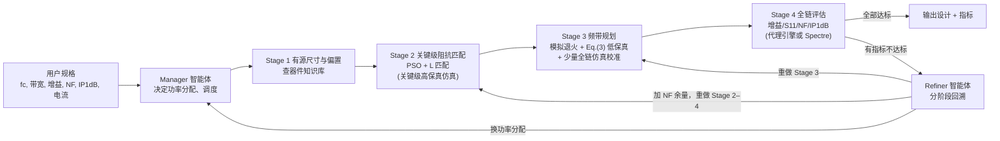
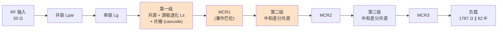
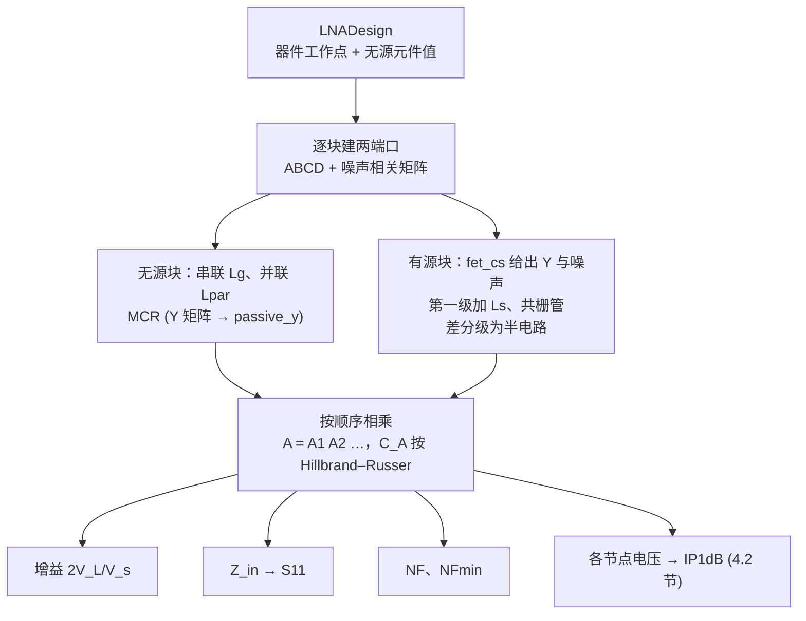
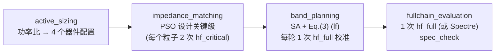
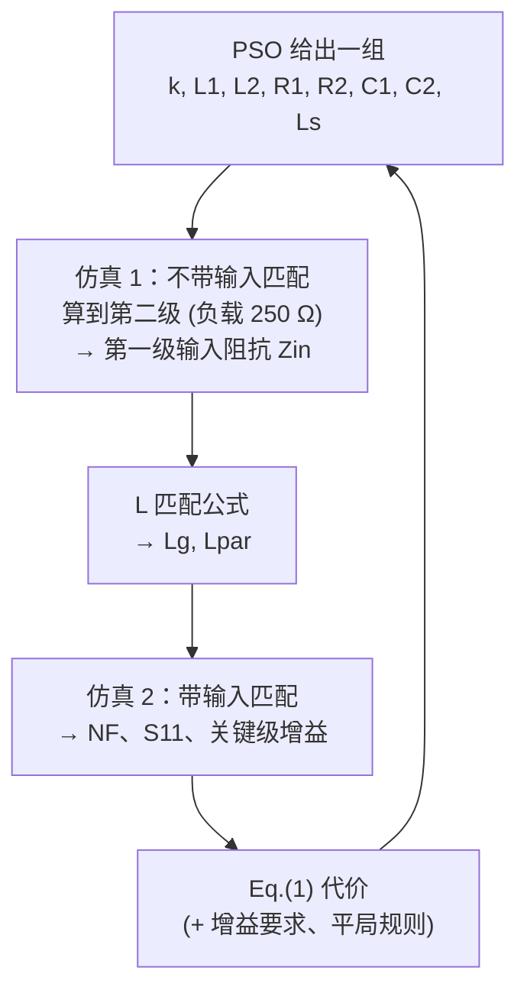
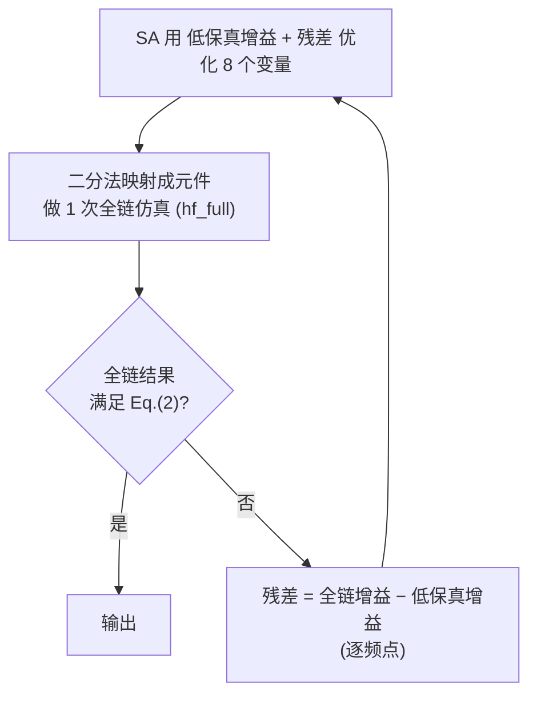
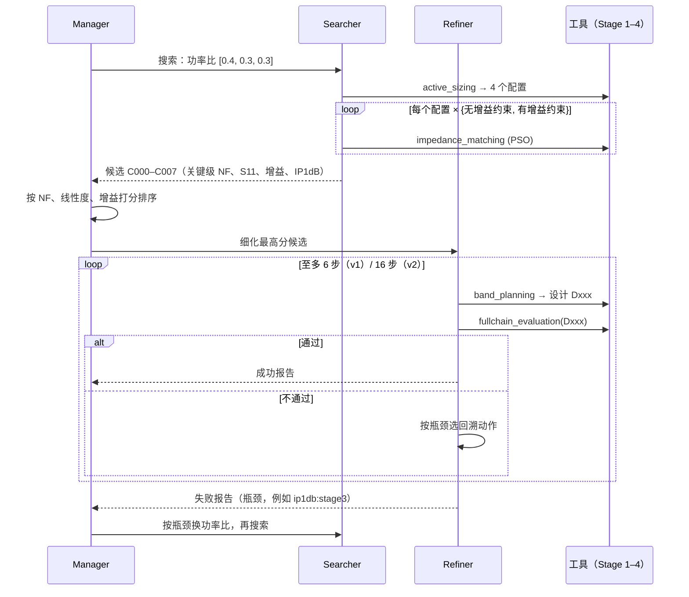
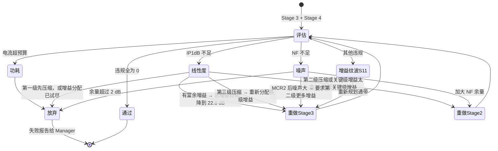
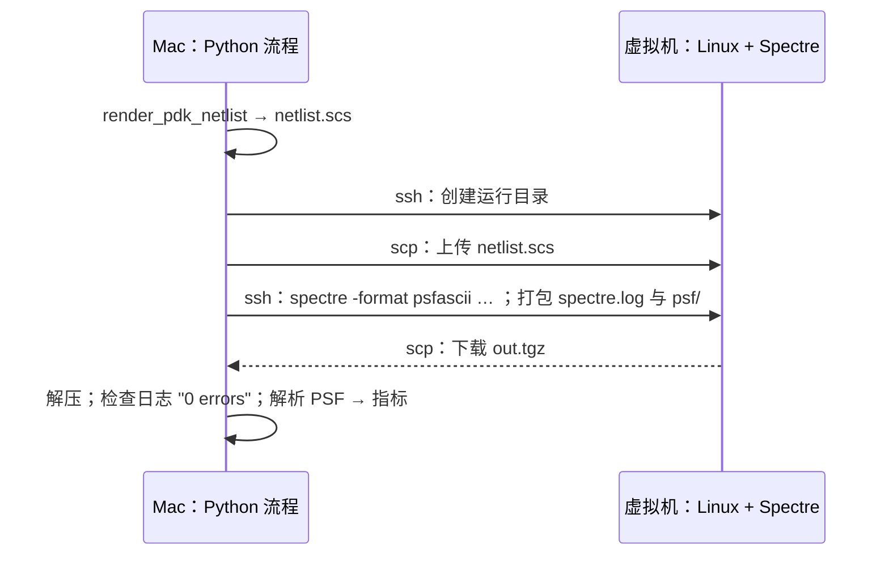

# 137 项目学习指南：RFAmpDesigner 复现的设计方案与仿真过程

> **读者**：微电子专业大三学生，已学过电路分析、模电和器件物理（MOSFET 小信号模型），射频知识从零讲起。
> **版本**：对应标签 `v2.0`。第 0–5 章讲电路与仿真，第 6–10 章讲智能体、Spectre/PDK、动手实践、结果解读和思考题，附录给出代码地图和公式汇总。
> **证据等级**：第 0–6 章和第 8 章的算例都来自开放代理仿真器（surrogate，趋势级）；第 7、9 章引用的 PDK 结果是原理图级。两者都不是硅结果。
> 算例的原始文件是 `results/repro/guide_s2/design_S2_seed0_mode1_rule.json`，由下面的命令生成（智能体实现 v1，规则策略）：
>
> ```bash
> export PYTHONPATH=src
> python -m orfadc.repro.bench design --spec S2 --seed 0 --policy rule --out results/repro/guide_s2
> ```
>
> 代码引用都写成"文件:行号"，以 `v2.0` 时的代码为准。

---

## 第 0 章 导读

**这一章解决什么问题**：用一页纸说清楚这个项目在做什么、数据怎么流动，以及后面各章该按什么顺序读。

### 0.1 一句话

给定一组低噪声放大器（LNA）指标，例如"30 GHz、带宽 20 %、增益 25 dB、NF ≤ 5 dB、电流 ≤ 30 mA"，
程序自动确定一个三级 LNA 中所有晶体管的尺寸、偏置和无源元件的值，并用仿真证明这些指标都满足。

论文 *RFAmpDesigner*（arXiv:2605.10093）的做法有三个要点：

- 不让 LLM 直接改网表里的几十个数值；
- 先用"资源分配"的方式把问题降维，例如"电流怎么分给三级""增益怎么分给各级"；
- 再由四个工具把这些高层决定翻译成具体元件值，并调用仿真器检验。

本仓库在开放的代理器件模型上实现了这条流程，同时也能接入 Cadence Spectre 和 TSMC 65 nm 的 PDK。

### 0.2 全局流程



图中的四个 Stage 是"工具"，在第 5 章讲；Manager、Searcher、Refiner 是"智能体"，在第 6 章讲。
工具内部每次"仿真"算了什么，在第 4 章讲；被仿真的电路，在第 3 章讲。

### 0.3 项目的四层结构

| 层 | 作用 | 主要文件 | 本文章节 |
|---|---|---|---|
| 电路 | 三级 LNA 拓扑、元件、器件模型 | `src/orfadc/repro/circuit.py`、`device.py`、`mcr_eq3.py` | 第 3 章 |
| 仿真 | 由元件值算出增益、S11、NF、IP1dB | `twoport.py`、`circuit.py::simulate` | 第 4 章 |
| 工具 | 论文 Table I 的四个工具，以及等效 EDA 时间记账 | `tools.py`、`optim.py` | 第 5 章 |
| 智能体 | 决定调用哪个工具、带什么参数；记忆与自进化 | `agents.py`（v1）、`agents_v2.py`（v2）、`memory.py` | 第 6 章 |
| EDA | 把仿真交给 Spectre 和 PDK 器件 | `backend_cadence.py`、`pdk_v2.py` 等 | 第 7 章 |

### 0.4 阅读路线

| 你的目标 | 必读 | 选读 |
|---|---|---|
| 只想知道项目在干什么 | 第 0、2 章，第 5 章各节开头 | 第 9 章 |
| 想看懂电路和仿真 | 第 1、3、4 章 | 第 7 章 |
| 想自己跑和改代码 | 第 4、5 章，第 8 章 | 附录 A |

### 0.5 三种证据（贯穿全文）

| 标签 | 含义 | 能说明什么 |
|---|---|---|
| **代理（surrogate，趋势级）** | 开放的 EKV 类器件公式加两端口引擎，参数是"典型 65 nm 量级"，不对应任何真实工艺 | 方法之间、规格之间的相对趋势 |
| **PDK 原理图级** | TSMC 65 nm（或 40 nm）晶体管模型、理想无源、无版图寄生，最终由 Spectre 判定 | 比代理更接近真实电路，但仍不是后仿 |
| **论文原文** | 作者在 TSMC N65 上做的后仿结果 | 只能引用，不能当作本项目的结果 |

**小结**
- 输入是规格，输出是元件值加上证明指标达标的仿真结果。
- 流程分四个 Stage，失败时按"越便宜的越先重做"的顺序回溯。
- 本文的数字都是代理结果，只看趋势。

---

## 第 1 章 预备知识速成

**这一章解决什么问题**：只讲本项目用到的射频和优化知识。每节先给直观解释，再给公式，最后指出代码位置。

### 1.1 LNA 的作用与指标

接收机里，天线收到的信号非常弱（常见量级为微伏）。LNA 是天线后的第一级放大器，它要做到两件事：
一是把信号放大；二是尽量少地加入自己的噪声，因为后级的噪声都会被它的增益"压低"，见 1.3 节的 Friis 公式。

| 指标 | 含义 | 本项目中怎么算 | 单位 |
|---|---|---|---|
| 增益 $G$ | 输出电压相对输入的放大倍数 | $2V_\text{load}/V_s$，$V_s$ 是 50 Ω 信号源的开路电压。负载为 50 Ω 时，它就等于 $\lvert S_{21}\rvert$（`circuit.py:10-12`） | dB，$20\log_{10}$ |
| 中心频率 $f_c$、相对带宽 FBW | 通带为 $[f_c(1-\tfrac{\text{FBW}}{2}),\ f_c(1+\tfrac{\text{FBW}}{2})]$ | `schemas.py:28-31` | GHz、% |
| 纹波（ripple） | 带内增益最大值减最小值 | `circuit.py:505` | dB |
| $S_{11}$ | 输入端反射，越负表示匹配越好 | 带内最大值，见 1.2 节 | dB |
| 噪声系数 NF | 放大器使信噪比恶化的程度 | 在 $f_c$ 处取值，见 1.3 节 | dB |
| IP1dB | 输入 1 dB 压缩点：增益比小信号时下降 1 dB 时的输入功率，越大线性度越好 | 4.2 节 | dBm |
| 功耗 | 各级直流电流之和（电源电压固定） | `circuit.py:67-69` | mA |

这些指标之间互相牵制：

- 电流越大，$g_m$ 越大，增益和 NF 都更好，但功耗上升；
- 增益越高，后级越早进入压缩，IP1dB 越差；
- 带宽越宽，无源网络的阶数越高、损耗越大，NF 和纹波都更难做好。

LNA 设计本质上是在这些指标之间做折中。

### 1.2 S 参数、阻抗匹配与 Q 值

**反射系数**：信号从特征阻抗 $Z_0=50\,\Omega$ 的传输线射向输入阻抗为 $Z_\text{in}$ 的电路时，反射比例为

$$
\Gamma=\frac{Z_\text{in}-Z_0}{Z_\text{in}+Z_0},\qquad S_{11}\,[\text{dB}]=20\log_{10}\lvert\Gamma\rvert .
$$

例如 $S_{11}=-10$ dB 表示约 10 % 的功率被反射，$-20$ dB 表示约 1 %。代码见 `twoport.py:136-138`。

**阻抗匹配**：晶体管栅极的输入阻抗通常是"小电阻加大容抗"，例如本文算例中为 $36.8-j38.5\,\Omega$，见 5.2 节。
匹配网络用无损的电感、电容把它变换成 50 Ω。本项目采用论文图 3 中的 L 型匹配：栅极串联电感 $L_g$，信号源一侧并联电感 $L_\text{par}$。5.2 节会手算一次。

**Q 值**：谐振回路储存的能量与每周期损耗能量之比，$Q\approx f_0/\text{BW}_{3\text{dB}}$。
Q 越高，通带越窄、越尖。要做宽带，就必须"压低 Q"，或者把几个谐振频率错开的回路串起来（交错调谐，staggered tuning）。
本项目用的磁耦合谐振器（MCR）同时用到了这两种手段，见第 3 章。

实际电感有损耗，代码用"电感 Q"来表示：$Z_L=j\omega L+\omega_\text{ref}L/Q$。
片上 MCR 电感默认 $Q=15$，输入匹配电感默认 $Q=25$，见 `circuit.py:27-28`、`circuit.py:98-99`。

**为什么宽带匹配难**：在给定的带宽内，一个含电抗的负载能匹配到多好有理论上限（Bode–Fano 极限）。
带宽越宽，带内能做到的平均 $\lvert\Gamma\rvert$ 就越大。这就是 S5（60 %）、S6（80 %）这类宽带规格难做的根本原因之一。

### 1.3 噪声系数、Friis 公式与 NFmin

**定义**：噪声因子 $F=\dfrac{\text{SNR}_\text{in}}{\text{SNR}_\text{out}}\ge 1$，噪声系数 $\text{NF}=10\log_{10}F$。
它衡量的是"放大器自己加了多少噪声"，参照标准是 290 K 下信号源电阻的热噪声。

**Friis 级联公式**：$n$ 级串联时

$$
F_\text{tot}=F_1+\frac{F_2-1}{G_1}+\frac{F_3-1}{G_1G_2}+\cdots
$$

其中 $G_i$ 是第 $i$ 级的可用功率增益。直观含义是：后级的噪声要除以前面各级的增益，所以**第一级的噪声和增益决定了整体 NF**。
这也是论文把第一级加上它的匹配网络称为"关键级"的原因。4.1 节会用实际设计逐块验证这一点。

**NFmin 与最佳源阻抗**：一个两端口的 $F$ 与它"看到"的源阻抗 $Z_s$ 有关：

$$
F=F_\text{min}+\frac{R_n}{G_s}\,\lvert Y_s-Y_\text{opt}\rvert^2 ,
$$

当 $Y_s=Y_\text{opt}$ 时取得最小值 $F_\text{min}$。
噪声最优的源阻抗一般与功率匹配所需的源阻抗不同，所以"低噪声"和"好的 $S_{11}$"天然冲突。
第一级加源极退化电感 $L_s$ 的作用，就是让这两个点尽量靠近。

**MOSFET 的两个噪声源**（代码采用 van der Ziel 经典模型，`circuit.py:115-125`）：

- 漏极沟道热噪声：$\overline{i_d^2}=4kT\gamma g_{d0}\Delta f$，取 $\gamma=1.1$，$g_{d0}=g_m/\alpha$，$\alpha=0.8$。
- 栅极感应噪声：$\overline{i_g^2}=4kT\delta\dfrac{\omega^2C_{gs}^2}{5g_{d0}}\Delta f$，取 $\delta=2\gamma$。它与漏极噪声部分相关，相关系数 $c=0.395j$。

参数定义在 `device.py:35-38`。

### 1.4 两端口网络：ABCD 矩阵与噪声相关矩阵

**ABCD 矩阵**描述一个两端口网络输入端与输出端的电压、电流关系：

$$
\begin{bmatrix}V_1\\ I_1\end{bmatrix}=\begin{bmatrix}A&B\\ C&D\end{bmatrix}\begin{bmatrix}V_2\\ I_2\end{bmatrix}.
$$

它的最大好处是**级联等于矩阵相乘**：$\mathbf{A}_\text{tot}=\mathbf{A}_1\mathbf{A}_2\cdots\mathbf{A}_n$。
常用的两个基本块：串联阻抗 $Z$ 为 $\begin{bmatrix}1&Z\\0&1\end{bmatrix}$，并联导纳 $Y$ 为 $\begin{bmatrix}1&0\\Y&1\end{bmatrix}$。
代码见 `twoport.py:67-82`。

**噪声怎么一起级联**：任何一个有噪两端口，都可以等效成"一个无噪两端口，加上输入端的一个噪声电压源 $v_n$ 和一个噪声电流源 $i_n$"。
两者可能相关，所以用一个 2×2 的**噪声相关矩阵**来描述：

$$
\mathbf{C}_A=\frac{1}{4kT_0\Delta f}\begin{bmatrix}\overline{v_nv_n^*}&\overline{v_ni_n^*}\\ \overline{i_nv_n^*}&\overline{i_ni_n^*}\end{bmatrix}.
$$

代码把它除以 $4kT_0\Delta f$ 做了归一化。这样一个串联电阻 $R$ 的 $C_{A,11}=R$；一个无源网络的 Y 形式相关矩阵就等于 $\Re(\mathbf Y)$（`twoport.py:5-6`、`twoport.py:116-119`）。

Hillbrand 和 Russer（1976）给出了级联规则：

$$
\mathbf A=\mathbf A_1\mathbf A_2,\qquad \mathbf C_A=\mathbf C_{A1}+\mathbf A_1\,\mathbf C_{A2}\,\mathbf A_1^{H}.
$$

直观理解：第二个网络的输入噪声源，被第一个网络"反向折算"到整体的输入端。代码只有两行，见 `twoport.py:32-35`：

```python
def __matmul__(self, other: "TwoPort") -> "TwoPort":
    a = self.abcd @ other.abcd
    ca = self.ca + self.abcd @ other.ca @ _herm(self.abcd)
```

有了整体的 $\mathbf C_A$，源阻抗为 $Z_s$ 时的噪声因子和最小噪声因子为（`twoport.py:47-55`）：

$$
F=1+\frac{C_{11}+2\Re(C_{12}Z_s^*)+C_{22}\lvert Z_s\rvert^2}{\Re(Z_s)},\qquad
F_\text{min}=1+2\left(\Re C_{12}+\sqrt{C_{11}C_{22}-(\Im C_{12})^2}\right).
$$

**小算例**（测试 `tests/test_repro_core.py:48-52`）：50 Ω 信号源，串一个 50 Ω 电阻，接 50 Ω 负载。

- 噪声因子 $F=1+50/50=2$，即 NF = 3.01 dB。
- 电压增益 $2V_L/V_s=2\times50/150=2/3$。

测试用代码算出的结果与这两个手算值一致。另一个测试（`tests/test_repro_core.py:55-64`）用两个匹配的 π 型衰减器级联，验证引擎符合 Friis 公式。

### 1.5 优化算法与 LLM 智能体

**粒子群优化（PSO，Stage 2 用）**：一群"粒子"在参数空间里飞。每个粒子记住自己见过的最好位置 $p_i$，整个群体记住全局最好位置 $g$。速度更新为

$$
v\leftarrow wv+c_1r_1(p_i-x)+c_2r_2(g-x),\qquad x\leftarrow x+v .
$$

本项目取 $w=0.6$、$c_1=c_2=1.5$，8 个粒子迭代 8 轮（`optim.py:29-56`、`tools.py:231-232`）。

**模拟退火（SA，Stage 3 用）**：每次随机扰动当前解。变好就接受；变差时以概率 $e^{-\Delta E/T}$ 接受，温度 $T$ 逐渐降低。
这样早期能跳出局部最优，后期逐步收敛（`optim.py:59-85`）。

**遗传算法（GA）与贝叶斯优化（BO）**：作为对照组的基线。

- GA 用"选择、交叉、变异"在种群里演化（`optim.py:88-119`）。
- BO 用高斯过程拟合"参数 → 代价"的代理模型，再用期望改进（EI）挑下一个试验点（`optim.py:131-174`）。
- 它们直接在 18 维元件空间里搜索，论文用它们说明"降维 + 工具"的价值（第 6 章）。

**ReAct 智能体**：LLM 每一步输出"思考"和"动作"两部分，动作是对某个工具的一次 JSON 调用。
程序执行该工具，把结果（"观察"）返回给 LLM，LLM 再决定下一步。如此循环，直到任务完成或预算用尽。第 6 章详细讲。

**小结**
- 指标之间相互牵制，LNA 设计本质是折中。
- $S_{11}$ 看匹配，NF 主要由第一级决定（Friis），IP1dB 主要由后级决定。
- 两端口引擎用 ABCD 矩阵乘法级联信号，用 Hillbrand–Russer 公式级联噪声。
- Stage 2 用 PSO、Stage 3 用 SA；基线用 GA 和 BO。

---

## 第 2 章 问题定义：设计规格

**这一章解决什么问题**：说明程序要满足哪些指标、怎样判定"通过"，以及各规格为什么难度不同。

### 2.1 Table III 的十个规格

规格文件为 `config/specs_table_iii.yaml`，与论文 Table III 一致。

| 规格 | $f_c$ (GHz) | FBW | 通带 (GHz) | 电流 (mA) | 增益 (dB) | NF (dB) | IP1dB (dBm) | 考察的是什么 |
|---|---|---|---|---|---|---|---|---|
| S1 | 10 | 20 % | 9–11 | 30 | 25 | ≤ 5 | ≥ −25 | 低频基准 |
| S2 | 30 | 20 % | 27–33 | 30 | 25 | ≤ 5 | ≥ −25 | 中频基准（本文算例） |
| S3 | 50 | 20 % | 45–55 | 30 | 20 | ≤ 5 | ≥ −20 | 高频：器件 $f_T$ 不够 |
| S4 | 30 | 10 % | 28.5–31.5 | 30 | 25 | ≤ 5 | ≥ −25 | 窄带，最容易 |
| S5 | 30 | 60 % | 21–39 | 30 | 25 | ≤ 5 | ≥ −25 | 宽带 |
| S6 | 30 | 80 % | 18–42 | 30 | 20 | ≤ 5 | ≥ −20 | 超宽带 |
| S7 | 30 | 20 % | 27–33 | 30 | 25 | ≤ **2.5** | ≥ −25 | 极低噪声 |
| S8 | 30 | 20 % | 27–33 | **15** | 25 | ≤ 5 | ≥ −25 | 低功耗 |
| S9 | 30 | 20 % | 27–33 | 30 | 25 | ≤ 5 | ≥ **−15** | 高线性度 |
| S10 | 30 | 20 % | 27–33 | 30 | 25 | ≤ **3.5** | ≥ **−15** | 低噪声加高线性度 |

规格中的"功耗"实际以电流（mA）给出，电源电压固定：代理模型为 1.2 V（`device.py:39`）。
所有规格的负载都是 $1787\,\Omega\parallel 62\,\text{fF}$，模拟下一级电路（例如混频器）的输入（`circuit.py:29`）。

### 2.2 怎样算"通过"

Stage 4 的判定函数是 `tools.py:416-426` 中的 `spec_check`。它对每项指标算一个"违规量"，全部为 0 才算通过：

$$
\begin{aligned}
v_\text{gain}&=\max\bigl(0,\ \lvert G_\text{spec}-G_\text{min,band}\rvert-3\bigr) &
v_\text{ripple}&=\max\bigl(0,\ G_\text{max}-G_\text{min}-3\bigr)\\
v_\text{NF}&=\max\bigl(0,\ \text{NF}(f_c)-\text{NF}_\text{spec}\bigr) &
v_\text{IP1dB}&=\max\bigl(0,\ \text{IP1dB}_\text{spec}-\text{IP1dB}\bigr)\\
v_{S11}&=\max\bigl(0,\ \max_\text{band}S_{11}+10\bigr) &
v_\text{power}&=\max\bigl(0,\ I_\text{tot}-1.001\,I_\text{spec}\bigr)
\end{aligned}
$$

需要注意四点：

1. 增益按"带内最小增益与目标值相差不超过 3 dB"判定，与论文 Eq.(2) 的口径一致。
2. NF 取中心频率处的值，与论文"中心频率处噪声系数"一致；带内最大 NF 只记录，不参与判定。
3. 带内 $S_{11}\le-10$ dB 是本项目的约定，论文 Table III 没有列出。Stage 2 的代价函数 Eq.(1) 在中心频率处要求的是更严格的 $-20$ dB。
4. "违规量之和"（`total_violation`）可以当作"离通过还差多远"的单一数字，后面的结果表中常用它。

**算例**：本文 S2 设计的最终指标，原始档 `results/repro/guide_s2/design_S2_seed0_mode1_rule.json` 中的 `report.metrics`。

| 指标 | 结果 | 要求 | 违规量 |
|---|---|---|---|
| 带内最小 / 最大增益 | 25.27 / 27.34 dB | 最小增益在 25 ± 3 dB 内 | 0 |
| 纹波 | 2.07 dB | ≤ 3 dB | 0 |
| $f_c$ 处 NF | 4.14 dB | ≤ 5 dB | 0 |
| 带内最大 $S_{11}$ | −23.8 dB | ≤ −10 dB | 0 |
| IP1dB | −22.56 dBm | ≥ −25 dBm | 0 |
| 电流 | 28.34 mA | ≤ 30 mA | 0 |

### 2.3 为什么难度不同

- **S1/S2/S4** 频率适中、带宽不宽，容易。
- **S3** 在 50 GHz：器件 $f_T$ 只有约 120 GHz，增益和 NF 都吃紧。
- **S5/S6** 带宽宽：匹配受 Bode–Fano 限制，纹波也难压。
- **S7** 要求 NF ≤ 2.5 dB，很接近器件的 NFmin。
- **S8** 电流只有一半，$g_m$ 不够。
- **S9/S10** 要求 IP1dB ≥ −15 dBm，而三级 25 dB 增益的放大器后级很早就压缩了。论文正文提到，这相当于输出 1 dB 压缩点约 9 dBm，而同类电路的典型值约 0 dBm。

### 2.4 S9s / S10s：为代理模型缩放的版本

在代理器件上，S9/S10 不可行：这个模型在 30 mA、25 dB 增益下，线性度前沿只有约 −19.7 dBm（docs/115 §6.2）。
为了仍能比较"最难的线性度任务"，项目定义了两个缩放版本，与前沿保持相近的距离（`bench.py:163-165`）：

- S9s：IP1dB ≥ −20 dBm；
- S10s：NF ≤ 4 dB，且 IP1dB ≥ −21 dBm。

其余参数与 S9/S10 相同。

### 2.5 时间预算

论文按墙钟时间限时：S1–S8 为 1 h，S9/S10 为 5 h。代理仿真只需毫秒，所以本项目用"等效 EDA 时间"记账（4.3 节），预算同样是 S1–S8 3600 s、S9/S10 18000 s（`bench.py:59-61`）。

**小结**
- 十个规格分别考察频率、带宽、噪声、功耗和线性度。
- 通过的判定是六项违规量全为 0，其中 $S_{11}\le-10$ dB 是项目约定。
- S9s/S10s 是代理模型上的替身，不是论文规格。

---

## 第 3 章 电路设计方案

**这一章解决什么问题**：被设计的电路长什么样、每一部分起什么作用、有哪些可调变量，以及代码怎样表示它。

### 3.1 三级 LNA 拓扑

论文图 3 的原图见 `references/paper/figures/fig3.png`。代码中的等效链路（半电路、单端等效）定义在 `circuit.py:376-393` 的 `_chain`：



图中着色的部分是"关键级"，由 Stage 2 设计；MCR2、MCR3 和第三级由 Stage 3 规划。

| 部分 | 电路作用 | 代码 |
|---|---|---|
| $L_\text{par}$、$L_g$ | L 型输入匹配，把第一级的输入阻抗变到 50 Ω | `circuit.py:381-383` |
| 第一级 cascode | 共源管加 $L_s$ 退化，兼顾 NF 与输入匹配；共栅管提高隔离、减小密勒效应。单端结构，输入端不需要巴伦，避免增加噪声 | `circuit.py:163-240` |
| MCR1 | 第一、二级之间的耦合谐振网络，同时完成单端到差分的转换（巴伦） | `circuit.py:288-303` |
| 第二、三级 | 带中和电容的差分共源级。中和电容抵消大部分 $C_{gd}$，使各级接近单向，改一级不太影响另一级 | `circuit.py:263-285` |
| MCR2、MCR3 | 级间和输出的耦合谐振网络，决定通带形状 | 同上 |

**中和**：差分管的栅极和对面管的漏极之间接一个电容 $C_N\approx C_{gd}$，把 $C_{gd}$ 的反馈抵消掉。
代理模型假设残余 12 %（`device.py:40`、`circuit.py:253-260`）。

**参数个数**：论文把候选设计写成 30 维向量，包括 3 个宽度、3 个偏置、3 个 MCR 各 7 个参数，以及 $L_\text{par}, L_g, L_s$。
数据结构 `LNADesign`（`circuit.py:53-91`）也是这样组织的：`ops` 是三个晶体管的工作点，`mcr1/2/3` 是三个 MCR 的物理值，另有三个电感。

### 3.2 磁耦合谐振器（MCR）与 Eq.(3)

**结构**：两个各自并联了 R、C 的电感，通过互感 $M=k\sqrt{L_1L_2}$ 耦合，见论文图 4（`references/paper/figures/fig4.png`）。
两个谐振回路耦合后，响应会分裂成两个峰，峰的间距由耦合系数 $k$ 控制，这就是"四阶耦合谐振"的宽带能力。
再把 MCR2、MCR3 的中心频率错开（交错调谐），就能拼出平坦的宽通带。代码中 MCR 的 Y 矩阵见 `circuit.py:288-303`。

**Stage 3 的抽象变量**：每个 MCR 用 4 个变量描述：$k$、谐振角频率 $\omega_0$、品质因数 $Q_0$、节点总电容 $C$，范围见论文 Table II。
比起直接调 $L_1, L_2, R_1, R_2, C_1, C_2$，这 4 个变量的物理意义清楚得多，这正是"降维"的一个例子。

**Eq.(3)**：论文把"一级晶体管驱动一个对称 MCR"的电压增益写成解析式，作为 Stage 3 的低保真模型。分子和 $Z_{21}$ 如下：

$$
\begin{aligned}
N(s)&=(1-k^2)Q^2s^4+2(1-k^2)Q\omega_0s^3+(1-k^2+2Q^2)\omega_0^2s^2+2Q\omega_0^3s+Q^2\omega_0^4,\\
Z_{21}(s)&=\frac{kQ\omega_0^3\sqrt{R_SR_2}\,s}{N(s)}.
\end{aligned}
$$

$Y_{11}$ 的分母，论文原式（印刷版）与本项目的修正式分别为：

$$
\begin{aligned}
\text{原式：}\quad D(s)&=(1-k^2)R_S\omega_0Qs^3+(1-k^2)R_S\omega_0^2s^2+R_S\omega_0^3Q,\\
\text{修正式：}\quad D(s)&=(1-k^2)R_S\omega_0Qs^3+(1-k^2)R_S\omega_0^2s^2+R_S\omega_0^3Q\,\boldsymbol{s},
\end{aligned}
\qquad Y_{11}=\frac{N(s)}{D(s)}.
$$

**为什么要补一个 $s$**：用量纲检查。$N(s)$ 每一项都是 $[\text{s}^{-4}]$（$s$ 与 $\omega_0$ 同量纲）。
修正后，$D$ 的每一项都是 $[\Omega\cdot\text{s}^{-3}]$，$Y_{11}$ 的单位是西门子，正确；原式最后一项少了一个频率量纲，各项无法相加。

**测试如何验证**（`tests/test_repro_core.py:25-45`）：

1. 用节点分析直接求解图 4 的两节点电路（`src/orfadc/tools/mcr_lumped.py`），作为参考答案；
2. 在三组 $(k,Q,f_0)$、每组三个频点上比较。修正式的 $Y_{11}$ 和 $Z_{21}$ 与节点分析的相对误差小于 $10^{-9}$；原式的误差大于 50 %。

**数值对比**（$k=0.3$、$Q=2$、$f_0=30$ GHz、$C=100$ fF，本文用同一组参数计算）：

| 频率 | 节点分析 $Y_{11}$ (mS) | 修正式 (mS) | 原式 (mS) |
|---|---|---|---|
| 24 GHz | 12.19 − j7.64 | 12.19 − j7.64 | −8.76 − j7.61 |
| 30 GHz | 13.37 − j1.08 | 13.37 − j1.08 | 1.14 − j6.01 |
| 36 GHz | 11.58 + j4.14 | 11.58 + j4.14 | 5.17 − j1.69 |

原式甚至给出了负的实部，相当于无源网络"产生能量"，这在物理上不可能。代码见 `mcr_eq3.py:21-38`，默认 `variant="corrected"`。

**从抽象变量到元件值**（`circuit.py:326-369` 的 `map_mcr`）：

- 给定 $(k,\omega_0,Q_0,C)$，先用二分法找电感 $L$，使带损耗的回路恰好在 $\omega_0$ 谐振。
- 再算出需要额外并联多大的电阻，才能把回路的 Q 降到 $Q_0$。
- 添加的电容等于 $C$ 减去节点上已有的晶体管寄生电容。

有两种情况无法实现，会记为标志：

- `c_below_parasitic`：要求的 $C$ 比寄生电容还小；
- `q0_unattainable_*`：节点本身的损耗已经比 $Q_0$ 要求的大，不需要也无法再加电阻。

**算例**：本文 S2 设计的 MCR3 带有标志 `q0_unattainable_pri`，原边电阻为 ∞。
原因是 MCR3 原边接的是第三级漏极，这一级电流较大（15.5 mA），输出电导较大，本身损耗已经够了。

### 3.3 器件模型与 Stage 1 的知识库

**代理器件**（`device.py:46-52`，参数在 `device.py:24-40`）用 EKV 型插值公式描述漏极电流，能从亚阈值平滑过渡到强反型：

$$
I_D=W\,I_0\,\frac{\ln^2\!\bigl(1+e^{(V_{GS}-V_{th})/(2nU_T)}\bigr)}{1+\theta\,(V_{GS}-V_{th})_+},
$$

其中 $V_{th}=0.32$ V，$n=1.3$，$I_0=0.021$ mA/µm，$\theta=1.6$ V⁻¹（迁移率退化和速度饱和）。小信号参数这样得到（`device.py:124-144`）：

- $g_m$：对 $V_{GS}$ 做数值差分；
- $g_{ds}=\lambda I_D$，取 $\lambda=0.45$ V⁻¹；
- $C_{gs}, C_{gd}, C_{db}$ 按每微米 1.05 / 0.38 / 0.55 fF；
- 栅电阻 $R_g=90\,\Omega\cdot\mu\text{m}/W$；
- $a_\text{1dB}$：由三阶导数估计 $g_m$ 压缩 1 dB 时的栅压幅度。

**算例**：本文 S2 设计的第一级，W = 81 µm、$V_{GS}$ = 0.5 V，由代码算出：

| 量 | 值 | 手算核对 |
|---|---|---|
| $I_D$ | 9.95 mA | — |
| $g_m$ | 88.6 mS | $g_m/I_D=8.9$ V⁻¹（中等反型） |
| $g_{ds}$ | 4.48 mS | $0.45\times9.95$ mA ✓ |
| $C_{gs}$ / $C_{gd}$ | 85.0 / 30.8 fF | $1.05\times81$、$0.38\times81$ ✓ |
| $R_g$ | 1.11 Ω | $90/81$ ✓ |
| $f_T$ | 121.7 GHz | $g_m/[2\pi(C_{gs}+C_{gd})]=0.0886/(2\pi\times115.8\,\text{fF})$ ✓ |

docs/115 §3 中"W = 100 µm、0.5 V 时 $f_T\approx120$ GHz"的说法与此一致。
到 50 GHz（S3）时，$f_T/f$ 只有约 2.4，单级可用增益很有限，这就是 S3 难的原因。

**知识库**（论文图 2 的黄色模块，`device.py:161-177`）：按论文的网格扫描器件，记录每个点的电流、$g_m$、$f_T$ 等。

- cascode：W = 45–180 µm，步长 9 µm，共 16 种；
- 差分管：W = 45–117 µm，步长 9 µm，共 9 种；
- 偏置：0.300–0.500 V，步长 25 mV，共 9 种。

合计 $16\times9+9\times9=225$ 行。差分级记录的是一对管子的电流，也就是半电路电流的 2 倍。

**换成 PDK 器件**：接入 TSMC PDK 时，`device.set_device_provider()`（`device.py:97-103`）把上面所有查询换成"用 Spectre 表征得到的器件表"，其余代码不变。
第 7 章讲这个表是怎么得到的。PDK 的具体数值属于保密数据，本文不列出。

**小结**
- 电路由 L 匹配、cascode 第一级、两级中和差分级和三个 MCR 组成，共约 30 个参数。
- MCR 用 4 个物理意义清楚的变量描述，再由二分法映射到元件值。
- Eq.(3) 原式漏了一个 $s$，修正式经节点分析验证到 $10^{-9}$。
- 器件可以是开放代理模型，也可以是 PDK 表，接口相同。

---

## 第 4 章 仿真引擎：一次"仿真"到底算了什么

**这一章解决什么问题**：程序说"仿真一次"时，具体从哪些数算出了哪些数，以及为什么要区分不同"保真度"的仿真。

### 4.1 从元件值到增益、S11、NF

入口函数是 `circuit.py:458-492` 的 `simulate`，计算链如下：



关键公式：

- **增益**（`twoport.py:42-45`）：$\dfrac{2V_L}{V_s}=\dfrac{2Z_L}{AZ_L+B+CZ_sZ_L+DZ_s}$，其中 $Z_s=50\,\Omega$，$Z_L$ 为负载。
- **输入阻抗**（`twoport.py:38-40`）：$Z_\text{in}=\dfrac{AZ_L+B}{CZ_L+D}$，代入 1.2 节的式子得到 $S_{11}$。
- **晶体管块**（`circuit.py:102-126`）：本征共源 Y 矩阵为

  $$
  \mathbf Y=\begin{bmatrix}s(C_{gs}+C_{gd})&-sC_{gd}\\ g_m-sC_{gd}&g_{ds}+s(C_{gd}+C_{db})\end{bmatrix},
  $$

  噪声相关矩阵由 1.3 节的两个噪声源构成。用 `from_y` 把 Y 形式转成 ABCD 形式（`twoport.py:85-98`）。
- **第一级**：共源管的 Z 矩阵加上 $L_s$ 的阻抗，等效于源极串联反馈；共栅管宽度取 0.45 W，电流相同（`circuit.py:129-143`、`circuit.py:203-240`）。

**频率点**：中心频率附近的通带内取 21 个点，$f_c/2$ 到 $2f_c$ 之间再取 41 个点，去重后共 61 个点，S2 也是如此（`circuit.py:515-520`）。

**算例 1：中心频率处的结果与各级增益**（S2 设计，30 GHz）

| 量 | 值 |
|---|---|
| 总增益 | 27.33 dB |
| 各级增益（含各自的匹配网络或 MCR） | 8.53 / 1.47 / 17.32 dB |
| NF / NFmin | 4.144 / 4.124 dB |
| $S_{11}$ | −40.6 dB |

**算例 2：用逐块累积的 NF 理解 Friis 公式**。从输入端开始，每多级联一个块，就算一次"到此为止"的噪声系数（源阻抗 50 Ω）：

| 级联到 | 累计 NF (dB) | 本块增加 (dB) | 说明 |
|---|---|---|---|
| $L_\text{par}$ | 0.10 | 0.10 | 匹配电感的损耗（Q = 25） |
| $L_g$ | 0.18 | 0.08 |  |
| 第一级 $R_g$ | 0.31 | 0.13 |  |
| 第一级共源管 | 1.30 | 0.99 | 最大的单项：第一级的沟道噪声 |
| 第一级共栅管 | 1.87 | 0.57 |  |
| MCR1 | 2.20 | 0.33 | MCR 电感损耗（Q = 15） |
| 第二级 $R_g$ | 2.20 | 0.00 |  |
| **第二级差分管** | **3.41** | **1.21** | 第二级电流只有 2.9 mA，而前面的增益只有 8.5 dB，压不住它的噪声 |
| MCR2 | 3.86 | 0.45 | 第二级增益只有 1.5 dB，所以 MCR2 的损耗也明显可见 |
| 第三级 $R_g$、差分管 | 4.12 | 0.26 | 前面已有约 10 dB 增益，贡献变小 |
| MCR3 | 4.14 | 0.02 | 前面三级的增益都已经叠加，几乎没有贡献 |

这张表就是 Friis 公式的直观演示：越往后，同样的噪声被前级增益除得越多。
这个设计中第二级"噪声大、增益小"，是 NF 的第二大来源。所以 Refiner 遇到 NF 不足时，有一个动作是"要求关键级更高的增益"（第 6 章）。
数据由本文用 `circuit._chain` 逐块级联算出，原始设计见上文的 JSON 文件。

### 4.2 1 dB 压缩点（IP1dB）的估计

两端口引擎只能算线性小信号，所以压缩点单独估计（`circuit.py:411-455`）。思路是：

1. 求出输入为单位电压时各级晶体管栅极和漏极的电压幅度 $v_g$、$v_d$（`circuit.py:400-408`）。
2. 每一级有三种压缩机理，各自给出一个"输入电压幅度上限"：
   - **跨导压缩**：栅压幅度达到 $a_\text{1dB}$ 时 $g_m$ 下降 1 dB，上限为 $a_\text{1dB}/v_g$；
   - **电流削顶**：交流电流峰值超过直流电流时，管子截止；
   - **电压摆幅**：漏极电压摆幅超过电源允许的范围。

   对后两种"硬削顶"，基波下降 1 dB 时，线性驱动幅度是削顶电平的 1.262 倍。这个系数来自方程
   $\tfrac{2}{\pi}\bigl(\arcsin x+x\sqrt{1-x^2}\bigr)=10^{-1/20}=0.891$（`circuit.py:30`）。
3. 每一级取三者中最小的作为该级上限 $V_{s,i}$，各级合成为

   $$
   \frac{1}{V_{s,\text{1dB}}^2}=\sum_i\frac{1}{V_{s,i}^2},\qquad
   \text{IP1dB}=10\log_{10}\frac{V_{s,\text{1dB}}^2/(8\times50\,\Omega)}{1\,\text{mW}} .
   $$

   $V_s^2/(8R)$ 是幅度为 $V_s$ 的信号源向匹配负载输出的可用功率。

**算例**（S2 设计）

| 级 | 上限 $V_{s,i}$ (V) | 主导机理 | 只有这一级时的 IP1dB (dBm) |
|---|---|---|---|
| 第一级 | 0.199 | 电流削顶 | −10.0 |
| 第二级 | 0.059 | 电流削顶 | −20.6 |
| 第三级 | 0.084 | 电压摆幅 | −17.5 |

合成：$1/V^2=1/0.199^2+1/0.059^2+1/0.084^2\approx451$，$V\approx0.0471$ V，
$P=0.0471^2/400\approx5.54\,\mu\text{W}$，即 −22.56 dBm，与代码结果一致。

可以看出，最先压缩的是电流很小的第二级。这也说明了 S9/S10（IP1dB ≥ −15 dBm）为什么难：每一级的上限都要再提高好几 dB。

### 4.3 多保真与等效 EDA 时间

论文的核心效率手段，是区分"贵"和"便宜"的计算。本项目定义三种调用，并按论文的量级给每种一个等效耗时（`tools.py:32`）：

| 类型 | 算什么 | 谁调用 | 等效耗时 |
|---|---|---|---|
| `hf_critical` | 关键级（输入匹配到第二级）单频点仿真 | Stage 2 的 PSO 内循环 | 0.5 s |
| `hf_full` | 全链宽带 S 参数、噪声加压缩 | Stage 3 校准、Stage 4 | 12 s |
| `lf` | 用 Eq.(3) 解析式算一次频响 | Stage 3 的 SA 内循环 | 0.002 s |

每次调用都由 `SimCounter.charge` 累加等效时间（`tools.py:48-82`）。累计时间超过预算后，`ToolContext.sim` 抛出 `BudgetExhausted`，设计就此结束（`tools.py:114-131`）。

**算例**：S2 设计的记账，原始档中的 `sims` 字段。

$$
2760\times0.5+41\times12+14576\times0.002=1380+492+29.15=1901.15\ \text{s}.
$$

这与文件中的 `equiv_time_s` 完全一致。在 3600 s 的预算内，用了约 53 %。而这次运行的实际 CPU 时间只有 3.4 s：代理引擎非常快，等效时间只用来与论文做相对比较。

**多保真省了多少**（论文图 5(b) 的复现，docs/115 §6.3，代理结果）：

- 同样完成一次频带规划，"Eq.(3) 加 HF 校准"用了 3 次全链仿真和约 2000 次 Eq.(3) 计算，等效 38 s；
- 每一步都做全链仿真的纯仿真 SA 用了 362 次全链仿真，等效 4344 s；
- 节省 99 %，论文报告的是 88 %。

**顺序记账与并行记账**：论文说明推理是顺序执行的，所以默认把所有仿真时间相加。
设置环境变量 `ORFADC_PARALLEL=1` 后，PSO 同一轮的 8 个粒子等可以并发的仿真，只按一次计（`tools.py:33-36`、`tools.py:251-259`）。

**仿真后端可替换**：所有仿真都经过 `ToolContext.sim` 调用 `Backend.simulate`（`tools.py:89-99`）。

- 默认是代理引擎 `SurrogateBackend`；
- 接 Cadence 时换成 `HybridBackend`：内层仍用引擎，Stage 4 调用时带 `final=True`，交给 Spectre 执行（`tools.py:124-125`、`tools.py:431`）。

第 7 章讲这条链路。

**小结**
- 一次仿真就是把每个元件变成两端口、按顺序相乘，再读出增益、$S_{11}$、NF；IP1dB 另用三种机理估计。
- 逐块 NF 表直观展示了 Friis 公式：第一级和"噪声大、增益小"的第二级是主要来源。
- 仿真分三种保真度，用等效时间记账，便于和论文的墙钟时间对比。

---

## 第 5 章 四个阶段的工具（论文 Table I）

**这一章解决什么问题**：逐个说明四个工具的输入、输出、内部算法、调用的仿真类型和失败时的返回值，并用实际数字走一遍。
工具都是"JSON 进、JSON 出"的函数，所以 LLM 或 MCP 客户端可以直接调用（`tools.py:1-12`）。



### 5.1 Stage 1：有源器件尺寸与偏置（`active_sizing`）

| 项 | 内容 |
|---|---|
| 输入 | `power_ratio_list`，例如 `[0.4, 0.3, 0.3]`；总电流预算 |
| 输出 | `active_params_dict_list`：4 个配置，每个配置给出三级的种类、宽度、偏置、电流、$g_m$、$f_T$ 等 |
| 算法 | 查知识库，不做仿真 |
| 失败 | 某一级找不到电流合适的器件时，返回 `status: "infeasible"` 和原因 |
| 代码 | `tools.py:138-174` |

**步骤**：

1. 按比例算出每一级的目标电流。
2. 在知识库中找电流落在 $[0.85, 1.005]\times$ 目标值之内的器件。宁小勿大，以保证不超预算。每种宽度只保留最接近的偏置。
3. 按论文的做法，把第一、二级视为"关键组"，第三级视为"非关键组"。每组只取两个极端：最大宽度（低偏置）或最小宽度（高偏置）。
4. 两组组合，得到 4 个配置：`crit_large/small × noncrit_large/small`。

**算例**：总电流 30 mA，功率比 `[0.4, 0.3, 0.3]`，各级目标 12 / 9 / 9 mA，每级各有 6 个候选宽度。四个配置中的关键组两个极端如下（本文用 `tools.active_sizing` 运行所得）：

| 关键组取法 | 第一级 cascode（W / $V_b$ / 电流 / $f_T$） | 第二级差分 |
|---|---|---|
| large | 162 µm / 0.45 V / 12.06 mA / 93 GHz | 108 µm / 0.40 V / 8.52 mA |
| small | 90 µm / 0.50 V / 11.05 mA / 122 GHz | 45 µm / 0.475 V / 8.73 mA |

同样的电流，大管子低偏置，$g_m$ 大但 $f_T$ 低、电容大；小管子高偏置，$f_T$ 高。哪个更好要看频率和匹配，所以两种都交给 Stage 2 去试。

本文 S2 设计最终采用的是功率比 `[0.35, 0.1, 0.55]` 的 `crit_small__noncrit_small` 配置，即三级为 81 / 54 / 63 µm，电流 9.95 / 2.92 / 15.48 mA。
这个功率比是 Manager 在前两个功率比失败后换上的（第 6 章）。它把电流从第二级挪到第三级，以改善第三级的压缩。

### 5.2 Stage 2：关键级阻抗匹配（`impedance_matching`）

| 项 | 内容 |
|---|---|
| 输入 | 一个 Stage 1 配置；可选 `nf_headroom_db`（默认 0.2）、`gain_require_db` |
| 输出 | `passive_params_cpstages`：$k, L_1, L_2, R_1, R_2, C_1, C_2, L_s, L_g, L_\text{par}$；`sim_result_cpstages`：关键级的 NF、$S_{11}$、增益、IP1dB；`feasible` |
| 算法 | PSO，8 个粒子 × 8 轮，可提前停止 |
| 仿真 | 每个粒子 2 次 `hf_critical`，最后加 1 次带内扫描 |
| 代码 | `tools.py:186-281` |

**优化变量**：MCR1 的 7 个参数加 $L_s$，范围为论文 Table II（`tools.py:37-40`）。
$L_g$ 和 $L_\text{par}$ 不参与搜索，而是每次由解析公式算出，这又是一处降维。



**Eq.(1) 代价**（`src/orfadc/tools/cost_functions.py:22-36`）：

$$
\begin{aligned}
v_\text{NF}&=\max\bigl(0,\ \text{NF}_\text{sim}-(\text{NF}_\text{user}-h)\bigr),\qquad
v_{S11}=\max\bigl(0,\ S_{11,\text{sim}}+20\bigr),\\
\text{cost}&=1000\,v_\text{NF}+1000\,v_{S11},
\end{aligned}
$$

其中 $h$ 是 NF 余量（headroom），默认 0.2 dB。它给后面几级的噪声留出空间，所以关键级要比规格好 0.2 dB。
代码在此基础上加了三条（`tools.py:241-247`）：

- 若给了增益要求，关键级增益偏离目标超过 1 dB 时按 100 / dB 罚分；
- 没有增益要求时，略微偏好更高的关键级增益；
- 偏好超出余量的 NF 裕度，可以减少后面的回溯。

**L 匹配解析公式**（`tools.py:186-199`）：设第一级输入阻抗为 $Z_\text{in}=r+jx$，且 $r<50\,\Omega$。
先串联 $L_g$，把总电抗变为 $x_t$，使 $\Re\{1/(r+jx_t)\}=1/50$；再用并联 $L_\text{par}$ 抵消剩下的电纳：

$$
x_t=-\sqrt{50r-r^2},\qquad X_{Lg}=x_t-x,\qquad B_\text{par}=\frac{-x_t}{r^2+x_t^2},\qquad
L_g=\frac{X_{Lg}}{\omega},\quad L_\text{par}=\frac{1}{\omega B_\text{par}}.
$$

**算例：手算本文设计的 L 匹配**，$f=30$ GHz，$\omega=1.885\times10^{11}$ rad/s。

1. 仿真 1 得到 $Z_\text{in}=36.83-j38.48\,\Omega$。
2. $x_t=-\sqrt{50\times36.83-36.83^2}=-\sqrt{1841.5-1356.4}=-22.03\,\Omega$。
3. $X_{Lg}=-22.03-(-38.48)=16.45\,\Omega$，所以 $L_g=16.45/1.885\times10^{11}=87.3$ pH。
4. $B_\text{par}=22.03/(1356.4+485.1)=11.96$ mS，所以 $L_\text{par}=1/(1.885\times10^{11}\times0.01196)=443.6$ pH。

与设计文件中的 $L_g=87.29$ pH、$L_\text{par}=443.58$ pH 一致。匹配后，关键级在 30 GHz 处 $S_{11}=-39.6$ dB、NF = 3.41 dB、增益 17.8 dB。

**算例：Eq.(1) 怎样淘汰一个候选**。原始档 trace 中的候选 C029：关键级 NF = 5.754 dB，$S_{11}=-20.19$ dB。

- $v_\text{NF}=5.754-(5-0.2)=0.954$；
- $v_{S11}=\max(0,-20.19+20)=0$；
- 代价为 954，所以 `stage2_feasible: false`。

而 C033 的 NF = 3.41 dB、$S_{11}=-39.6$ dB，代价为 0，后来成为最终设计的关键级。

**仿真次数**：trace 中每个候选消耗 129 次 `hf_critical`，即 8 个粒子 × 8 轮 × 2 次 = 128 次，加 1 次带内扫描。
有些候选提前满足停止条件，次数会少一些，例如 C004 只用了 49 次。
最后那次带内扫描是一次"锚点"仿真。它的结果（到第二级栅极的电压增益随频率的变化）会交给 Stage 3 使用（`tools.py:268-270`）。

### 5.3 Stage 3：频带规划（`band_planning`）

| 项 | 内容 |
|---|---|
| 输入 | Stage 1 配置、Stage 2 结果；可选总增益目标 `gain_user_db`、各级增益要求 `gain_req_list` |
| 输出 | MCR2、MCR3 的抽象变量和物理值；低保真与高保真的增益曲线；Eq.(2) 代价；每轮校准记录 `rounds` |
| 算法 | 模拟退火（500 步）优化 8 个变量，外加多保真校准循环（最多 4 轮） |
| 仿真 | 每步 1 次 `lf`；每轮 1 次 `hf_full` |
| 代码 | `tools.py:288-409` |

**优化变量**：MCR2、MCR3 各 4 个，即 $(k,f_0,Q_0,C)$，共 8 个。
$f_0$ 限制在通带内；$C$ 的下限是节点上的寄生电容（`tools.py:288-294`）。

**低保真模型**（`tools.py:311-325`）：全链增益 = Stage 2 带内扫描得到的"到第二级栅极的增益" + 第二级加 MCR2 的 Eq.(3) 增益 + 第三级加 MCR3 的 Eq.(3) 增益。
Eq.(3) 需要的驱动级参数（等效跨导、输出电阻、输出电容）直接从器件工作点取。

**Eq.(2) 代价**（`cost_functions.py:39-58`）：

$$
v_\text{gain}=\max\bigl(0,\ \lvert G_\text{user}-\min G_\text{cal}\rvert-3\bigr),\quad
v_\text{ripple}=\max\bigl(0,\ \max G_\text{cal}-\min G_\text{cal}-3\bigr),\quad
\text{cost}=1000(v_\text{gain}+v_\text{ripple}).
$$

代码另加了"各级增益要求"的罚分，以及一个很小的纹波偏好项（`tools.py:359-363`）。

**多保真校准循环**：这是论文图 5(a) 中蓝色曲线的做法，代码见 `tools.py:382-394`。



Eq.(3) 用了对称 MCR 和单点源/负载阻抗等简化，所以它和真实全链响应之间有系统偏差。
做法是：每轮用一次真实仿真，算出逐频点的偏差（残差），把它加回低保真模型，再优化一轮。

**算例：一次独立的 Stage 2→3→4 运行**。本文在 S2、功率比 `[0.35, 0.1, 0.55]`、`crit_small__noncrit_small` 配置上直接调用三个工具，参数为 `gain_require_db=17`，其余用默认值。
这次运行与智能体那次运行的随机种子和参数不完全相同，所以数值不同。

| 轮次 | SA 的低保真代价 | 全链仿真的 Eq.(2) 代价 | 低保真与全链的最大偏差 |
|---|---|---|---|
| 0 | 0.10 | 1405 | 2.25 dB |
| 1（加残差后） | 0.25 | **0** | 0.34 dB |

- 第 0 轮，低保真模型认为已经完美（代价 0.10），但全链仿真显示增益违规，代价 1405。
- 把 2.25 dB 的偏差作为残差加回去后，第 1 轮全链结果就满足了。
- 整个 Stage 3 只用了 2 次 `hf_full` 和 730 次 `lf`，等效约 25 s。

结果：带内增益 26.34–28.83 dB，纹波 2.49 dB。MCR2 的 $f_0=32.7$ GHz、MCR3 的 $f_0=28.1$ GHz，两者一高一低，正是交错调谐。

### 5.4 Stage 4：全链评估（`fullchain_evaluation`）

| 项 | 内容 |
|---|---|
| 输入 | 完整设计 |
| 输出 | `sim_results_dict`（第 2 章表中的指标）、`spec_check`（各项违规量与是否通过）、各级压缩机理、频率扫描数据、证据来源 |
| 仿真 | 1 次 `hf_full`，带 `final=True`；接 Cadence 时这一步由 Spectre 执行 |
| 代码 | `tools.py:416-447` |

使用 PDK 后端时，电流取 Spectre 直流工作点的实测值，而不是规划值（`tools.py:434-436`）。
输出中始终带有 `not_silicon_result: True` 标签。

**算例：为什么"四个工具串一遍"还不够**。接着 5.3 节的独立运行，Stage 4 的结果是：

- 增益、纹波、$S_{11}$、IP1dB、电流全部满足；
- 但 $f_c$ 处 NF = 5.51 dB，超出 0.51 dB，**不通过**。

原因在逐级增益：这次第二级增益为 −0.94 dB（8.40 / −0.94 / 20.00 dB）。
按 4.1 节的分析，第二级之后的噪声几乎没有被压低，即使 Stage 2 时关键级 NF 只有 3.74 dB 也不够。

而智能体那次运行，在同一个功率比下找到的关键级 NF 为 3.41 dB、第二级增益为 +1.47 dB，最终 NF = 4.14 dB，通过。

这说明各工具单独看都"成功"了，组合起来仍可能失败，需要有人根据 Stage 4 的瓶颈决定回溯到哪一步。例如：

- NF 不足：加大 NF 余量，或要求更高的关键级增益，重做 Stage 2–4；
- 线性度不足：重新分配各级增益，重做 Stage 3；
- 都不行：换功率比，回到 Stage 1。

这正是 Refiner 和 Manager 的工作，见第 6 章。

### 5.5 四个工具一览

| 工具 | 维度 | 算法 | 每次调用的仿真 | 本文算例中的等效耗时 |
|---|---|---|---|---|
| Stage 1 `active_sizing` | 功率比 3 个数 | 查表 | 无 | 0 |
| Stage 2 `impedance_matching` | 8 个（另有 2 个解析求出） | PSO 8×8 | 约 129 次 `hf_critical` | 约 64.5 s |
| Stage 3 `band_planning` | 8 个 | SA + 校准 | 数百次 `lf` + 每轮 1 次 `hf_full` | 约 25 s（2 轮） |
| Stage 4 `fullchain_evaluation` | 0 | 无优化 | 1 次 `hf_full` | 12 s |

**小结**
- Stage 1 把"电流怎么分"变成 4 个器件配置，只查表，不仿真。
- Stage 2 用 PSO 加解析 L 匹配设计关键级，Eq.(1) 保证 NF 留有余量、$S_{11}\le-20$ dB。
- Stage 3 用 Eq.(3) 低保真模型加少量全链仿真校准来规划通带，是"多保真"的核心。
- Stage 4 给出最终判定；工具串起来仍可能失败，失败时由智能体决定回溯路径。

---

## 第 6 章 智能体如何驱动设计

**这一章解决什么问题**：第 5 章最后的例子说明，四个工具串一遍不一定成功。本章讲三个智能体怎样决定"调用哪个工具、带什么参数、失败后退到哪一步"，以及记忆如何让后面的任务越做越快。

### 6.1 三个智能体的分工

| 智能体 | 有无状态 | 负责什么 | 能调用的工具 |
|---|---|---|---|
| **Manager** | 有：维护候选队列、已试过的功率比、各次报告 | 选功率比；决定搜索新候选，还是细化已有候选；何时结束 | 调用 Searcher、Refiner；模式 2 下查询记忆 |
| **Searcher** | 无：每次调用都从零开始 | 对一个功率比，用 Stage 1 加 Stage 2 生成关键级候选 | `active_sizing`、`impedance_matching` |
| **Refiner** | 无 | 对一个候选反复做 Stage 3、Stage 4，按瓶颈回溯，直到通过或放弃 | `band_planning`、`fullchain_evaluation`；同一配置下重做 Stage 2 |

论文把子智能体设计成"无状态"，好处是可以并行调用，而且一个子任务出错不会污染其他子任务。一次设计的典型交互如下：



### 6.2 v1：规则策略（加两个 LLM 决策点）

v1 的三个智能体都是程序，决策规则写在 `agents.py:141-281` 的 `RulePolicy` 中，对应论文第 II-B-4 节的回溯策略。
把其中两个决策点（`next_split` 选功率比、`refine_action` 选回溯动作）交给 LLM，就是 v1 的"LLM 版本"（`llm.py`）。

**Manager 的规则**

- **初始功率比**（`agents.py:147-155`）：先试均衡的 `[0.4, 0.3, 0.3]`，再试偏向第三级的 `[0.35, 0.15, 0.5]`。若 IP1dB 要求高（≥ −20 dBm），两者顺序对调，因为输出级决定线性度。
- **关键级增益目标**（`agents.py:157-161`）：$G_\text{cp}=G_\text{spec}-8-0.6\max(0,\ \text{IP1dB}_\text{spec}+25)$。S2 为 $25-8-0=17$ dB。Searcher 对每个配置各做一次"无约束"和"约束到 17 dB"的 Stage 2。
- **候选打分**（`agents.py:166-172`）：

  $$
  \text{score}=5\cdot[\text{Stage 2 可行}]+\min(\text{NF 裕度},1.5)+0.5\min(\text{线性度裕度},4)-0.3\cdot\text{超额增益}+[\text{来自记忆}] .
  $$

  每个功率比只保留得分最高的 3 个候选进入队列。
- **换功率比**（`agents.py:174-191`）：按上一次失败的瓶颈移动电流。例如第三级压缩（`ip1db:stage3`）就把第二级的 5 % 挪给第三级；NF 不足就把电流挪给第一级。
- **剪枝**：若失败原因是"某一级压缩"或"功耗"，说明这个功率比本身不行，同一功率比的其余候选从队列中删掉（`agents.py:494-496`）。

**Refiner 的回溯规则**（`agents.py:207-281`）按下面的优先级检查违规项：



规律是"能用便宜的手段解决，就不用贵的"：Stage 3 只花几次 `hf_full`，Stage 2 要上百次 `hf_critical`，换功率比则要整个重新搜索。
Refiner 放弃时会报告瓶颈，Manager 据此换功率比，这一步就是论文说的"升级到 Stage 1"。

**算例：读懂本文 S2 设计的完整过程**（原始档 `trace` 字段，v1 规则策略）

| 阶段 | 发生了什么 | 累计等效时间 |
|---|---|---|
| 功率比 1：`[0.4, 0.3, 0.3]` | Searcher 生成 C000–C007 共 8 个候选；Manager 选 C001 细化 | 420 s |
| 细化 C001 第 1 步 | 纹波差 2.97 dB，IP1dB 差 1.82 dB → 先处理线性度：把总增益目标降到 22.8 dB | 483 s |
| 第 2 步 | IP1dB 差 2.18 dB，第三级电流削顶 → 重新分配各级增益为 [5.1, 7.4, 13.5] dB | 547 s |
| 第 3、4 步 | 纹波和 IP1dB 交替不达标 → 判定"增益重分配已试尽"，以瓶颈 `ip1db:stage3` 放弃 | 649 s |
| 功率比 2：`[0.35, 0.15, 0.5]` | 按规则第二个试偏向第三级的功率比；C012–C019；细化 C019 六步，最好时只差 IP1dB 1.66 dB；步数用完 | 1409 s |
| 功率比 3：`[0.35, 0.1, 0.55]` | 瓶颈仍是 `ip1db:stage3` → 再把第二级的 5 % 挪给第三级；C026–C033 | 1877 s |
| 细化 C033 第 1 步 | **六项全部通过** | 1901 s |

共搜索 3 次、细化 3 次，与原始档中的 `n_search`、`n_refine` 一致。
最终方案把第二级电流压到只有 2.9 mA。代价是第二级噪声变大，4.1 节的逐块 NF 表已经显示了这一点；好处是第三级有足够电流，压缩点达标。
这正是一次"资源分配"上的折中。

### 6.3 v2：三个智能体都由 LLM 以 ReAct 方式驱动

v2 的设计文档是 docs/131，代码在 `agents_v2.py`。它与论文的形态一致：三个智能体各自是一个 LLM 循环，自己决定调用什么工具。

**一次 LLM 调用的输入**（`agents_v2.py:243-274`）

- **系统提示词**：角色说明，来自 `src/orfadc/repro/prompts/v2/{manager,searcher,refiner}.md`。
  例如 Refiner 的提示词把论文的分级回溯策略写成 4 条规则：NF 不足、IP1dB 不足、增益/纹波/$S_{11}$ 不足、当前功率比无法修复时，分别怎么做。
  后面附工具清单和输出格式。
- **用户消息**：
  - 任务 JSON；
  - 历史：最近 6 步给出完整的动作和观察，更早的每步一行摘要；
  - 剩余预算：已用等效时间、LLM 调用余量、本智能体剩余步数。

**一次 LLM 调用的输出**：必须是一个动作，格式为
`<rationale>一两句理由</rationale><tools>{"tool": 工具名, "args": {…}}</tools>`。

程序的处理流程是"校验 → 执行 → 回填观察"（`agents_v2.py:276-338`）：

1. 检查工具名、参数名、类型和取值范围。例如功率比每项在 0.15–0.7 之间、总和为 1、不能重复。
2. 不合法就把错误信息作为观察返回，让 LLM 重试；连续 3 次不合法则终止该智能体。
3. 合法就执行工具，把结果作为观察放进下一轮的历史。

v2 不会退回规则策略：LLM 出错时，要么重试，要么终止。

**终止条件**（docs/131 §3）

| 原因 | 条件 |
|---|---|
| `finish` | LLM 主动结束 |
| `spec_met` | Refiner 的评估通过，自动结束 |
| `max_steps` | 步数到上限：Manager 60、Searcher 24、Refiner 16（`agents_v2.py:44`） |
| `invalid_actions` | 连续 3 次非法动作 |
| `eda_budget` | 等效时间预算或 Spectre 每设计上限用完 |
| `llm_call_cap` / `llm_unavailable` | LLM 调用次数到上限，或连续 3 次传输错误 |

**算例：v2 + Codex 的一次 S2 运行**。原始档 `results/repro/v2_a3/smoke/design_S2_seed0_mode1_codex-mcp_v2_calls1000.json`，代理后端。

- 结果：通过，终止原因 `spec_met`；搜索 2 次、细化 3 次；等效时间 1523 s，比 v1 的 1901 s 少。
- LLM 调用 55 次：Manager 5 次、Searcher 12 次、Refiner 38 次；0 次非法动作。
- 每次调用的提示约 1.6–1.8 万 token，大部分来自提示词、工具说明和历史；回复只有一两百 token。

日志中 Manager 的第一次决策（原文为英文，下面是意译）：

> 理由：队列为空；规格是 NF ≤ 5 dB、IP1dB ≥ −25 dBm、电流 30 mA。先用一个偏向第一级（为了噪声）的均衡功率比。
> 动作：`search_candidates`，参数为功率比 [0.4, 0.3, 0.3]、NF 余量 0.5 dB、关键级增益目标 [14, 16, 18] dB。

Refiner 拿到候选 C001 后的第一步：

> 理由：该候选 NF 裕度 0.566 dB、IP1dB 裕度 9.35 dB，但关键级增益只有 16.79 dB，需要靠通带规划补到总增益 25 dB。
> 动作：`band_planning`，参数为总增益目标 25 dB。

可以看到，LLM 的"理由"引用了观察到的具体数字，这正是 ReAct"先思考、再行动"的含义。
与 v1 的对比：v1 的每个决定都来自固定公式；v2 的决定由 LLM 读数字后做出，因此每次运行的路径会不同（第 9 章会看到这带来的波动）。

### 6.4 记忆与自进化（KB / EB）

记忆的代码在 `memory.py`。每次 Refiner 结束（且有评估过的设计）时，写两条记录（`agents.py:506-526`）：

- **知识库 KB**：规格、功率比、器件配置、NF 余量、关键级增益、各级增益分配、各级 IP1dB、最终 NF 与 IP1dB、是否通过，以及 Stage 2/3 的完整参数。
- **经验库 EB**：一句模板化的经验，例如"x dB 的第一级 NF 和 y dB 的第一级增益，得到 z dB 的总 NF；余量为 a dB……"，加上瓶颈。

**检索**：先把规格变成 6 维特征（`memory.py:25-29`），即 $\ln f_c$、FBW、电流/30、增益/10、NF/2.5、(IP1dB+增益)/5。
最后一项相当于输出参考的线性度。再用加权欧氏距离（权重 3, 2, 1, 1, 1, 1）找最近的已通过设计（`memory.py:32-36`）。
距离超过 0.8 的不用，避免用一个 −25 dBm 的设计去引导 −15 dBm 的任务（`memory.py:75-81`）。

**模式 2（检索-细化）**

- Manager 先把 KB 中最近的 3 个设计按当前规格重做 Stage 2，放进队列（`agents.py:436-452`）；Stage 3 的初值也从记忆中取，并按中心频率缩放。
- EB 给出初始提示：成功过的 NF 余量、关键级增益、功率比，以及常见的瓶颈（`memory.py:87-103`）。

**自进化实验**（论文图 10）：S4 窄带，增益要求从 20 dB 每次提高 5 dB 到 45 dB，共 6 个任务，按顺序做，记忆一路累积。代理结果如下。

| 方法 | 解出 | 6 个任务累计等效时间 | 出处 |
|---|---|---|---|
| v2 + Codex（带记忆） | 18/18 | 1292 s | docs/133 §13 |
| v1 规则（带记忆） | 18/18 | 3348 s | docs/115 §6.4 |
| BO（无记忆） | 16/18 | 5292 s | 同上 |
| GA（无记忆） | 14/18 | 11620 s | 同上 |

- 带记忆的方法会出现"锯齿"：第一个任务要探索，耗时较长；后面的任务复用记忆，成本降一个数量级。
- v2 比 GA 低 9.0 倍，与论文报告的约 5.5 倍同一量级。

### 6.5 对照组：GA / BO 为什么不行

基线代码在 `baselines.py`，有两种。

- **vanilla（18 维）**（`baselines.py:67-73`）：直接搜索 3 个宽度、3 个偏置、$L_s, L_g, L_\text{par}$、MCR1 的 3 个参数和 MCR2/MCR3 各 3 个参数。每个点做一次全链仿真，代价 12 s。
- **subtool（14 维）**（`baselines.py:121-171`）：借用 Stage 1/2 工具综合关键级，只搜功率比、器件极端、关键级增益目标、NF 余量和 8 个 Stage 3 变量。论文是 16 维，本项目的 Stage 2 工具吸收了其中两个变量。

所有方法用同一个归一化违规量做目标（`baselines.py:27-31`）：

$$
V=\frac{v_\text{gain}}{3}+\frac{v_\text{ripple}}{3}+\frac{v_\text{NF}}{1}+\frac{v_\text{IP1dB}}{3}+\frac{v_{S11}}{3}+\frac{v_\text{power}}{3},
$$

遇到第一个通过的设计即停止。

基线吃亏有三个原因：

- 维度高，"维度灾难"；
- 可行域稀疏：宽带规格下，绝大多数随机点的违规量都很大，几乎没有梯度信息，论文称之为奖励稀疏；
- 不懂电路先验，例如"NF 由第一级决定""线性度由最后一级决定"。

代理结果（docs/115 §6.1）：S1–S8 上，本方法 22/40，最好的基线 BO-vanilla 11/40。

**小结**
- Manager 管资源分配和调度，Searcher 产生关键级候选，Refiner 按瓶颈分级回溯。
- v1 的决策来自固定规则（可选两个 LLM 决策点）；v2 的三个智能体都由 LLM 读观察数字后决定，有严格的动作校验和终止条件。
- KB/EB 记忆让后续任务复用前面的设计，这就是"自进化"。
- GA/BO 在高维、稀疏的可行域里效率低，这正是论文提出"降维 + 工具 + 智能体"的动机。

---

## 第 7 章 接入真实 EDA：Cadence Spectre 与 PDK

**这一章解决什么问题**：代理模型只能说明趋势。本章讲怎样把同一套流程接到真实工艺的晶体管模型和工业仿真器上，以及怎样确认两者的结果一致。
出于保密，本章只讲流程和方法，不列出任何 PDK 文件路径、器件名或器件参数。

### 7.1 PDK 是什么，为什么要先"表征"

PDK（工艺设计套件）是晶圆厂提供给设计者的一整套文件：晶体管的 SPICE 模型、无源器件模型、版图规则等。
本项目用到的是其中的 RF 晶体管模型，在 Spectre 里以子电路的形式调用。

问题在于：Stage 2 和 Stage 3 每个设计要做上千次仿真（4.3 节），而一次 Spectre 仿真要 2–3 s，虚拟机只有 4 个虚拟 CPU，承受不了。
所以项目采用和论文相同的思路，先"表征"，把器件的行为做成一张表：

1. **表征**：对每个宽度和偏置，用 Spectre 仿真单个晶体管，提取小信号参数和噪声参数。
2. **建表**：用这张表替换代理器件（3.3 节的 `set_device_provider`）。内层的成千上万次仿真仍由引擎完成，但引擎里的晶体管已经是"PDK 晶体管"。
3. **最终判定**：Stage 4 把完整网表交给 Spectre，用 PDK 晶体管直接仿真。

**表征网表**（`pdk_v2.py:239-254`）只有一个晶体管：

- 栅极、漏极各接一个直流电压源，经理想偏置 T 型网络（大电感通直流、大电容通交流）接到两个 50 Ω 端口；
- 做两种分析：
  - 直流扫描：栅压 0.15–1.0 V，步长 5 mV，得到 $I_D(V_{GS})$ 曲线；
  - 对每个偏置做 S 参数和噪声分析，至少包括 5 GHz 和 30 GHz 两个频点。

**参数提取**（`pdk_v2.py:289-325`）：把 S 参数转成 Y 参数，然后

$$
C_{gd}=-\frac{\Im Y_{12}}{\omega},\quad C_{gs}=\frac{\Im Y_{11}}{\omega}-C_{gd},\quad C_{db}=\frac{\Im Y_{22}}{\omega}-C_{gd},\quad
g_m=\Re Y_{21},\quad g_{ds}=\Re Y_{22}\quad(\text{低频点}),
$$

另外：

- 栅电阻 $R_g=\Re(1/Y_{11})$，取高频点；
- $f_T\approx\lvert Y_{21}/Y_{11}\rvert\cdot f$；
- $a_\text{1dB}$ 由直流曲线的三阶导数估计。

**N65 的表征规模**（docs/132 §3.3，原理图级）

| 步骤 | Spectre 次数 | 结果 |
|---|---|---|
| 两端口表征，$V_{DS}$ = 1.2 V | 22 | 16 种宽度 × 13 种偏置 = 208 行 |
| 两端口表征，$V_{DS}$ = 0.6 V（第一级 cascode 的两个管子各分到约一半电源电压，用这张表） | 16 | 208 行 |
| 三端口表征（第一级共源、共栅） | 12 | 156 行 |
| cascode 单元噪声 | 6 | 78 行 |

每次 Spectre 约 2–3 s，一次表征只要几十次仿真，之后就可以离线使用。

### 7.2 器件模型拟合

只用两个频点的集总参数，在宽带下误差较大。docs/122 因此引入了拟合（`pdk_fit.py:30-49`、`pdk_fit.py:102-134`）：
对每个（宽度、偏置）点，用最小二乘同时拟合 10 个参数（$C_{gs}, C_{gd}, C_{db}, g_m$、跨导延迟 $\tau$、$g_{ds}, R_g$、沟道电阻 $R_i$、噪声系数 $\gamma$ 和 $\delta/\gamma$）。
目标是让模型的 Y 参数和噪声参数（$F_\text{min}, R_n, Y_\text{opt}$）在两个频点上都与 Spectre 吻合。
N65 两张表的拟合残差 RMS 中位数分别为 0.047 和 0.049（docs/132 §3.3）。

另外两项改进：

- **压缩点**：PDK 路径改用直流转移曲线的傅里叶分析，求基波下降 1 dB 时的栅压幅度（`pdk_fit.py:159`）。它比 4.2 节的"电流削顶"规则更准确。
- **端口参数**：第一级用实测的三端口 Y 参数，差分级用实测的两端口 Y 参数，代替拟合模型的信号部分（docs/123，`pdk3.py`）。

### 7.3 网表如何由设计自动生成

Stage 4 的网表由 `pdk_v2.py:490-601` 的 `render_pdk_netlist` 从 `LNADesign` 生成，结构与第 3 章的链路逐块对应：

```text
simulator lang=spectre
include "<PDK 模型文件>" section=<工艺角>        // 实际路径来自 git 忽略的本地配置
VDD / VB1 / VB2 / VB3     直流电源与三级偏置
PORT1 (50 Ω, 带正弦源，供 HB 用) — 隔直电容 — 输入匹配 Lpar、Lg（电感 + 串联损耗电阻）
M1 共源管（PDK RF 晶体管）+ 源极 Ls；MCG 共栅管
MCR1：两个电感 + mutual_inductor 耦合 + 并联 R/C
M2 + 中和：理想反相器 (vcvs gain=-1) + 电容 CN，接到栅极和漏极两侧
MCR2 — M3 + 中和 — MCR3 — PORT2 (1787 Ω) + 负载电容 62 fF
dcop dc                                            // 直流工作点 → 实测电流
sp1 sp ... donoise=yes                             // S 参数 + 噪声 → 增益、S11、NF
hbsw sweep pin = -50 … -5 dBm { hb ... }           // 谐波平衡功率扫描 → IP1dB
```

几个细节：

- 理想电感的损耗用"电感 + 串联电阻"表示，电阻值与引擎中的 $\omega_\text{ref}L/Q$ 相同，保证两边描述的是同一个电路。
- 差分级用半电路表示，所以对面管的反相信号用一个增益为 −1 的受控源模拟。
- 晶体管的总宽度由"单指宽 × 指数 × 倍数"凑出，取最接近设计值的组合（`pdk_v2.py:207`）。

### 7.4 Spectre 的三种分析给出什么

| 分析 | 输出 | 本项目怎么用 |
|---|---|---|
| DC（`dcop`） | 各管的直流电流 | 判定功耗时用实测电流，不用规划值（`tools.py:434-436`） |
| SP + 噪声（`donoise=yes`） | 各频点的 S 参数、NF、NFmin | 增益、$S_{11}$、NF、纹波 |
| HB 功率扫描 | 输入功率从 −50 dBm 到 −5 dBm（步长 2.5 dB）时输出基波的幅度 | 找增益比小信号下降 1 dB 的输入功率，即 IP1dB（`pdk_v2.py:604`）。扫描范围内没压缩时，报告扫描上限作为下界 |

结果以 PSF 文本格式（psfascii）返回，由解析函数读成数组。

### 7.5 远程执行链路与资源护栏

Cadence 装在 Linux 虚拟机上，Python 流程在 Mac 上运行，两者通过 ssh 连接。一次 Spectre 调用的过程（`pdk_v2.py:257-276`）：



- **连接方式**：主机、用户、密钥位置等写在 git 忽略的本地配置文件里，代码只读取，不打印（`remote_runner.py:29-40`）。
- **失败处理**：只有"ssh 根本没连上"时才自动重试一次（`remote_runner.py:21-26`）。连上之后中途失败的，结果不确定，不自动重派，要先查虚拟机上的状态，以免重复仿真、重复计费。
- **混合后端**：`HybridBackend`（`backend_cadence.py:334-343`）内层用引擎，Stage 4（`final=True`）用 Spectre（`bench.py:975-977`）。
  设置 `ORFADC_SPECTRE_ANCHORS=1` 时，Stage 2 的带内扫描和 Stage 3 的校准这些"锚点"仿真也交给 Spectre（`tools.py:114-131`），代价是 Spectre 用量增加约 5 倍（docs/133 §12）。
- **资源护栏**：
  - `ORFADC_SPECTRE_MAX_PER_DESIGN` 限制每个设计的 Spectre 次数，到达后设计被硬停（`tools.py:128-130`）；
  - 所有 Spectre 运行都记在账本 `results/repro/n65/spectre_ledger.csv` 中，总量不超过用户批准的上限。

### 7.6 怎样确认引擎和 Spectre 算的是同一个电路

两种独立核对：

1. **网表翻译核对**：`tests/fakes/mna_spectre.py` 是一个独立写的小型"Spectre"，用改进节点分析（MNA）求解宏模型网表，与两端口引擎不共享任何代码。
   它已用真实 Spectre 的 PSF 输出校验，S 参数和 NF 一致到约 $10^{-12}$。若引擎与它一致，就说明"设计 → 网表"的翻译没有错。
2. **同一设计两边都算**：在 N65 上对同一个 S2 设计做 `pdk-check`（docs/132 §4，原理图级）。

| | 增益 @ $f_c$ | NF @ $f_c$ | $S_{11}$ @ $f_c$ | IP1dB |
|---|---|---|---|---|
| 引擎（PDK 表） | 28.63 dB | 4.92 dB | −27.3 dB | −19.0 dBm |
| Spectre（PDK 晶体管） | 29.14 dB | 4.56 dB | −39.7 dB | −20.4 dBm（HB） |

增益相差 0.5 dB，引擎的 NF 偏悲观 0.36 dB，两边判定结果相同。

宽带时误差更大：在 crn40lp 上，S5、S6 共 47 次对比中，中心增益的差值中位数为 +1.2 dB（docs/122 §2）。
这也是"内层用引擎、最终用 Spectre 判定"这种分工的原因：内层只需要方向对，最终判定必须由 Spectre 给出。

**小结**
- PDK 晶体管先用少量 Spectre 仿真表征成表，再拟合成模型，供引擎在内层使用。
- Stage 4 自动生成完整网表，在虚拟机上由 Spectre 判定，用 DC、SP + 噪声、HB 三种分析。
- 远程链路只对"没连上"自动重试；护栏和账本控制 Spectre 用量。
- 引擎与 Spectre 用两种独立方式核对过：窄带吻合较好，宽带有 1–3 dB 误差。

---

## 第 8 章 动手实践：带你跑一遍

**这一章解决什么问题**：在自己的电脑上不接 Cadence 跑通流程，并读懂输出文件。下面的输出摘录都来自本文写作时的实际运行。

### 8.1 环境与命令

需要 Python ≥ 3.11。在仓库根目录执行：

```bash
python -m pip install -r config/requirements_repro.txt
```

```bash
export PYTHONPATH=src
```

PowerShell 中改用 `$env:PYTHONPATH="$PWD\src"`。

**第一步：跑核心单测**（约 15–20 s）

```bash
python -m pytest tests/test_repro_core.py -q
```

预期最后一行为 `14 passed`。这 14 项包括 Eq.(3) 的节点分析验证、两端口引擎的 Friis 测试、四个工具的输出格式、预算耗尽、v1 智能体解 S2 等。
全量测试（`python -m pytest tests -q`）在 `v2.0` 时为 141 项全部通过。

**第二步：冒烟设计**（约 6 s）

```bash
python -m orfadc.repro.bench smoke --out results/repro/guide_smoke
```

它用规则策略、代理后端设计 S2，输出 `smoke_S2.json` 和 `smoke_S2_trace.json`。控制台最后打印的指标为：增益 25.27–27.34 dB、NF 4.144 dB、IP1dB −22.56 dBm、等效时间 1901.15 s。
这与第 2 章的结果**逐位相同**：代理流程在相同 seed 下完全可复现。

**第三步：自己指定规格和 seed**

```bash
python -m orfadc.repro.bench design --spec S5 --seed 1 --policy rule
```

把 `S5` 换成 S1–S10、S9s、S10s 中的任一个，`--seed` 换成 0–4。S1–S8 每个设计在本机只需几秒到几十秒。

### 8.2 读懂输出 JSON

以 `results/repro/guide_s2/design_S2_seed0_mode1_rule.json` 为例：

| 字段 | 含义 |
|---|---|
| `spec`、`seed`、`mode`、`policy` | 规格、随机种子、运行模式（1 = 自主搜索，2 = 检索-细化）、策略 |
| `success` | 是否找到通过的设计 |
| `report` | 最终（或违规最小的）设计：候选号 `cid`、设计号 `did`、`metrics`（第 2 章的指标）、`violations`（六项违规量）、`bottleneck`、`reason` |
| `sims` | 三类仿真的次数、等效时间 `equiv_time_s`、实际 CPU 时间 |
| `n_search`、`n_refine`、`splits_tried` | 搜索、细化次数和试过的功率比 |
| `design` | 完整设计：`active`（三级的类型、宽度、偏置、电流）、`ls_ph` / `lg_ph` / `lpar_ph`、`mcr1`–`mcr3` 的物理值和标志 |
| `sweep` | 61 个频点上的增益、$S_{11}$、NF、NFmin，可直接画图 |
| `trace` | 事件日志，见 8.3 节 |
| `backend`、`run_settings`、`labels` | 后端名、主要设置、证据标签（`agent_impl`、`pdk`、`not_silicon_result`） |

v2 的结果文件另有 `terminated_reason`、`llm_usage`（调用次数、token、延迟、非法动作数）和 `llm_log`（每次 LLM 调用的原始回复）。

### 8.3 跟踪一次设计：读 trace

`trace` 是按时间排列的事件列表，每个事件都带当时的累计仿真次数 `sims`。常见事件：

| 智能体 | 事件 | 携带的信息 |
|---|---|---|
| manager | `plan` | 模式、记忆提示 |
| searcher | `active_sizing` | 功率比、配置数 |
| searcher | `impedance_matching` | 候选号、关键级 NF/$S_{11}$/增益/IP1dB、是否可行 |
| manager | `refine_candidate` | 选中细化的候选 |
| refiner | `evaluate` | 设计号、是否通过、违规量、指标 |
| refiner | `decide` | 回溯动作和理由（`why`） |
| manager | `refine_report` | 细化结果和瓶颈 |

下面的脚本打印每一步的决策，并画出最终设计的频响：

```python
import json
import matplotlib.pyplot as plt

r = json.load(open("results/repro/guide_s2/design_S2_seed0_mode1_rule.json"))
for e in r["trace"]:
    if e["event"] in ("refine_candidate", "evaluate", "decide", "refine_report"):
        print(e["agent"], e["event"], e.get("cid"), e.get("did"),
              e.get("action") or e.get("passed"), e.get("why", ""), e["sims"]["equiv_time_s"])

sw = r["sweep"]
fig, ax = plt.subplots(3, 1, sharex=True)
for a, key, lab in zip(ax, ("gain_db", "s11_db", "nf_db"), ("Gain (dB)", "S11 (dB)", "NF (dB)")):
    a.plot(sw["f_ghz"], sw[key]); a.set_ylabel(lab); a.grid(True)
ax[-1].set_xlabel("f (GHz)")
plt.show()
```

打印出的就是 6.2 节那张表的原始内容：每个"decide"都写明了为什么这样做。

### 8.4 可以动手改的地方

| 改什么 | 怎么改 | 会影响什么 |
|---|---|---|
| 匹配电感 Q | 环境变量 `ORFADC_Q_MATCH`（默认 25） | 输入匹配损耗 → NF |
| MCR 电感 Q | `ORFADC_Q_IND`（默认 15） | MCR 损耗 → 增益、NF、带宽 |
| 预算 | `ORFADC_BUDGET_SCALE`（默认 1） | 等效时间预算的倍数 |
| 并行记账 | `ORFADC_PARALLEL=1` | 只改等效时间的算法 |
| 规格 | 编辑 `config/specs_table_iii.yaml`，或用 `--spec` 选择 | 任务本身 |
| 用 LLM | `--policy claude-cli` 或 `--policy codex-mcp`，加 `--agent-impl v2` | 需要本机已登录相应的 CLI 订阅 |

改了 `src/` 下的代码后，先跑核心单测，确认没有破坏公式。不要运行带 `--backend pdk` 或 `bench pdk-*` 的命令：它们会连接虚拟机、消耗 Spectre 次数，只能在负责人同意后执行。

**小结**
- 三条命令就能离线跑通：单测、冒烟、指定规格设计。
- 结果文件中 `report` 看结论、`sims` 看成本、`design` 看元件、`sweep` 画曲线、`trace` 看决策过程。
- 代理流程完全可复现；LLM 流程每次运行的路径不同。

---

## 第 9 章 实验结果与如何解读

**这一章解决什么问题**：汇总项目的主要结论，并说明每个结论的证据等级和可信程度。数字都摘自总报告 docs/125、docs/135 和各实验记录。

### 9.1 主要结果

| 论文结论 | 本项目结果 | 证据等级 | 出处 | 复现状态 |
|---|---|---|---|---|
| 方法框架可行（四个工具、三智能体、记忆） | v1 与 v2 都端到端可运行，都能接入 Spectre | — | docs/131、135 | ✅ |
| Table IV：本方法 32/40，明显优于 GA/BO | 代理：22/40，最好的基线 11/40 | 代理 | docs/115 §6.1 | ⚠️ 趋势一致 |
| 同上 | crn40lp PDK：29/40（原记 34/40 为加法错误，已更正） | PDK 原理图级 | docs/127 §5.1 | ⚠️ |
| 同上 | N65 PDK：v1 24/40，v2 + Codex 21/40 | PDK 原理图级 | docs/132 §5.3、docs/135 | ⚠️ 偏低 |
| 难度排序（S1/S2/S4 易，S3/S6/S7 难） | 一致 | 两种都是 | 同上 | ✅ |
| Table V：S9/S10 各 LLM 都 5/5 | N65：S9 4/5、S10 0/5（v1 与 v2 相同） | PDK 原理图级 | docs/133 §9 | ⚠️ S9 部分复现 |
| LLM 推理是 S9/S10 成功的关键 | 代理 S9s/S10s：v2 + Codex 6/10，v1 0/10；但在 N65 上 v1 规则同样能做 S9 | 代理 / PDK | docs/133 §3、§9 | ⚠️ 只在代理上成立 |
| 图 5：多保真省时 88 % | 代理上省 99 % | 代理 | docs/115 §6.3 | ✅ 趋势一致 |
| 图 10：自进化约 5.5 倍 | v2 比 GA 低 9.0 倍，v1 比 GA 低 3.5 倍 | 代理 | docs/133 §13 | ✅ 同一量级 |
| （本项目追加）锚点改用 Spectre 是否改变结论 | 5 个设计中没有一个从失败变成通过 | PDK 原理图级 | docs/133 §12 | — |

### 9.2 没有复现的部分及原因

- **S3（N65）**：50 GHz 时 RF 管的 $f_T$ 只有约 110–120 GHz，单管 NFmin 已有 2.1–3.7 dB，再加匹配损耗和后级噪声，达不到 5 dB。这是器件限制，提高偏置也只能改善约 0.15 dB（docs/132 §4）。
- **S6、S7**：宽带 $S_{11}$ 与 NF 相互冲突，输入匹配电感的损耗也有影响。S7 改用 PDK 螺旋电感后仍是 0/5（docs/133 §8）。
- **S10（N65）**：两种实现的 NF 都差 0.4–1.0 dB。
- **v2 在 S5 上不如 v1**：v2 + Codex 在宽带输入匹配上细化不足，预算加倍也没有改善（docs/133 §7）。v2 在 S5 上 5 个 seed 只通过 1 个，同一个 seed 换一次运行，结果也可能不同（docs/133 §12b）。

### 9.3 解读结果时要注意什么

1. **等效时间不是墙钟时间**：它来自 4.3 节的成本模型，只能做相对比较，不能和论文的秒数直接比。
2. **PDK 结果是原理图级**：理想无源、没有版图寄生，比论文的后仿乐观；代理结果只是趋势。都不能填进论文表格的"实测"位置。
3. **样本小**：每个规格 5 个 seed，pass@1 的统计误差很大。例如 4/5 和 3/5 可能只是运气差别。
4. **资源护栏不是论文设置**：碰到每设计 Spectre 上限的运行，在 docs/133 中单独标注过，解读时要扣除。
5. **LLM 的波动**：v2 的每次运行路径不同，比较时要看多个 seed 的统计，不要看单次。

**小结**
- 方法和趋势基本复现：降维 + 工具 + 智能体优于 GA/BO，多保真省时，记忆让后续任务更快。
- 最难的规格（S3、S6、S7、S10）在本项目条件下没有复现，原因都有证据。
- 看结果时，先看证据等级，再看样本量。

---

## 第 10 章 术语表、思考题与延伸阅读

### 10.1 术语表

| 术语 | 英文 | 解释 |
|---|---|---|
| 低噪声放大器 | LNA, Low-Noise Amplifier | 接收机第一级放大器，要求高增益、低噪声 |
| 噪声系数 | NF, Noise Figure | 信噪比经过电路后恶化的 dB 数 |
| 最小噪声系数 | NFmin | 源阻抗取最佳值时能达到的 NF |
| 1 dB 压缩点 | P1dB / IP1dB | 增益比小信号时下降 1 dB 时的输入功率 |
| 反射系数、$S_{11}$ | Reflection coefficient | 输入端反射的比例，越小匹配越好 |
| S 参数 | Scattering parameters | 以入射波、反射波描述网络的参数 |
| ABCD 矩阵 | Chain matrix | 两端口级联时可以直接相乘的参数矩阵 |
| 噪声相关矩阵 | Noise correlation matrix | 描述等效输入噪声电压源、电流源及其相关性的 2×2 矩阵 |
| Friis 公式 | Friis formula | 多级级联噪声系数的计算公式 |
| 品质因数 | Q, Quality factor | 储能与每周期耗能之比，决定谐振的尖锐程度 |
| 共源共栅 | Cascode | 共源管上叠一个共栅管，提高隔离和增益 |
| 源极退化电感 | Source degeneration $L_s$ | 源极串联电感，改善输入匹配与噪声的折中 |
| 中和电容 | Neutralization capacitor | 抵消 $C_{gd}$ 反馈的交叉耦合电容 |
| 巴伦 | Balun | 单端与差分信号的转换器 |
| 磁耦合谐振器 | MCR, Magnetically Coupled Resonator | 两个耦合的 LC 谐振回路，用于宽带级间匹配 |
| 交错调谐 | Staggered tuning | 把多个谐振回路的中心频率错开以拓宽通带 |
| 特征频率 | $f_T$ | 晶体管电流增益降到 1 的频率 |
| 工艺设计套件 | PDK, Process Design Kit | 晶圆厂提供的器件模型与设计规则 |
| 谐波平衡 | HB, Harmonic Balance | 求周期稳态大信号响应的频域仿真方法 |
| 等效 EDA 时间 | Equivalent EDA time | 本项目按仿真类型记账的虚拟耗时 |
| 多保真 | Multi-fidelity | 低成本模型与少量高成本仿真结合 |
| 粒子群优化 | PSO | 群体协作的随机优化算法 |
| 模拟退火 | SA | 以概率接受劣解、逐步降温的优化算法 |
| 贝叶斯优化 | BO | 用代理模型和采集函数选择下一个试验点 |
| ReAct | Reasoning + Acting | LLM 交替输出思考和工具调用的工作方式 |
| 知识库 / 经验库 | KB / EB | 存放历史设计点 / 推导出的经验的记忆 |
| pass@1 | — | 每次独立运行一次、成功的比例 |

### 10.2 思考题（附答案要点）

1. **（概念）** 为什么论文把"第一级 + 输入匹配 + 第二级"称为关键级，并用最贵的仿真去设计它？
   *要点*：Friis 公式表明 NF 主要由第一级决定；第二级是第一级的负载，影响第一级的增益。4.1 节的逐块 NF 表中，到第二级为止累计 3.41 dB，占总 NF 4.14 dB 的大部分。
2. **（计算）** 一个 50 Ω 系统中，$Z_\text{in}=25-j20\,\Omega$，在 30 GHz 用 5.2 节的 L 匹配，$L_g$ 和 $L_\text{par}$ 各是多少？
   *要点*：$x_t=-\sqrt{50\times25-25^2}=-25\,\Omega$；$X_{Lg}=-25+20=-5\,\Omega<0$，需要的是串联电容而不是电感。所以这种拓扑匹配不了，代码会返回 `ok=False`（`tools.py:196`）。这说明 L 匹配有适用范围。
3. **（推导）** 用量纲检查说明 Eq.(3) 中 $Z_{21}$ 的单位是欧姆。
   *要点*：$s$ 和 $\omega_0$ 都是"频率"量纲，$k$、$Q$ 无量纲。分子 $kQ\omega_0^3\sqrt{R_SR_2}\,s$ 为"欧姆 × 频率⁴"，分母 $N(s)$ 每一项都是"频率⁴"，相除得欧姆。
4. **（计算）** 本文 S2 设计中，若只有第二级压缩（上限 0.059 V），IP1dB 是多少？三级合起来后为什么更低？
   *要点*：$0.059^2/400=8.7\,\mu$W ≈ −20.6 dBm；合成公式是各级"倒数平方和"，所以总上限低于任何单级。
5. **（读代码）** 等效时间为 1901.15 s 的设计中，哪一类仿真占的时间最多？这对"多保真"意味着什么？
   *要点*：`hf_critical` 2760 次，占 1380 s（73 %）。Stage 2 的 PSO 最贵，所以论文要把它限制在关键级、单频点。
6. **（动手）** 把 `ORFADC_Q_MATCH` 从 25 改成 15，重跑 S2 seed 0，预期哪些指标会变？
   *实际结果*（本文运行，`results/repro/guide_qmatch15/design_S2_seed0_mode1_rule_qm15_qi15.json`，代理）：
   - 仍通过；
   - $f_c$ 处 NF 从 4.14 dB 升到 4.84 dB，因为匹配电感损耗更大，它在第一级之前，直接加到 NF 上；
   - 带内最大 $S_{11}$ 从 −23.8 dB 降到 −30.3 dB，因为损耗压低了 Q，使匹配更宽；
   - 等效时间 1316 s，搜索路径变了。
7. **（概念）** 为什么 Refiner 遇到 IP1dB 不足时，第一个动作常常是"把总增益目标降到 22.8 dB"？
   *要点*：规格允许最小增益在 25 ± 3 dB 内，降低增益可以推迟后级压缩，而且只需重做便宜的 Stage 3。
8. **（比较）** v1 和 v2 在同一个 seed 上的设计路径为什么不同？哪个更容易复现？
   *要点*：v1 是确定性的规则，相同 seed 的结果逐位相同（8.1 节）；v2 由 LLM 决策，每次运行可能不同，要用多个 seed 做统计。
9. **（开放）** 若要让 S3（50 GHz）在 N65 上通过，你会从哪里入手？
   *要点*：器件 $f_T$ 是硬限制。可以考虑更高的 $V_{DS}$ 或不同的器件选型、更高 Q 的无源、换成两级结构以减少后级噪声，或放宽 NF 要求。每一条都要先用代理或表征数据估计效果，再决定是否花 Spectre 次数。
10. **（EDA）** 为什么不把 Stage 2 的每次仿真都交给 Spectre？
    *要点*：一次设计要上千次关键级仿真，每次 Spectre 约 3 s，按串行计算一个设计就要约 1 h。所以项目只在锚点和最终判定上用 Spectre，并用实验 b 验证了这样做没有改变结论。

### 10.3 延伸阅读

- **射频电路基础**（章节名以所用版本的目录为准）：
  - B. Razavi，*RF Microelectronics*（第 2 版）："Basic Concepts in RF Design"与"Low-Noise Amplifiers"两章：噪声系数、Friis 公式、1 dB 压缩点、LNA 拓扑。
  - T. H. Lee，*The Design of CMOS Radio-Frequency Integrated Circuits*（第 2 版）："Noise"与"LNA Design"两章：MOSFET 沟道噪声、栅感应噪声、源极退化 LNA 的噪声与匹配。
  - D. M. Pozar，*Microwave Engineering*："Microwave Network Analysis""Impedance Matching and Tuning""Noise and Nonlinear Distortion""Microwave Amplifier Design"各章：S 参数、ABCD 矩阵、L 匹配、宽带匹配极限。
- **本项目直接用到的方法**：
  - H. Hillbrand and P. H. Russer, "An efficient method for computer aided noise analysis of linear amplifier networks," *IEEE Trans. Circuits and Systems*, 1976：噪声相关矩阵的级联方法（第 4 章）。
  - S. Yao et al., "ReAct: Synergizing Reasoning and Acting in Language Models," ICLR 2023：v2 智能体的工作方式（第 6 章）。
  - 论文本身：`references/paper/RFAmpDesigner_中文翻译.md`，以及其中引用的 MCR 建模文献 [35]–[37] 和 FoM 定义文献 [48]。
- **仓库内文档**：docs/115（代理流水线）、docs/131（v2 设计）、docs/132（N65 接入）、docs/135（总报告）。

---

## 附录 A 代码地图

| 文件 | 职责 | 关键函数 / 类 | 章节 |
|---|---|---|---|
| `src/orfadc/repro/twoport.py` | 两端口 ABCD 与噪声相关矩阵 | `TwoPort.__matmul__`、`noise_factor`、`fmin`、`series`、`shunt`、`from_y`、`passive_y` | 1.4、4.1 |
| `src/orfadc/repro/device.py` | 代理器件、知识库、器件提供者接口 | `drain_current_ma`、`device_op`、`knowledge_database`、`set_device_provider` | 3.3 |
| `src/orfadc/repro/circuit.py` | 三级 LNA、MCR 映射、仿真入口、压缩估计 | `LNADesign`、`_chain`、`fet_cs`、`map_mcr`、`simulate`、`compression`、`band_metrics` | 3、4 |
| `src/orfadc/repro/mcr_eq3.py` | 论文 Eq.(3)（修正式与原式） | `eq3_voltage` | 3.2 |
| `src/orfadc/repro/tools.py` | 四个工具、等效时间记账、后端协议 | `SimCounter`、`ToolContext.sim`、`active_sizing`、`impedance_matching`、`l_match`、`band_planning`、`fullchain_evaluation`、`spec_check` | 4.3、5 |
| `src/orfadc/tools/cost_functions.py` | Eq.(1)、Eq.(2) 代价函数 | `stage2_cost`、`stage3_cost` | 5.2、5.3 |
| `src/orfadc/repro/optim.py` | PSO、SA、GA、BO | `pso`、`simulated_annealing`、`genetic`、`bayes_opt` | 1.5 |
| `src/orfadc/repro/agents.py` | v1 智能体与规则策略 | `RulePolicy`、`RFAmpSearcher`、`RFAmpRefiner`、`RFAmpManager`、`run_design` | 6.2 |
| `src/orfadc/repro/agents_v2.py` | v2 ReAct 智能体 | `ReActAgent`、`SearcherAgent`、`RefinerAgent`、`ManagerAgent`、`run_design_v2` | 6.3 |
| `src/orfadc/repro/prompts/` | 三个智能体的提示词（v1 与 v2） | — | 6.3 |
| `src/orfadc/repro/llm.py`、`llm_cli.py` | LLM 传输层（订阅 CLI、API、离线脚本） | — | 6.2、6.3 |
| `src/orfadc/repro/memory.py` | KB/EB 记忆 | `MemoryStore.retrieve`、`insights`、`spec_distance` | 6.4 |
| `src/orfadc/repro/baselines.py` | GA/BO 对照组 | `run_flat`、`run_subtool`、`scalar_violation` | 6.5 |
| `src/orfadc/repro/backend_cadence.py` | Spectre 宏模型后端、混合后端 | `CadenceBackend`、`HybridBackend`、`render_netlist` | 7.5 |
| `src/orfadc/repro/pdk_v2.py` | PDK 盘点、表征、器件表、PDK 网表、Spectre 执行 | `char_netlist`、`extract_rows`、`PdkTable`、`render_pdk_netlist`、`run_spectre`、`PdkCadenceBackend` | 7.1–7.4 |
| `src/orfadc/repro/pdk_fit.py` | 器件模型拟合、大信号 1 dB 点 | `fit_point`、`large_signal_a1db` | 7.2 |
| `src/orfadc/repro/pdk3.py`、`pdk_spiral.py` | 三端口 Y 表征、螺旋电感 | `Y3Table`、`kron` | 7.2 |
| `src/orfadc/cadence/remote_runner.py` | ssh/scp 远程执行 | `RemoteCadenceConfig`、`run_shell`、`upload`、`download` | 7.5 |
| `src/orfadc/repro/bench.py` | 命令行入口、实验编排 | `design`、`smoke`、`all`、`budget_for` | 8 |
| `tests/test_repro_core.py` | 核心单测（Eq.(3)、引擎、工具、智能体） | — | 8.1 |
| `tests/fakes/mna_spectre.py` | 独立的 MNA 网表求解器 | — | 7.6 |

## 附录 B 重要公式汇总

| 内容 | 公式 | 章节 |
|---|---|---|
| 反射系数 | $\Gamma=\dfrac{Z_\text{in}-Z_0}{Z_\text{in}+Z_0}$，$S_{11}=20\log_{10}\lvert\Gamma\rvert$ | 1.2 |
| Friis | $F=F_1+\dfrac{F_2-1}{G_1}+\dfrac{F_3-1}{G_1G_2}+\cdots$ | 1.3 |
| 噪声与源导纳 | $F=F_\text{min}+\dfrac{R_n}{G_s}\lvert Y_s-Y_\text{opt}\rvert^2$ | 1.3 |
| 两端口级联 | $\mathbf A=\mathbf A_1\mathbf A_2$，$\mathbf C_A=\mathbf C_{A1}+\mathbf A_1\mathbf C_{A2}\mathbf A_1^H$ | 1.4 |
| 噪声因子 | $F=1+\dfrac{C_{11}+2\Re(C_{12}Z_s^*)+C_{22}\lvert Z_s\rvert^2}{\Re Z_s}$ | 1.4 |
| 最小噪声因子 | $F_\text{min}=1+2\left(\Re C_{12}+\sqrt{C_{11}C_{22}-(\Im C_{12})^2}\right)$ | 1.4 |
| 电压增益 | $\dfrac{2V_L}{V_s}=\dfrac{2Z_L}{AZ_L+B+CZ_sZ_L+DZ_s}$ | 4.1 |
| 特征频率 | $f_T=\dfrac{g_m}{2\pi(C_{gs}+C_{gd})}$ | 3.3 |
| IP1dB 合成 | $\dfrac{1}{V_{s,\text{1dB}}^2}=\sum_i\dfrac{1}{V_{s,i}^2}$，$P=\dfrac{V_s^2}{8\cdot50\,\Omega}$ | 4.2 |
| 硬削顶 1 dB 条件 | $\tfrac{2}{\pi}\bigl(\arcsin x+x\sqrt{1-x^2}\bigr)=0.891$，驱动 = 1.262 × 削顶电平 | 4.2 |
| L 匹配 | $x_t=-\sqrt{50r-r^2}$，$X_{Lg}=x_t-x$，$B_\text{par}=-x_t/(r^2+x_t^2)$ | 5.2 |
| Eq.(1) | $\text{cost}=1000\max(0,\text{NF}-(\text{NF}_u-h))+1000\max(0,S_{11}+20)$ | 5.2 |
| Eq.(2) | $\text{cost}=1000\max(0,\lvert G_u-\min G\rvert-3)+1000\max(0,\max G-\min G-3)$ | 5.3 |
| Eq.(3) 修正式分母 | $(1-k^2)R_S\omega_0Qs^3+(1-k^2)R_S\omega_0^2s^2+R_S\omega_0^3Qs$ | 3.2 |
| 等效时间 | $0.5\,n_\text{hf\_critical}+12\,n_\text{hf\_full}+0.002\,n_\text{lf}$（秒） | 4.3 |
| PSO 速度更新 | $v\leftarrow wv+c_1r_1(p_i-x)+c_2r_2(g-x)$ | 1.5 |
| 通过判定 | 六项违规量 $v_\text{gain}, v_\text{ripple}, v_\text{NF}, v_\text{IP1dB}, v_{S11}, v_\text{power}$ 全为 0 | 2.2 |
| 记忆检索距离 | 6 维规格特征的加权欧氏距离，权重 (3, 2, 1, 1, 1, 1)，阈值 0.8 | 6.4 |
