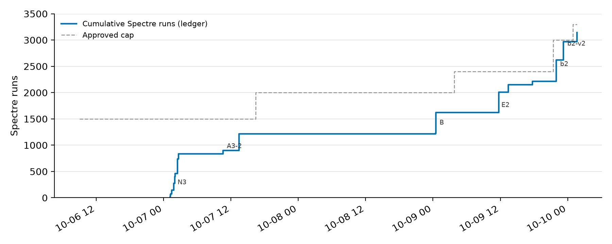
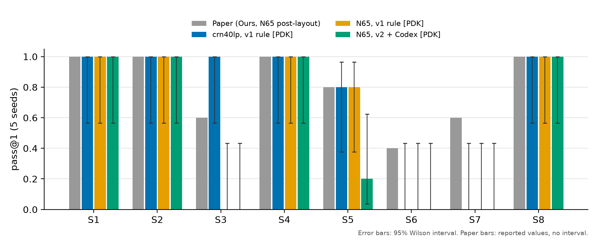
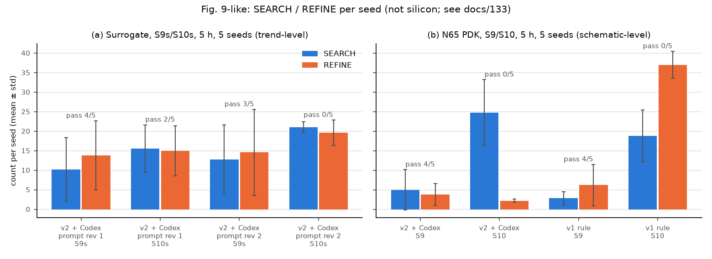
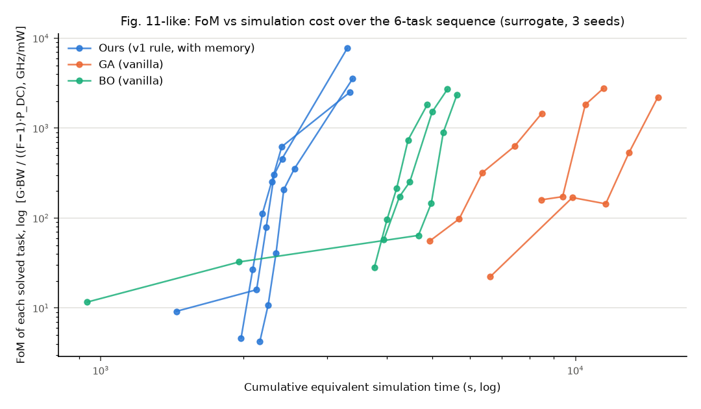
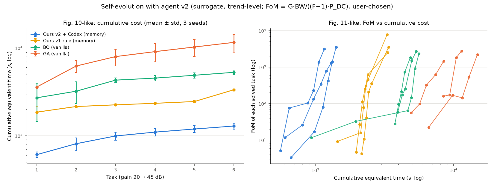

# 基于 LLM 多智能体的宽带 LNA 自动设计方法复现：v2 阶段实验报告

| 项目 | 内容 |
|---|---|
| 姓名 / 学号 | 徐鹤岩 / 【待填】 |
| 指导教师 | 陆叶 |
| 课程或项目 | 【待填】 |
| 报告日期 | 2026 年 10 月 12 日 |
| 复现对象 | RFAmpDesigner: A Self-Evolving Multi-Agent LLM Framework for Automated RF Amplifier Design（arXiv:2605.10093） |
| 代码仓库 | 私有仓库 `xujunonline/Open-RFAmpDesigner-Cadence` |
| 版本 | v2 封版标签 `v2.0`（提交 `175b06e`）；本报告依据 `main` 分支提交 `3e9cde4` |
| 数据重算 | `scripts/report/make_report_tables.py` → `results/report/` |

> **证据等级说明**：本报告中的结果分为三类，均在正文中逐项标注。
> 【代理】为开放代理仿真器的结果，只能说明趋势；【PDK】为 TSMC 晶体管模型加理想无源、无版图寄生、由 Spectre 判定的原理图级结果；【论文】为原论文报告的数据。
> 本报告中没有任何硅测试或版图后仿结果。

---

## 摘要

本阶段复现论文 RFAmpDesigner 的方法，并完成两项任务。

- **A 线**：按论文实现由大语言模型（LLM）驱动的 Manager、Searcher、Refiner 三个 ReAct 智能体（实现 v2）。
- **B 线**：把 PDK 后端迁移到与论文相同节点的 TSMC 65 nm LP RF 工艺（CRN65LP v1.7），并先用规则策略（实现 v1）建立同工艺基线，以便把"智能体的影响"与"工艺的影响"分开。

设计对象是三级宽带低噪声放大器（LNA），评价沿用论文 Table III 的 10 个规格和 pass@1 口径。

**主要结果**（下面的区间为 95 % Wilson 置信区间，p 为 Fisher 精确检验的双侧 p 值）：

1. 【PDK】N65 上 S1–S8 各 5 个 seed：v1 规则策略通过 24/40，区间 [0.45, 0.74]；v2 + Codex 通过 21/40，区间 [0.37, 0.67]。两者差异不显著（p = 0.65），通过的规格集合除 S5 外完全相同。
2. 【代理】前沿缩放规格 S9s/S10s：v2 + Codex 通过 6/10，v1 + Codex 与 v1 规则策略都是 0/10，差异显著（p = 0.011）。
3. 【PDK】原论文 S9/S10：v1 与 v2 都是 S9 4/5、S10 0/5，v2 的 Spectre 用量约为 v1 的 1/3。
4. 【代理】自进化实验（论文图 10 流程）：v2 解出 18/18，累计等效仿真成本比 GA 低 9.0 倍，与论文约 5.5 倍处于同一量级。
5. 【PDK】把多保真流程中的锚点仿真也改用 Spectre，在 5 个设计上没有使任何设计从失败变为通过，支持"内层用表征引擎、最终由 Spectre 判定"的分工。

**未复现的部分**：N65 上的 S3、S6、S7、S10 通过数为 0。其中 S3 有直接证据表明是器件受限（50 GHz 时 $f_T$ 约 110–120 GHz）。另外，"LLM 推理是 S9/S10 成功关键"这一结论只在代理后端上成立。

本阶段共使用 Spectre 3144 次，在用户批准的 3300 次上限之内；所有数字均可追溯到原始文件。

**关键词**：低噪声放大器；电子设计自动化；大语言模型；多智能体；多保真优化；方法复现

**Abstract** (optional). This phase reproduces the RFAmpDesigner method with (i) LLM-driven ReAct Manager/Searcher/Refiner agents (v2) and (ii) a TSMC 65 nm LP RF schematic-level PDK back end with Spectre sign-off, first establishing a rule-based (v1) baseline on the same process. On N65, v1 and v2 pass 24/40 and 21/40 of S1–S8 (p = 0.65). On surrogate frontier-scaled S9s/S10s, v2 + Codex passes 6/10 against 0/10 for v1 (p = 0.011). Both implementations pass S9 4/5 and S10 0/5 on N65, v2 using about one third of the Spectre runs. In the self-evolution protocol, v2 solves 18/18 tasks with 9.0× lower cumulative cost than GA. Moving the multi-fidelity anchor simulations to Spectre changes no pass/fail outcome on five designs. S3, S6, S7 and S10 are not reproduced on N65. No result is silicon or post-layout.

---

## 第 1 章 引言

本章说明研究背景、原论文的要点、前期工作，以及本阶段的目标与验收标准。

### 1.1 研究背景

宽带射频放大器的参数设计是一个高维、强耦合的多目标问题：

- 增益、带宽、纹波、输入匹配、噪声系数、线性度和功耗之间相互制约；
- 宽带"频率整形"的要求使可行域十分稀疏；
- 每次高保真仿真代价较高。

基于优化的方法（GA、BO 等）在高维空间中受维度灾难和奖励稀疏的影响；基于学习的方法依赖大量数据。
近年的研究开始尝试用 LLM 的推理能力辅助电路设计，但多数工作面向低频模拟电路，或要求 LLM 直接改写网表。

### 1.2 原论文概述

原论文提出 RFAmpDesigner，核心思想有三点：

1. **资源分配式工具中间件**：把约 30 维的电路参数调节，改写为"电流如何分配到各级、增益如何分配到无源网络"的低维决策，由四个工具（论文 Table I）把这些决策逐级翻译成元件值。
2. **多保真**：关键级用高保真仿真，频带规划用解析模型加少量仿真校准。论文报告这种做法使运行时间减少 88 %（论文图 5）。
3. **两层多智能体与记忆**：Manager 调度 Searcher（搜索关键级候选）和 Refiner（细化与分级回溯），并用知识库与经验库（KB/EB）实现跨任务的"自进化"。

论文的主要结论【论文】：

- S1–S8 上 pass@1 为 32/40，明显优于 GA、BO 和其他 LLM 方法（Table IV）；
- 在最难的 S9/S10 上，多个 LLM 主干达到 5/5，而加了工具的 GA/BO 不超过 3/5，作者把差距归因于 LLM 推理（Table V）；
- 自进化使样本效率提高约 5.5 倍（图 10）。

论文的全部仿真使用 Cadence Spectre 与 TSMC N65 版图后网表，硬件为两颗 64 核 EPYC 7763。

### 1.3 前期工作（v1 阶段）回顾

前期（标签 `v1-decision-points`、`v1.1-clean`）完成了以下工作：

- 【代理】在开放代理仿真器上实现了完整流程。S1–S8 上本方法通过 22/40，最好的基线 BO-vanilla 通过 11/40；多保真节省 99 %；自进化 18/18（docs/115 §6）。
- 【PDK】在 TSMC 40 nm LP RF（crn40lp）原理图级 PDK 上，v1 规则策略 S1–S8 通过 **29/40**，区间 [0.57, 0.84]。
- 【代理】Table V 未复现：在代理器件上 S9/S10 不可行；在缩放规格 S9s/S10s 上，v1 + Codex 与规则策略都是 0/10（docs/127 §5.2）。

> **更正**：docs/127 §5.1 及其汇总文件 `results/repro/pdk_pass_at1_20261002/summary.json` 原把 crn40lp 的合计写作 34/40，后来被 docs/125、docs/135、README 等沿用。
> 本报告的重算脚本按逐规格结果重新加总，得到 29/40（5+5+5+5+4+0+0+5）。这也与"crn40lp 与 N65 的差距全部来自 S3"的诊断一致（29 − 24 = 5）。
> 2026-10-12 已在所有引用处统一更正，汇总文件中加了更正记录。逐规格数值未变。详见附录 E。

v1 的智能体实现中，Searcher 是固定程序，LLM 只在两个决策点起作用（选功率分配、选回溯动作）。这与论文"三个智能体都是 LLM"的形态不同，也可能是 Table V 未能复现的原因之一。

### 1.4 本阶段目标与验收标准

本阶段任务由 docs/130 规定，分两条线并行。

**表 1** 本阶段目标与验收标准（来源：docs/130）

| 线 | 阶段 | 目标 | 验收标准 |
|---|---|---|---|
| — | 阶段 0 | 环境与分支 | 全量测试与冒烟通过；建立 N65 Spectre 账本 |
| A | A1 | 修复 v1 遗留问题：输出文件名冲突、功率比范围、Cadence 后端的 Spectre 上限 | 补充测试；v1 行为不变 |
| A | A2 | 实现 v2 ReAct 智能体（离线） | 设计文档先行；离线脚本覆盖正常、非法动作、超预算、LLM 中断；S2 端到端通过 |
| A | A3 | 真实 LLM 运行：代理后端的 S2 冒烟与 S9s/S10s 5 seed；N65 上 S1–S8 5 seed | 与 v1、规则策略同口径对比 |
| B | N0 | 新虚拟机密钥登录 | 执行者不接触密码；能远程调用 Spectre |
| B | N1 | PDK 盘点、器件表征与拟合 | 不写出 PDK 参数；Spectre ≤ 150 次 |
| B | N2 | N65 冒烟：`pdk-check` 与 S1–S8 seed 0 | ≤ 120 次 |
| B | N3 | N65 v1 基线：S1–S8 × 5 seed | 在 A3 第 2 步之前完成；≤ 550 次 |

贯穿全程的约束有五条：

- 不伪造结果，结果标注证据等级；
- v1 行为冻结：默认设置下输出与 v1.1 逐字节一致；
- 机密配置与凭据不读、不打印、不提交；
- 每个用 Spectre 的阶段事先报告预计次数，并设每设计上限；
- 推送与打标签先经用户确认。

**为什么先在 N65 上跑 v1 基线**：若直接比较"v2 + N65"与"v1 + crn40lp"，差异无法区分来自智能体还是来自工艺。先在同一工艺上用 v1 建立基线，再比较 v1 与 v2，就能把两种因素分开。

在原任务之外，用户还追加了以下实验，本报告一并记录：

- B：S5 预算加倍；
- C：提示词修订 2；
- D：PDK 螺旋电感；
- E：原论文 S9/S10；
- Fig. 9/11-like 图；
- a：v2 自进化；
- b：Spectre 锚点。

### 1.5 报告结构

- 第 2 章：实验对象与方法；
- 第 3 章：实验环境；
- 第 4 章：实验设计与资源预算；
- 第 5 章：实验过程与异常处理；
- 第 6 章：结果；
- 第 7 章：分析与讨论；
- 第 8 章：有效性威胁；
- 第 9 章：结论与后续工作。

**小结**
- 本阶段要回答两个问题：论文形态的 LLM 智能体（v2）是否优于 v1；在论文同节点工艺上，方法能复现到什么程度。
- 先在同一工艺上建 v1 基线，是把智能体与工艺两种因素分开的关键设计。
- 前期报告中的 crn40lp 合计应为 29/40，本报告已更正。

---

## 第 2 章 实验对象与方法

本章说明被设计的电路、设计流程、两种智能体实现、两种仿真后端，以及评价方法和与论文设置的差异。

### 2.1 设计对象与规格

**电路**：论文图 3 的三级 LNA。

- 输入为 L 型匹配：并联 $L_\text{par}$、串联 $L_g$。
- 第一级为单端共源共栅，带源极退化电感 $L_s$，输入端不需要巴伦。
- 第二、三级为带中和电容的差分共源级。
- 级间与输出用三个磁耦合谐振器（MCR）连接，MCR1 兼作单端到差分的巴伦。
- 负载为 $1787\,\Omega\parallel62\,\text{fF}$。

论文把设计向量写成 30 维：3 个宽度、3 个偏置、3 个 MCR 各 7 个参数，以及 3 个电感。代码中的表示见 `src/orfadc/repro/circuit.py:53-91`。

**规格**：论文 Table III 的 S1–S10（`config/specs_table_iii.yaml`），覆盖以下几类：

- 中心频率 10/30/50 GHz；
- 相对带宽 10 %–80 %；
- 低 NF（S7：≤ 2.5 dB）；
- 低功耗（S8：15 mA）；
- 高线性度（S9/S10：IP1dB ≥ −15 dBm）。

在代理器件上，S9/S10 的线性度目标超出了器件前沿（在 30 mA、25 dB 增益下约为 −19.7 dBm，docs/115 §6.2）。所以另定义了两个缩放规格，与前沿保持相近距离（`src/orfadc/repro/bench.py:163-165`）：

- S9s：IP1dB ≥ −20 dBm；
- S10s：NF ≤ 4 dB，且 IP1dB ≥ −21 dBm。

S9s/S10s 只用于代理后端。

### 2.2 设计流程：四个工具与多保真

**表 2** 四个工具的输入、算法与所用仿真（来源：`src/orfadc/repro/tools.py`）

| 工具（论文 Table I） | 输入 | 算法 | 所用仿真 |
|---|---|---|---|
| Stage 1 有源尺寸与偏置 | 三级功率比 | 查器件知识库；关键组与非关键组各取最大和最小两种器件，共 4 个配置 | 无 |
| Stage 2 关键级阻抗匹配 | 一个配置，NF 余量，可选关键级增益目标 | PSO（8 粒子 × 8 轮）优化 MCR1 的 7 个参数和 $L_s$；L 匹配由解析式求出；代价为论文 Eq.(1) | 关键级单频点高保真仿真，每粒子 2 次 |
| Stage 3 频带规划 | Stage 2 结果，可选增益目标 | 模拟退火优化 MCR2/MCR3 的 $(k,f_0,Q_0,C)$；低保真模型为论文 Eq.(3)，用少量全链仿真的残差迭代校准；代价为 Eq.(2) | 解析计算，加每轮 1 次全链仿真 |
| Stage 4 全链评估 | 完整设计 | 带内扫描增益、$S_{11}$、NF、NFmin，以及 IP1dB | 全链高保真仿真；PDK 后端下由 Spectre 执行 |

论文 Eq.(3) 中 $Y_{11}$ 分母的末项漏了一个 $s$。本项目使用修正式 $R_S\omega_0^3Qs$，并用节点分析验证到 $10^{-9}$（`tests/test_repro_core.py:25-45`）。

**等效 EDA 时间**：代理引擎每次仿真只需毫秒级时间，所以按论文的量级为三类调用规定等效耗时（`src/orfadc/repro/tools.py:32`）：

$$
T_\text{eq}=0.5\,n_\text{关键级}+12\,n_\text{全链}+0.002\,n_\text{解析}\quad(\text{s}),
$$

并按论文"顺序执行"的口径累加。等效时间超过预算后，设计就此终止。

### 2.3 两种智能体实现

**表 3** 两种智能体实现的对比（来源：docs/131）

| | v1（`agents.py`） | v2（`agents_v2.py`，docs/131） |
|---|---|---|
| Manager | 程序循环。功率比按规则选；用 LLM 时只有这一个决策点 | LLM ReAct 循环：自己决定搜索、细化哪个候选、何时结束 |
| Searcher | 程序：固定枚举 4 个配置 × 2 个增益目标 | LLM ReAct 循环：自己调用 Stage 1/2，自己挑选候选 |
| Refiner | 程序循环。回溯动作按规则选；用 LLM 时只有这一个决策点 | LLM ReAct 循环：自己调用 Stage 3/4，或在同一配置下重做 Stage 2 |
| 动作格式 | — | 每步输出一段理由和一个 JSON 动作；程序校验工具名、参数类型与取值范围 |
| LLM 出错时 | 回落到规则策略 | 不回落：非法动作让 LLM 重试，连续 3 次非法或 3 次传输错误即终止 |
| 步数上限 | Refiner 6 步 | Manager 60 步、Searcher 24 步、Refiner 16 步 |
| 功率比范围 | 0.1–0.8 | 0.15–0.7 |
| 记忆 | KB/EB（JSONL） | 同 v1，记录中另加 `agent_impl` 和 `pdk` 字段 |

本阶段 v2 的 LLM 主干是 Codex（通过 ChatGPT 订阅、MCP 桥接调用）。Claude（订阅）只用于冒烟和少量补充运行。两者都按次数和 token 记录，不计费用。

### 2.4 仿真后端

1. **代理后端**：两端口 ABCD 矩阵与噪声相关矩阵级联（Hillbrand–Russer 方法），器件为开放的 EKV 类 65 nm 量级模型（`twoport.py`、`device.py`）。结果为【代理】。
2. **PDK 后端（混合）**：
   - 先用少量 Spectre 仿真表征 PDK RF 晶体管，得到随宽度和偏置变化的小信号与噪声参数表，并拟合 10 参数器件模型；
   - 内层（Stage 2/3）的仿真由引擎在这张表上完成；
   - Stage 4 自动生成完整网表，由 Spectre 判定，用到 DC、S 参数加噪声、谐波平衡功率扫描三种分析。
   - 无源器件为理想元件加固定 Q（匹配电感 Q = 25，MCR 电感 Q = 15），没有版图寄生。结果为【PDK】。
3. **锚点选项**：设置 `ORFADC_SPECTRE_ANCHORS=1` 后，Stage 2 的候选带内扫描和 Stage 3 的校准仿真也交给 Spectre（`tools.py:114-131`），用于检验多保真分工（实验 b）。

### 2.5 评价指标

- **通过判定**（`tools.py:416-426`）：六项违规量全为 0。
  - 带内最小增益与目标相差不超过 3 dB；
  - 纹波 ≤ 3 dB；
  - 中心频率处 NF 不超过规格；
  - IP1dB 不低于规格；
  - 带内 $S_{11}\le-10$ dB（项目约定，论文表中未列）；
  - 电流不超过预算。
- **pass@1**：每个（规格，seed）独立运行一次，统计通过比例。报告中附 95 % Wilson 置信区间；两组比较用 Fisher 精确检验，取双侧 p 值。
- **成本**：
  - 等效 EDA 时间；
  - Spectre 次数：按设计记在结果文件中，按阶段记在账本 `results/repro/n65/spectre_ledger.csv`；
  - LLM 调用次数与 token。
- **其他**：失败设计的瓶颈和违规量；同一 seed 不同运行之间的差异。

### 2.6 与论文设置的差异

**表 4** 与论文设置的差异及其可能影响

| 项目 | 论文 | 本阶段 | 对结论可能的影响 |
|---|---|---|---|
| 工艺与网表 | TSMC N65，含版图寄生的后仿网表 | TSMC 65 nm LP RF（CRN65LP v1.7）晶体管，理想无源加固定 Q，无版图寄生 | 原理图级结果通常比后仿乐观；但固定 Q 的匹配电感也可能比实际螺旋电感更差（S7） |
| 内层仿真 | 全部用 Spectre | 内层用 PDK 表征引擎，只有最终判定（和可选的锚点）用 Spectre | 内层方向的误差可能使搜索偏离；实验 b 在 5 个设计上未见结论改变 |
| 时间口径 | 墙钟时间，两颗 64 核 EPYC 7763 | 等效 EDA 时间（成本模型） | 只能比较相对大小，不能直接比较秒数 |
| 预算 | S1–S8 1 h，S9/S10 5 h | 等效时间同样为 1 h / 5 h | 口径对齐，但成本模型不同 |
| LLM 主干 | GPT-5.1、Claude Sonnet 4.5、Gemini 2.5 Flash、DeepSeek V3.2、Qwen3 等，按 API 计费 | Codex（ChatGPT 订阅）为主，Claude 为辅 | 主干不同，Table V 的逐主干对照与 Table VI 的成本无法复现 |
| 资源护栏 | 未提及 | 每设计 Spectre 上限（14–300，视实验而定）、总账本、LLM 调用上限 1000 | 碰到护栏的运行可能提前终止，已单独标注 |
| $S_{11}$ 判定 | 表中未列 | 带内 ≤ −10 dB | 比不判 $S_{11}$ 更严格，宽带规格尤甚 |
| 工艺角 | 未说明 | 只有典型角（tt） | 不能说明工艺偏差下的稳健性 |

**小结**
- 设计对象、规格、四个工具、等效时间口径都与论文对齐；最大的差异在于原理图级 PDK 和"内层不用 Spectre"。
- v1 与 v2 的唯一区别在于决策由谁做出，工具和后端完全相同。
- 每项差异对结论的影响方向都已列出，第 8 章还会再讨论。

---

## 第 3 章 实验环境

本章说明硬件、软件、工艺和版本管理，并给出离线复现方法。

### 3.1 硬件

**表 5** 硬件环境

| 设备 | 配置 | 用途 | 出处 |
|---|---|---|---|
| 主机 | Intel MacBook，Core i9-9980HK（8 核 16 线程），32 GB 内存，macOS 26.5 | 运行 Python 流程、LLM CLI；托管虚拟机 | 本机查询；docs/132 文首 |
| Cadence 虚拟机 | VMware Fusion 上的 CentOS 7.9 客户机，4 vCPU，8 GB 内存 | 运行 Spectre | docs/128、docs/132 §2；CPU 数经用户在 VMware 中确认 |

> 虚拟机的 CPU 数量在文档中曾记录不一致：docs/128 记为 4 vCPU，docs/133、docs/135 写作"2 核"。经用户在 VMware 中确认为 4 vCPU，相关文档已更正（附录 E）。此数字只影响对"纯 Spectre 方案耗时"的估计，不影响任何结果。

### 3.2 软件

**表 6** 软件版本

| 软件 | 版本 | 出处 |
|---|---|---|
| Python | 3.12（本机 `.venv`；要求 ≥ 3.11） | 本机查询 |
| 主要依赖 | numpy、scipy ≥ 1.10 等（`config/requirements_repro.txt`） | 仓库 |
| Cadence IC / Spectre | IC 6.1.8；Spectre 18.1.0.077 | docs/132 §2 |
| Codex CLI | 0.161.0 正式版。运行期间曾被 ChatGPT 应用自动更新为 0.162.0-alpha，导致部分运行作废（见第 5 章） | docs/134、docs/133 §6 |
| Claude CLI | 订阅登录 | docs/133 §1 |
| Claude Code | 作为执行者完成代码、实验调度与文档；见附录 G | — |

### 3.3 工艺

- **N65**：TSMC 65 nm LP RF（CRN65LP v1.7）。
  - 使用 RF NMOS，沟长 60 nm，单指宽 2 µm，VDD 1.2 V；
  - 偏置网格 0.375–0.675 V，步长 25 mV（docs/132 §3.1–3.2）；
  - 只用典型工艺角。
- **crn40lp**：TSMC 40 nm LP RF，只用于 v1 的历史结果。

本报告不包含任何 PDK 文件路径、器件子电路名或器件参数。

### 3.4 版本管理与可复现性

- 分支 `v2-agentic` 承载全部 v2 工作，经 PR #1–#9 合并到 `main`。
- 标签：
  - `v1-decision-points`、`v1.1-clean`：前期；
  - `v2-agentic-alpha`：中间版本；
  - `v2.0`（`175b06e`）：本阶段封版。
- 每个 Spectre 运行都记入账本 `results/repro/n65/spectre_ledger.csv`，共 143 行，每行带当时的提交哈希。
- 全量离线测试在 `v2.0` 时为 141 项通过。
- **离线复现**：不需要 Cadence 与 LLM。

  ```bash
  export PYTHONPATH=src
  python -m pytest tests/test_repro_core.py -q                      # 14 passed
  python -m orfadc.repro.bench smoke --out results/repro/guide_smoke  # S2 代理设计，逐位可复现
  python scripts/report/make_report_tables.py                          # 重算本报告的表格与统计
  ```

- PDK 结果的原始设计文件已提交，但只含指标与元件值，不含器件表。重跑 PDK 实验需要虚拟机和 PDK，不在离线复现范围内。

**小结**
- 主机运行流程与 LLM，虚拟机运行 Spectre，两者通过 ssh 连接。
- 软件与工艺版本均有记录；虚拟机 CPU 数量的记录不一致，已标出待确认。
- 所有结果有提交哈希和账本可追溯；代理部分可完全离线复现。

---

## 第 4 章 实验设计

本章列出全部实验、对照逻辑和资源预算。

### 4.1 实验总表

各列含义：

- **Spectre**：取自账本，括号内为作废运行；
- **LLM 调用**：取自结果文件的 `llm_usage`；
- **护栏**：每设计 Spectre 上限；
- **预算**：等效 EDA 时间。

数据由 `scripts/report/make_report_tables.py` 重算，见 `results/report/resources_by_experiment.csv` 与 `spectre_ledger_by_stage.csv`。

**表 7** 实验总表（来源：`results/report/resources_by_experiment.csv`、`spectre_ledger_by_stage.csv`）

| 编号 | 目的 | 自变量 / 设置 | 对照 | 规格 × seed | 预算 | 护栏 | Spectre | LLM 调用 | 原始档 | 文档 |
|---|---|---|---|---|---|---|---|---|---|---|
| 阶段 0 | 环境、分支、账本 | — | — | — | — | — | 0 | 0 | — | docs/134 |
| A1 | 修复 v1 遗留问题 | 代码 | v1 冻结核对 | — | — | — | 0 | 0 | — | docs/134 |
| A2 | v2 智能体离线实现 | 离线脚本驱动 | v1 规则 | S2 × 1 | 1 h | — | 0 | 66（离线） | — | docs/131 §8 |
| A3-冒烟 | 真实 LLM 通道 | v2 + Codex / Claude | — | S2 × 1（每个主干） | 1 h | — | 0 | 94 | `results/repro/v2_a3/smoke/` | docs/133 §2 |
| A3-S9s/S10s | v2 能否解最难的线性度任务【代理】 | v2 + Codex（修订 1） | v1 + Codex、v1 规则 | (S9s, S10s) × 5；另有 Claude 补充 3 次 | 5 h | — | 0 | 3687 | `results/repro/v2_a3/s9s10s/` | docs/133 §3 |
| N0 | 虚拟机密钥登录 | — | — | — | — | — | 0 | 0 | — | docs/132 §2 |
| N1 | N65 盘点、表征、拟合 | — | — | — | — | — | 75 | 0 | 器件表不入库 | docs/132 §3 |
| N2 | N65 冒烟 | v1 规则 | crn40lp seed 0 | S1–S8 × 1，另加 `pdk-check` | 1 h | 14 | 73 | 0 | `results/repro/n65/n2/` | docs/132 §4 |
| N3 | N65 v1 基线 | v1 规则 | crn40lp、论文 | S1–S8 × 5 | 1 h | 60 | 505（184） | 0 | `results/repro/n65/n3/` | docs/132 §5 |
| A3-N65 | v2 在 N65 上的表现 | v2 + Codex | N3 | S1–S8 × 5 | 1 h | 60 | 375（含作废 2） | 2246 | `results/repro/v2_a3/n65/` | docs/133 §4 |
| B | 预算加倍能否改善 v2 的 S5 | v2 + Codex，2 h | A3-N65 的 S5 | S5 × 5 | 2 h | 60 | 272 | 878 | `results/repro/v2_a3/n65_b_s5_2h/` | docs/133 §7 |
| C-代理 | 提示词修订 2 的效果 | 修订 2 | 修订 1（A3-S9s/S10s） | (S9s, S10s) × 5 | 5 h | — | 0 | 4262 | `results/repro/v2_a3/s9s10s_r2/` | docs/133 §6.1 |
| C-N65 | 修订 2 在 PDK 上 | 修订 2 | A3-N65 | S3、S5、S7 × seed 0 | 1 h | 60 | 38 | 156 | `results/repro/v2_a3/n65_c_rev2/` | docs/133 §6 |
| D1 / D3 | PDK 螺旋电感能否改善 S7 | 匹配电感改为 PDK 螺旋电感 | N3 的 S7 | 表征 1 次；S7 × 5 | 1 h | 60 | 1 + 85 | 0 | `results/repro/v2_a3/n65_d3_spiral/` | docs/133 §8 |
| E / E2 / E3 | 原论文 S9/S10 在 N65 上的表现 | v1 规则与 v2 + Codex | 两者互为对照 | S9、S10 × 5；v2 的 S10 加跑到 9 个 seed | 5 h | 60–80 | 12 + 530 + 64 | 2833 | `results/repro/v2_a3/n65_s9s10/` | docs/133 §9 |
| Fig. 9 / 11 | 搜索与细化次数；FoM 与成本 | 用已有运行；Fig. 11 重跑了 Fig. 10 流程【代理】 | — | — | — | — | 0 | 0 | `results/repro/v2_a3/figures/` | docs/133 §10–11 |
| a | v2 的自进化 | v2 + Codex，模式 2（带记忆） | v1、GA、BO（前期结果） | 6 个增益任务 × 3 seed | 每任务 1 h | — | 0 | 163 | `results/repro/v2_a3/fig10_v2/` | docs/133 §13 |
| b-v1 | 锚点用 Spectre 是否改变结论 | 锚点用 Spectre，v1 规则 | N3 的同一设计 | S3/0、S5/0、S5/1 | 1 h | 200 | 405 | 0 | `results/repro/v2_a3/n65_b2_anchors/` | docs/133 §12 |
| b-v2 | 同上，v2 | 锚点用 Spectre，v2 + Codex | A3-N65 的同一设计 | S5/0、S5/1，另有 S5/1 放宽护栏后的重跑 | 1 h | 180 / 300 | 525 | 325 | `results/repro/v2_a3/n65_b2_anchors_v2/` | docs/133 §12b |
| **合计** | | | | | | | **3144** | **14644** | | |

说明：

1. Spectre 合计按账本 14 个阶段求和为 3144，等于账本最后一行的累计值（`results/report/summary.json` 的 `ledger_check`）。
2. LLM 调用合计 14644 次，为表中有效运行之和（A2 的离线脚本调用不计）；作废运行的调用未计入。

### 4.2 对照设计的逻辑

本阶段的比较按"一次只变一个因素"的原则安排：

**表 8** 对照设计

| 想回答的问题 | 变化的因素 | 保持不变 | 对应实验 |
|---|---|---|---|
| 工艺从 crn40lp 换到 N65 的影响 | 工艺 | v1 规则、规格、seed、预算 | N3 对 docs/127 |
| 智能体从 v1 换到 v2 的影响 | 智能体实现 | 工艺、规格、seed、预算、护栏 | A3-N65 对 N3；E 中 v1 对 v2 |
| LLM 对最难任务的作用（代理） | 智能体实现与决策方式 | 同一 LLM（Codex）、同一预算 | A3-S9s/S10s 对 v1 + Codex、v1 规则 |
| 预算是否是 v2 在 S5 上偏弱的原因 | 预算（1 h → 2 h） | 其他全部 | B 对 A3-N65 |
| 提示词能否改善 v2 | 提示词版本 | 其他全部 | C 对 A3 |
| 理想匹配电感是否是 S7 的瓶颈 | 匹配电感模型 | v1 规则与其他设置 | D3 对 N3 |
| 内层不用 Spectre 是否改变结论 | 锚点仿真用引擎还是 Spectre | 同一设计、同一 seed | b 对 N3 / A3-N65 |

v2 由 LLM 决策，同一 seed 的不同运行可能结果不同（docs/133 §12b）。因此关于 v2 的结论都以多 seed 统计为准；单次运行只用来说明现象。

### 4.3 资源预算

**Spectre 上限**：N65 单独记账。用户先后五次批准上限（docs/130 §1-3）：

**表 9** N65 Spectre 上限的批准记录（来源：docs/130 §1-3）

| 日期 | 上限 | 用途 |
|---|---|---|
| 2026-10-06 | 1500 | N1–N3 与 A3 第 2 步（按阶段预分配） |
| 2026-10-07 | 2000 | 实验 B、C、D |
| 2026-10-09 | 2400 | 实验 E：S9/S10 的 v1 与 v2 对照（护栏 60） |
| 2026-10-09 | 3000 | 实验 b：锚点（v1） |
| 2026-10-10 | 3300 | 实验 b：v2 S5 seed 1 放宽护栏重跑 |

最终用量 3144 次。其中 184 次误操作重跑、2 次 ssh 中断后作废的运行、12 次中止的三端口表征，都已在账本中注明不用于结果（详见第 5 章）。

**每设计护栏**：用 `ORFADC_SPECTRE_MAX_PER_DESIGN` 设置，达到后设计被硬停。各实验的取值见 4.1 节；碰到护栏的运行在结果中单独标注。

**LLM**：

- 每设计调用上限为 1000 次，即论文口径（`ORFADC_LLM_MAX_CALLS=1000`）；
- 使用订阅额度，按调用次数与 token 记录，不计金额；
- 真实 LLM 运行前，先向用户报告预计调用量。

**小结**
- 约 20 项实验，覆盖原任务的全部阶段与 7 项追加实验，每项都有原始档和文档出处。
- 对照设计遵循"一次只变一个因素"：先分离工艺因素，再比较智能体。
- Spectre 总用量 3144 次，在批准上限内，账本可逐行对账。

---

## 第 5 章 实验过程记录

本章按时间顺序记录各实验的执行过程、遇到的异常与处理方式，以及资源消耗。

时间取自 git 提交时间、Spectre 账本的时间戳和实验文档，精确到分钟。阶段 0 至 A2 在 Windows 主机上完成，之后迁移到 macOS 主机（docs/134）。

### 5.1 时间线

**表 10** 本阶段主要事件（来源：`git log v1.1-clean..v2.0`、`results/repro/n65/spectre_ledger.csv`）

| 时间 | 事件 | 提交 / 记录 |
|---|---|---|
| 10-06 09:18 | 阶段 0：建立分支 `v2-agentic` 与 N65 Spectre 账本 | `1c8059d` |
| 10-06 09:37 | A1：输出文件名、功率比范围、Cadence 后端的 Spectre 上限 | `02d114a` |
| 10-06 10:05 | A2：v2 ReAct 智能体（离线）实现完成 | `5999a06` |
| 10-06 19:48 | 迁移到 macOS 主机 | `0c3fa91` |
| 10-07 00:59 | N0：虚拟机密钥登录验证 | `20b7566` |
| 10-07 01:20 | N1：PDK 盘点、器件表征与拟合（75 次 Spectre） | `4e586dc` |
| 10-07 01:29 | N2：冒烟，4/8 通过 | `4a09831` |
| 10-07 01:39 | N2：S3 失败诊断为器件受限（0 次 Spectre） | `de84f1b` |
| 10-07 01:51–02:42 | N3：v1 基线 5 seed，24/40 | `cf1a105`、`9f567d0`、`f256b24` |
| 10-07 02:34–03:05 | A3 冒烟：Codex、Claude 两个通道都通过 | `a14830a`、`4363d01` |
| 10-07 02:57 | 修复 v2 在增益要求为 null 时崩溃的缺陷 | `cd23d4e` |
| 10-07 11:29 | A3：代理后端 S9s/S10s，v2 + Codex 6/10 | `9f65673` |
| 10-07 12:21 | 远程执行改为只在"未连上"时重试一次 | `708f3a9` |
| 10-07 13:53 | A3：N65 S1–S8，v2 + Codex 21/40 | `b18b441` |
| 10-07 16:02 | 打中间版本标签 `v2-agentic-alpha` | `c0e108f` |
| 10-07 16:24 | Spectre 上限提高到 2000；B、C 的队列 | `7c3a70a` |
| 10-08 21:20 | C 的中间结果；4 次运行因 Codex 自动更新作废 | `22fcdab` |
| 10-08 22:39–23:23 | Codex 传输层重试；改用固定的正式版 0.161.0 | `6ce751d`、`4e52368` |
| 10-09 02:02 | B、C-N65、D3、E（S9/S10 seed 0）完成 | `46c2f1e` |
| 10-09 03:32 | C 在代理后端的最终结果：修订 2 为 3/10 | `b7a3e32` |
| 10-09 03:46 | 上限提高到 2400；E2 的队列 | `205ad9a` |
| 10-09 12:47 | E2 中间结果；虚拟机地址变化导致一次崩溃 | `db5059b` |
| 10-09 13:42 | E：N65 上 S9 4/5、S10 0/5（v1 与 v2 相同） | `eeebce4` |
| 10-09 13:51–15:10 | Fig. 9-like、总报告 docs/135、Fig. 11-like；PR #1、#2 | `e62a8df`、`de76ae5`、`23d6ccf` |
| 10-09 18:58 | E3：v2 的 S10 加跑 seed 5–8，0/4 | `f6df883` |
| 10-09 21:24 | 锚点选项代码；上限提高到 3000 | `08ef2a9` |
| 10-09 22:04 | 实验 a：v2 自进化 18/18 | `bd7cb2e` |
| 10-09 22:16–23:58 | 实验 b：v1 三个设计、v2 两个设计 | `5760c6a`、`4697b94` |
| 10-10 13:59 | 实验 b：v2 S5 seed 1 放宽护栏重跑（上限提高到 3300） | `944ea67` |
| 10-12 20:51 | 封版：PR #7 合并，打标签 `v2.0` | `175b06e` |

**图 1** 所示为 N65 Spectre 用量随时间的累计曲线与历次批准的上限。图中各点按账本时间戳排序后重新累加，终值等于账本累计值 3144。
生成脚本为 `scripts/report/make_report_figs.py`。



### 5.2 逐个实验记录

每个实验都按"目的 → 配置与命令 → 执行过程 → 资源 → 原始档 → 小结"的顺序记录。命令中省略了环境变量 `PYTHONPATH=src`。

#### 5.2.1 阶段 0、A1、A2（代码与离线验证）

- **目的**：搭建环境；修复 v1 遗留问题；离线实现 v2 智能体。
- **配置与命令**：
  - `python -m pytest tests -q`
  - `python -m orfadc.repro.bench smoke`
  - v2 使用离线脚本传输层 `scripted` 进行验证。
- **过程**：
  - A1 修复了三个问题：输出文件名冲突，非默认设置时追加稳定后缀；v2 功率比范围统一为 0.15–0.7；Cadence 后端遵守每设计 Spectre 上限。
  - A2 先写设计文档 docs/131，再写代码。12 项离线测试覆盖正常完成、非法动作重试、连续非法终止、预算耗尽、LLM 中断和调用上限。
- **v1 冻结核对**：默认设置下 `bench replot` 重算的 Table IV/V 与 2026-10-03 的结果逐字节一致；S2 规则策略的结果文件只多了标签字段（docs/131 §8）。
- **资源**：0 次 Spectre；离线脚本调用不计入 LLM 用量。
- **小结**：v2 在离线条件下通过 S2（等效 2036 s，v1 为 1901 s），说明协议与记账正确。这一步不反映 LLM 的能力。

#### 5.2.2 N0–N2（N65 接入与冒烟）

- **目的**：在新虚拟机上接通 Spectre，表征 N65 器件，并用 v1 冒烟。
- **配置与命令**：
  - `bench pdk-inventory`；
  - `bench pdk-config`：从盘点结果写本地模型配置，配置文件被 git 忽略，内容不在对话中打印；
  - `bench pdk-characterize`（$V_{DS}$ = 1.2 V 与 0.6 V 两张表）、`bench pdk-characterize3`、`bench pdk-characterize-casc`、`bench pdk-refit`；
  - `bench pdk-check --spec S2`；
  - 队列 `scripts/jobs/queue_n65_n2.txt`（S1–S8 seed 0，每设计上限 14）。
- **过程**：
  - **N0**：执行者生成专用密钥，由用户本人完成授权（执行者不接触密码）。虚拟机上没有任务说明中预设的登录用户，按实际情况改用另一个普通用户（docs/132 §2）。
  - **N1**：
    - 用单宽度探测确定偏置网格：沿用 crn40lp 的网格时，在 N65 上过于靠近亚阈区，因此改为 0.375–0.675 V。
    - 修正了一个 v1 遗留缺陷：三端口表征时会构建一种不支持的模式而报错。报错前已完成的 12 次 Spectre 记账但作废。
    - 修正后表征全部 0 失败；拟合残差 RMS 的中位数为 0.047 和 0.049。
  - **N2**：
    - `pdk-check` 显示引擎与 Spectre 在同一 S2 设计上判定一致：增益相差 0.5 dB，NF 相差 0.36 dB（引擎偏悲观）。
    - S1–S8 seed 0 通过 4/8。其中 S3 的 NF 违例为 3.16 dB，经诊断为器件受限（docs/132 §4）。
- **资源**：N1 共 75 次（含作废 12 次），N2 共 73 次。
- **原始档**：`results/repro/n65/n2/`；器件表在 git 忽略的 `results/runs/` 中，不入库。
- **小结**：N65 链路可用，引擎与 Spectre 在窄带设计上一致。S3 在本工艺上接近器件极限。

#### 5.2.3 N3（N65 v1 基线）

- **目的**：在 N65 上建立 v1 规则策略的 pass@1 基线，作为 v2 的对照。
- **配置与命令**：队列 `queue_n65_n3.txt`、`queue_n65_n3_s123.txt`、`queue_n65_n3_s4.txt`。S1–S8 × seed 0–4，预算 1 h，每设计护栏 60。
- **过程**：
  - 用户在终端启动队列。自动模式的安全分类器不允许执行者在后台启动批量远程仿真。
  - seed 0 为 4/8，seed 1–4 各 5/8。60 次的护栏一次也没有触发，单设计最多用 36 次。
  - 用户两次误把 seed 0 队列又跑了一遍，共 184 次 Spectre，账本记为 `N3-dup`，不用于结果。完整重跑的那一次，每个设计的 Spectre 次数与第一次完全相同，说明运行可复现。
- **资源**：有效运行 505 次，作废 184 次。
- **原始档**：`results/repro/n65/n3/seed{0,1-3,4}/`。
- **小结**：24/40。与 crn40lp 的 29/40 相比，差距全部在 S3（0/5 对 5/5）。

#### 5.2.4 A3（真实 LLM 运行）

- **目的**：用真实 LLM 检验 v2，包括代理后端的冒烟与最难的线性度任务、N65 上的 S1–S8。
- **配置与命令**：
  - `bench design --spec <S> --seed <n> --policy codex-mcp --agent-impl v2 [--backend pdk]`，设置 `ORFADC_LLM_MAX_CALLS=1000`；
  - 队列 `queue_a3_*.txt`。
  - S9s/S10s 的 seed 1–4 按用户决定只用 Codex，以便与 v1 的 5 seed 实验（同样只用 Codex）对齐。
- **过程**：
  - **冒烟**：Codex 55 次调用、Claude 39 次调用，都通过，0 次非法动作。
  - **S9s seed 0 首次运行崩溃**：原因是 v2 允许"某级增益不约束"（null），但共享工具对每一项都做减法。修复后补了回归测试。修复前的 S10s seed 0 运行同样崩溃，两次都作废并重跑。
  - **代理 S9s/S10s**：Codex 5 个 seed 共 6/10。
    - 失败的 4 次都只差 NF 0.14–0.47 dB。
    - 其中 S10s seed 2 因 Manager 连续 3 次提交已搜索过的功率比而按规则终止。这是 LLM 的行为，不是程序错误。
    - 另有 Claude 的补充运行 3/3（未进入对齐表）。
  - **N65 S1–S8**：
    - 5 个 seed 由用户在两个终端并行启动。
    - S2 seed 4 的第一次运行遇到 ssh 建连失败，已执行 2 次 Spectre，设计中止。查过虚拟机后重跑通过。两次都记了账；之后加了"只在没连上时重试一次"的保护。
- **资源**：
  - 代理部分：0 次 Spectre，3687 + 94 次 LLM 调用；
  - N65 部分：375 次 Spectre（含作废 2 次），2246 次 LLM 调用。
- **原始档**：`results/repro/v2_a3/{smoke,s9s10s,n65}/`。
- **小结**：v2 在代理后端最难的任务上明显优于 v1；在 N65 的 S1–S8 上与 v1 接近（21/40 对 24/40），差别只在 S5。

#### 5.2.5 追加实验 B、C、D（针对 A3 发现的问题）

- **B（S5 预算加倍）**：
  - 目的：检验"v2 在 S5 上偏弱是因为 1 h 预算不够"这一假设。
  - 设置：`ORFADC_BUDGET_SCALE=2`，S5 × 5 seed。
  - 结果：1/5，与 1 h 时相同。失败的 4 次都在用满 2 h 之前碰到了 60 次护栏，所以这是"2 h 预算加 60 次护栏"的结果。
  - Spectre 272 次，LLM 878 次。
- **C（提示词修订 2）**：
  - 目的：修复 A3 观察到的两个行为：反复换功率比、受器件限制时一个设计都不报告。
  - 代理后端 S9s/S10s × 5：
    - 运行期间 ChatGPT 应用自动把 Codex 更新为测试版，该版本间歇报"workspace routing discovery"错误，先后有 4 次、2 次运行作废；
    - 另有 2 次运行因执行者会话重启而中断，也作废；
    - 处理方式：加入只针对该错误的重试（等 15/30/60 s 后重发同一次调用），并改用固定的正式版 0.161.0、关闭自动更新，之后重跑；
    - 最终 3/10（修订 1 为 6/10）。
  - N65（S3、S5、S7 各 seed 0）：0/3。但 S3、S7 现在都报告了设计，修好了"不报告"的问题。
  - Spectre 38 次；LLM 共 4262 + 156 次。
- **D（PDK 螺旋电感）**：
  - 目的：检验 S7 的瓶颈是否是理想匹配电感的 Q（= 25）。
  - D1 用 1 次 Spectre 表征了 108 种螺旋几何。30 GHz 下 120–250 pH 区间的 Q 中位数为 34.7，最大 49.5。
  - D3：S7 × 5，v1 规则，匹配电感改用螺旋实例。结果 0/5，NF 差 1.43–1.77 dB，与理想电感时（1.5–1.8 dB）几乎相同。
  - 核对网表：85 次 Spectre 中有 84 次的网表含螺旋实例。
  - Spectre 1 + 85 次。

#### 5.2.6 E、E2、E3（原论文 S9/S10）

- **目的**：在 N65 上检验原论文的 S9/S10（代理器件上不可行），并比较 v1 与 v2。
- **配置**：预算 5 h；护栏为 seed 0 的 v2 取 80，其余取 60；上限提高到 2400（方案 α）。
- **过程**：
  - v2 seed 0 首次在 PDK 上通过 S9：IP1dB −14.29 dBm，NF 4.91 dB，余量很小。
  - v1 先用 seed 0 做探测，两个规格都用满了 60 次护栏；之后 seed 1–4 分两批运行。
  - **v2 S10 seed 2 首次运行崩溃**：虚拟机通过 DHCP 获得的地址发生变化，主机上写死的地址失效，ssh 各步骤返回失败（0 次 Spectre）。
    处理：改为每次连接时查询虚拟机当前地址；随后由用户在 DHCP 配置中为虚拟机固定地址。之后重跑。
  - 用户同意后，v2 的 S10 加跑了 seed 5–8（E3）。
- **资源**：Spectre 12 + 530 + 64 = 606 次；LLM 2833 次。
- **原始档**：`results/repro/v2_a3/n65_s9s10/`（含崩溃日志）。
- **小结**：S9 两者都是 4/5，S10 两者都是 0/5（v2 累计 0/9）。v2 用的 Spectre 约为 v1 的 1/3。

#### 5.2.7 Fig. 9-like、Fig. 11-like、实验 a

- **Fig. 9-like**：从已有设计结果统计每个 seed 的搜索与细化次数，不做新仿真（`python -m orfadc.repro.figs_v2 fig9`）。
- **Fig. 11-like**：
  - 论文的 FoM 引自其参考文献 [48]，正文没有给出公式。经用户选定，采用 $\text{FoM}=G\cdot\text{BW}/((F-1)P_\text{DC})$，其中 $G$、$F$ 为线性值，BW 以 GHz 计，$P_\text{DC}$ 以 mW 计。
  - 按 Fig. 10 的原流程重跑，各任务的等效时间与前期 `fig10.json` 完全一致。
- **实验 a**：
  - 用 v2 + Codex 在模式 2（带记忆）下按 Fig. 10 流程运行：S4 窄带、增益 20→45 dB 的 6 个任务，3 个 seed 并行（`python -m orfadc.repro.figs_v2 fig10v2`），约 25 min。
  - 共 163 次 LLM 调用，0 次传输错误。
- **资源**：0 次 Spectre。

#### 5.2.8 实验 b（Spectre 锚点）

- **目的**：本阶段内层不用 Spectre，与论文不同。本实验检验把锚点仿真（Stage 2 带内扫描、Stage 3 校准）改用 Spectre 后，结论是否改变。
- **配置**：`ORFADC_SPECTRE_ANCHORS=1`。PSO 内层仍用引擎，因为每设计 1k–12k 次，在虚拟机上不可行。
- **过程**：
  - **v1 部分**：选 N3 中两个失败、一个通过的设计（S3/0、S5/0、S5/1），护栏 200；用量 185、189、31 次。
  - **v2 部分**：账本当时余量为 381 次，所以只选 S5 的 seed 0、1，护栏 180。
    - 预计 60–250 次，实际 348 次，没有超出事先说明的最坏情况 360 次。
    - seed 1 碰到护栏后失败。
    - 用户把上限提高到 3300，以护栏 300 重跑，用 177 次、未碰护栏，仍然失败。
- **资源**：405 + 525 次。
- **原始档**：`results/repro/v2_a3/n65_b2_anchors{,_v2}/`。

### 5.3 异常与处理汇总

**表 11** 异常事件、处理与对结果的影响（来源：docs/132–134、账本备注）

| # | 现象 | 原因 | 处理 | 对结果的影响 | 作废运行 |
|---|---|---|---|---|---|
| 1 | 三端口表征报错 | v1 遗留缺陷：遍历的模式中含一种不支持的模式 | 只遍历支持的两种模式 | 无（修正后重做） | 12 次 Spectre |
| 2 | 用户误把 N3 seed 0 队列重跑两次 | 操作失误 | 记为 `N3-dup`，不用于结果；查过虚拟机无残留进程 | 无；完整的那次重跑恰好证明了可复现性 | 184 次 Spectre |
| 3 | v2 S9s/S10s seed 0 崩溃 | v2 允许 null 增益要求，共享工具未处理 | 跳过 null 项；补回归测试；重跑 | 无（崩溃不会悄悄改变结果） | 2 次运行，约 330 次 LLM 调用 |
| 4 | v2 N65 S2 seed 4 中止 | ssh 建连失败 | 查虚拟机后重跑；之后只对"未连上"自动重试一次 | 无 | 2 次 Spectre |
| 5 | Codex 间歇报"workspace routing discovery" | ChatGPT 应用自动更新为 0.162.0 测试版 | 只对该错误重试；改用 0.161.0 正式版；关闭自动更新 | 实验 C 推迟约一天 | 6 次运行（另有 2 次因会话重启中断） |
| 6 | v2 S10 seed 2 崩溃 | 虚拟机的 DHCP 地址变化 | 每次连接时查询地址；在 DHCP 中固定地址 | 无（重跑） | 1 次运行，0 次 Spectre |
| 7 | 实验 B 的 4 次失败碰到 60 次护栏 | 护栏先于 2 h 预算到达 | 在结果中标注 | 实验 B 只能说明"2 h + 护栏 60"的情况 | — |
| 8 | 实验 b 中 v2 S5 seed 1 碰到 180 次护栏 | 锚点使 Spectre 用量增加约 6 倍 | 经用户批准，以护栏 300 重跑 | 两次运行都失败；第一次不作结论依据 | — |
| 9 | v2 S10s seed 2、S10 seed 8 连续 3 次非法动作后终止 | LLM 反复提交已试过的功率比 | 按规则终止并报告最好的设计；修订 2 在错误观测中列出未试的相邻功率比 | 计入结果（这是 v2 行为的一部分） | — |
| 10 | 自动模式不允许执行者在后台启动批量远程仿真（早期） | 安全分类器的规则 | 由用户在终端启动队列；后期部分已获准 | 无 | — |

所有作废的运行都在账本或实验文档中逐条注明，且不进入任何结果表。

### 5.4 资源消耗汇总

**表 12** N65 Spectre 按阶段汇总（`results/report/spectre_ledger_by_stage.csv`）

| 阶段 | 次数 | 说明 |
|---|---|---|
| N1 | 75 | 含作废 12 |
| N2 | 73 | |
| N3 | 505 | |
| N3-dup | 184 | 作废 |
| A3-2 | 375 | 含作废 2 |
| D1 / D3 | 1 / 85 | |
| E / E2 / E3 | 12 / 530 / 64 | |
| B | 272 | |
| C-N65 | 38 | |
| b2 / b2-v2 | 405 / 525 | |
| **合计** | **3144** | 等于账本累计值；有效 2946，作废 198 |

**表 13** LLM 用量（`results/report/resources_by_experiment.csv`；只计有效运行；token 为订阅通道报告的值）

| 实验 | 设计数 | LLM 调用 | 输入 token（百万） | 输出 token（万） | 每设计平均调用 |
|---|---|---|---|---|---|
| A3-冒烟 | 2 | 94 | 1.15 | 2.8 | 47 |
| A3-S9s/S10s（含 Claude 补充） | 13 | 3687 | 63.8 | 106.5 | 284 |
| C-代理 | 10 | 4262 | 78.4 | 124.1 | 426 |
| A3-N65 | 40 | 2246 | 39.4 | 53.9 | 56 |
| B | 5 | 878 | 16.4 | 20.8 | 176 |
| C-N65 | 3 | 156 | 2.9 | 3.5 | 52 |
| E | 14（v2） | 2833 | 50.8 | 76.8 | 202 |
| a | 18 | 163 | 2.8 | 2.9 | 9 |
| b-v2 | 3 | 325 | 5.9 | 7.3 | 108 |
| **合计** | | **14644** | **261.4** | **398.5** | |

v2 每次调用的输入按实验平均为 1.2–1.9 万 token，主要来自提示词、工具说明和历史。以 Codex 冒烟运行为例，976797 个输入 token 中有 746880 个（76 %）命中缓存。
订阅通道不按 token 计费，所以论文 Table VI 的成本对照无法进行。

**小结**
- 时间线、每个实验的命令、过程和资源都有提交与账本可追溯。
- 共 10 类异常，作废的运行全部注明，不进入结果；有两类（护栏、LLM 非法动作）会影响结果的解读，已在对应结果旁标出。
- Spectre 有效用量 2946 次、作废 198 次；LLM 有效调用 14644 次。

---

## 第 6 章 实验结果

本章给出各实验的结果。表中区间为 95 % Wilson 置信区间，p 为 Fisher 精确检验的双侧 p 值。
数据来自 `results/report/pass_by_spec.csv`、`pass_totals.csv`、`comparisons_fisher.csv`，以及文中注明的原始档。

### 6.1 N65 v1 基线（N3）【PDK】

**表 14** S1–S8 pass@1（5 seed，1 h），与 crn40lp 和论文对照

| 规格 | N65 v1 规则 | crn40lp v1 规则【PDK】 | 论文 Ours【论文】 | N65 失败项（docs/132 §5） |
|---|---|---|---|---|
| S1 | 5/5 | 5/5 | 5/5 | — |
| S2 | 5/5 | 5/5 | 5/5 | — |
| S3 | **0/5** | 5/5 | 3/5 | NF 差 1.94–4.0 dB（器件受限） |
| S4 | 5/5 | 5/5 | 5/5 | — |
| S5 | 4/5 | 4/5 | 4/5 | seed 0 纹波差 0.18 dB |
| S6 | 0/5 | 0/5 | 2/5 | $S_{11}$ 差 3.7–7.7 dB，纹波差约 2 dB |
| S7 | 0/5 | 0/5 | 3/5 | NF 差 1.5–1.8 dB |
| S8 | 5/5 | 5/5 | 5/5 | — |
| **合计** | **24/40** [0.45, 0.74] | **29/40** [0.57, 0.84] | 32/40 | |

- crn40lp 与 N65 只在 S3 上不同；两者整体差异不显著（p = 0.34）。
- 各规格在 5 个 seed 之间非常稳定，唯一的例外是 S5 seed 0（纹波只差 0.18 dB）。
- N3 通过的设计平均等效时间：S1 383 s、S2 664 s、S4 615 s、S5 1114 s、S8 801 s。论文为墙钟时间，不可直接比较。

**图 2** 是各规格 pass@1 的对比，误差线为 Wilson 区间；论文数据没有误差线。



### 6.2 N65 v2 + Codex 与 v1 对比（A3-N65）【PDK】

**表 15** v2 与 v1 在 N65 S1–S8 上的对比（5 seed，1 h，护栏 60）

| 规格 | v2 + Codex | v1 规则 | v2 Spectre | v2 LLM 调用 | v2 通过者平均等效时间 / v1 |
|---|---|---|---|---|---|
| S1 | 5/5 | 5/5 | 5 | 63 | 359 / 383 s |
| S2 | 5/5 | 5/5 | 12 | 71 | 467 / 664 s |
| S3 | 0/5 | 0/5 | 2 | 398 | — |
| S4 | 5/5 | 5/5 | 8 | 73 | 506 / 615 s |
| S5 | **1/5** [0.04, 0.62] | **4/5** [0.38, 0.96] | 151 | 556 | 2901 / 1114 s |
| S6 | 0/5 | 0/5 | 156 | 595 | — |
| S7 | 0/5 | 0/5 | 0 | 358 | — |
| S8 | 5/5 | 5/5 | 39 | 132 | 835 / 801 s |
| **合计** | **21/40** [0.37, 0.67] | **24/40** [0.45, 0.74] | **373** | **2246** | |

- 整体差异不显著（p = 0.65）。S5 单项为 1/5 对 4/5，也不显著（p = 0.21）。
- v2 在 S5 上的 4 次失败都卡在输入匹配：$S_{11}$ 差 0.63–4.42 dB，且都用掉了 3276–3463 s。
- v2 在 S3、S7 上有 8 次运行没有报告任何设计：Manager 一直在换功率比重新搜索，从不进入细化（docs/133 §4.2）。按 pass@1 计，这与 v1 同样是失败，但 v2 没有给出"最接近的设计"。
- v2 用的 Spectre 少于 v1（373 对 505）。原因是 v2 在器件受限的规格上很少进入 Stage 4。

### 6.3 代理后端 S9s/S10s（A3、C）【代理】

**表 16** 最难线性度任务的对比（5 seed，5 h，同一代理后端）

| 方法 | S9s | S10s | 合计 | 来源 |
|---|---|---|---|---|
| **v2 + Codex（修订 1）** | 4/5 | 2/5 | **6/10** [0.31, 0.83] | docs/133 §3.1 |
| v2 + Codex（修订 2） | 3/5 | 0/5 | 3/10 [0.11, 0.60] | docs/133 §6.1 |
| v1 + Codex（不封顶） | 0/5 | 0/5 | 0/10 [0.00, 0.28] | docs/127 §5.2 |
| v1 规则 | 0/5 | 0/5 | 0/10 [0.00, 0.28] | 2026-10-03 Table V-like |
| GA-subtool / BO-subtool | 1/5、1/5 | 2/5、3/5 | 3/10、4/10 | 同上 |
| v2 + Claude（补充，非对齐） | 2/2 | 1/1 | 3/3 | docs/133 §3 |

- v2（修订 1）对 v1 + Codex、对 v1 规则的差异都显著（p = 0.011）。修订 2 与修订 1 的差异不显著（p = 0.37）。
- v2 失败的 4 次都只差 NF 0.14–0.47 dB，其中 3 次几乎用满 5 h。
- 每次运行的 LLM 调用为 90–588 次；v1 + Codex 平均约 65 次。

### 6.4 N65 上的原论文 S9/S10（E）【PDK】

**表 17** S9/S10 对比（5 h，护栏 60；v2 seed 0 护栏 80，实际只用 6 次）

| 方法 | S9 | S10 | Spectre | S10 未通过时的 NF 缺口 | LLM 调用 |
|---|---|---|---|---|---|
| v2 + Codex | 4/5 [0.38, 0.96] | 0/5；加跑后 0/9 [0.00, 0.30] | 141（seed 0–4）+ 64（seed 5–8） | 0.37–0.82 dB，均值 0.56 | 2833 |
| v1 规则 | 4/5 [0.38, 0.96] | 0/5 [0.00, 0.43] | 401 | 0.69–1.01 dB，均值 0.79 | — |
| 论文（前沿 LLM 主干）【论文】 | 均为 5/5 | 3/5–5/5 | — | — | — |

- S9 两者完全相同（p = 1.0），各自唯一的失败都只差约 0.05 dB NF。
- v1 在 S10 上 5 次都用满护栏；v2 每次只用 2–36 次。
- v2 在 S10 上离要求更近，但也没有通过。

### 6.5 预算加倍、提示词修订与螺旋电感（B、C-N65、D3）【PDK】

**表 18** 针对 A3 问题的追加实验

| 实验 | 对照 | 结果 | 主要观察 |
|---|---|---|---|
| B：S5，2 h | 1 h 时 1/5 | 1/5 [0.04, 0.62] | 4 次失败都碰到 60 次护栏；$S_{11}$ 违例从 0.63–4.42 dB 缩小到 1.31–1.51 dB |
| C-N65：修订 2，S3/S5/S7 seed 0 | 修订 1 的同 seed：0/3，其中 2 次没有报告设计 | 0/3 | 3 次都报告了设计；S5 的 $S_{11}$ 违例从 4.42 dB 缩小到 1.29 dB |
| D3：S7，PDK 螺旋电感 | N3 的 S7：0/5，NF 差 1.5–1.8 dB | 0/5 | NF 差 1.43–1.77 dB，几乎没有改善 |

### 6.6 搜索与细化次数（Fig. 9-like）和 FoM（Fig. 11-like）

**图 3** 为每个 seed 的平均搜索与细化次数（`results/repro/v2_a3/figures/fig9_like.png`；代理与 PDK 两个面板）。



- N65 S10 上，v2 平均每个 seed 搜索 24.8 次、细化 2.2 次；v1 搜索 18.8 次、细化 37.0 次。
- 也就是说，v2 主要靠换功率比搜索，v1 主要靠细化。这也解释了 v2 的 Spectre 用量较少，因为 Stage 4 主要在细化时调用。

**图 4** 为 FoM 随累计仿真成本的变化（`results/repro/v2_a3/figures/fig11_like.png`，代理后端，FoM 公式由用户选定）。



- 在成本上，本方法（v1 规则，带记忆）用最少的累计仿真解出全部任务。
- 在 FoM 上没有一致的优势：G35、G45 上更高，G25、G30、G40 上低于 GA/BO。
- 三种方法都在第一个可行解处停止，FoM 不是优化目标（docs/133 §11）。

### 6.7 自进化（实验 a）【代理】

**表 19** Fig. 10 流程：6 个增益任务 × 3 seed

| 方法 | 解出 | 6 个任务累计等效时间（均值 ± 标准差） | 相对 v2 |
|---|---|---|---|
| **v2 + Codex（带记忆）** | **18/18** [0.82, 1.00] | **1292 ± 103 s** | 1× |
| v1 规则（带记忆） | 18/18 | 3348 ± 35 s | 2.6× |
| BO vanilla | 16/18 | 5292 ± 314 s | 4.1× |
| GA vanilla | 14/18 | 11620 ± 2624 s | 9.0× |

**图 5** 为累计成本与各任务的 FoM（`results/repro/v2_a3/figures/fig10_v2_like.png`）。



- 第一个任务 G20 约 600 s，之后借助记忆，每个任务降到约 100 s，出现论文所说的"锯齿"。
- v2 的 FoM 在 6 个任务中有 5 个高于 v1（G45 除外）。

### 6.8 Spectre 锚点（实验 b）【PDK】

**表 20** 锚点用 Spectre 与原运行（锚点用引擎）的对比

| 设计 | 锚点用 Spectre | Spectre | 原运行 | 原 Spectre |
|---|---|---|---|---|
| v1 S3 seed 0 | ❌ NF 差 3.55 dB，增益差 0.16 dB，纹波差 1.51 dB | 185 | ❌ NF 差 3.16 dB | 33 |
| v1 S5 seed 0 | ❌ 纹波差 0.13 dB | 189 | ❌ 纹波差 0.18 dB | 36 |
| v1 S5 seed 1 | ✅ | 31 | ✅ | 7 |
| v2 S5 seed 0 | ❌ $S_{11}$ 差 2.58 dB | 168 | ❌ $S_{11}$ 差 4.42 dB，纹波差 0.31 dB | 24 |
| v2 S5 seed 1（护栏 180） | ❌ 增益差 0.24 dB，**碰到护栏** | 180 | ✅ | 27 |
| v2 S5 seed 1（护栏 300 重跑） | ❌ $S_{11}$ 差 0.87 dB，未碰护栏 | 177 | ✅ | 27 |

- v1 的 3 个设计通过与否都不变。
- v2 S5 seed 1 两次锚点运行都失败。但同一个 seed 在实验 B（锚点用引擎、预算 2 h）中也失败，而 v2 在 S5 上 1 h 和 2 h 都只有 1/5。
  所以这个"从通过到失败"不能归因于锚点。
- Spectre 用量增加 4.4–7 倍。

### 6.9 引擎与 Spectre 的一致性【PDK】

**表 21** 同一 S2 设计在两种仿真器上的结果（docs/132 §4）

| | 增益 @ $f_c$ | NF @ $f_c$ | $S_{11}$ @ $f_c$ | IP1dB |
|---|---|---|---|---|
| 引擎（N65 表征表） | 28.63 dB | 4.92 dB | −27.3 dB | −19.0 dBm |
| Spectre（N65 晶体管） | 29.14 dB | 4.56 dB | −39.7 dB | −20.4 dBm（HB） |

宽带误差更大：在 crn40lp 上对 S5、S6 的 47 次对比中，中心频率增益差的中位数为 +1.2 dB，第 10 到第 90 百分位为 −0.7 到 +4.7 dB（docs/122 §2）。

**小结**
- N65 上 v1 与 v2 的通过率无显著差异，差别只在 S5。
- 代理后端最难的任务上，v2 显著优于 v1（6/10 对 0/10）。
- S9 在 N65 上可行，v1 和 v2 都能做到 4/5；S10 两者都未通过。
- 锚点改用 Spectre 没有改变任何设计的结论。

---

## 第 7 章 分析与讨论

本章把结果与论文逐条对照，并分析 v1 与 v2 的差异、工艺的影响、未复现的原因和成本。

### 7.1 与论文逐条对照

**表 22** 论文结论的复现情况

| 论文结论 | 本阶段证据 | 判定 |
|---|---|---|
| 方法框架可行（工具中间件、多保真、三智能体、记忆） | v1 与 v2 都端到端运行，并接入 Spectre 与 N65 PDK | 复现 |
| 难度排序：S1/S2/S4 易，S3/S6/S7 难 | N65 与 crn40lp 都一致（表 14） | 复现 |
| Table IV：本方法 32/40，明显优于基线 | 【PDK】N65 v1 24/40、v2 21/40；crn40lp 29/40；【代理】22/40 对最佳基线 11/40 | 部分复现：趋势一致，N65 通过数偏低 |
| 本方法在 S6/S7 上有 2–3/5 | 两种工艺、两种实现都是 0/5；螺旋电感也未改善 S7 | 未复现 |
| 本方法在 S3 上 3/5 | N65 0/5（crn40lp 5/5） | 未复现（N65） |
| Table V：前沿主干 S9 均为 5/5，S10 为 3/5–5/5 | 【PDK】S9 4/5、S10 0/5（v1 与 v2 相同） | S9 部分复现，S10 未复现 |
| LLM 推理是 S9/S10 成功的关键 | 【代理】v2 6/10 对 v1 0/10（p = 0.011）；【PDK】v1 规则在 S9 上同样 4/5 | 只在代理后端成立 |
| 图 5：多保真省时 88 % | 【代理】省 99 %（前期） | 趋势复现 |
| 图 9：LLM 方法的细化次数明显少于基线 | 【PDK】v2 在 S10 上细化很少（2.2 次/seed），但通过数为 0，无法单独判断细化的作用 | 无法判断 |
| 图 10：自进化约 5.5 倍 | 【代理】v2 比 GA 低 9.0 倍，v1 比 GA 低 3.5 倍 | 复现（同一量级） |
| 图 11：以更低成本达到相当或更好的 FoM | 【代理】成本优势一致，FoM 优势不一致；FoM 公式不是论文原式 | 部分复现 |
| Table VI：成本 | 订阅额度，不按 token 计费 | 无法对照 |

### 7.2 v1 与 v2

1. **通过率**：
   - 在 N65 的 S1–S8 上两者没有可检出的差异（p = 0.65）。
   - 在代理后端最难的任务上，v2 显著更好（p = 0.011）。
   - 两个结论方向不同，一个可能的解释是任务性质不同：S9s/S10s 是"在线性度、噪声、增益之间找很窄的可行区"，需要灵活的资源再分配，LLM 有优势；S5 是"宽带输入匹配"，v1 固定的细化流程更有效。
   - 实验 B 已排除"只是预算不够"这一解释（加倍预算仍为 1/5），但上述解释本身尚未被直接验证。
2. **行为差异**：v2 倾向于换功率比重新搜索，较少细化（图 3）。这带来三个后果：
   - 器件受限时常常没有报告设计（修订 2 已修复）；
   - Spectre 用量更少；
   - 在需要反复细化的宽带匹配上较弱。
3. **"LLM 是否关键"**：
   - 在代理后端，同一个 LLM（Codex）在 v1 中只做两个决策时 0/10，在 v2 中做全部决策时 6/10。所以起作用的是"LLM 驱动整个流程"，而不只是"有 LLM"。
   - 但在 N65 上，S9 不需要 LLM 也能做到 4/5。
   - 论文的结论在本阶段只得到部分支持，而且与后端有关。
4. **成本**：v2 每个设计的 LLM 调用按实验平均为 9–426 次，每次输入约 1.2–1.9 万 token；v1 规则策略不用 LLM。v2 在 N65 S9/S10 上节省了约 2/3 的 Spectre。两者的成本结构不同，哪个更划算取决于仿真和 LLM 的相对价格。
5. **运行间波动**：v2 同一 seed 两次运行的失败点不同（表 20 中 S5 seed 1 的两次锚点运行，分别差在增益和 $S_{11}$）。单次运行不能作为 v2 能力的结论。

### 7.3 工艺的影响

- crn40lp 与 N65 在 v1 规则下只差 S3（5/5 对 0/5），其余 7 个规格逐项相同。
- S3 的诊断（docs/132 §4）：
  - N65 RF 管在偏置网格上限处 $f_T\approx$ 110–120 GHz，$f_c/f_T\approx0.43$；
  - 单管 NFmin 在 45 GHz 为 2.1–2.9 dB，在 60 GHz 为 2.7–3.7 dB；
  - 这还没有计入匹配损耗、共栅管和后级噪声；
  - 把偏置从 0.6 V 提到 0.675 V，NFmin 只改善约 0.15 dB。
- 所以 S3 在本条件下接近器件极限，不是搜索问题。
- 论文同为 N65，S3 却是 3/5，差别可能来自版图后的真实器件与本阶段原理图级模型的不同，或来自论文使用的其他器件选择。现有材料无法确定。

### 7.4 未复现规格的原因

| 规格 | 本阶段结果 | 证据支持的原因 | 证据 |
|---|---|---|---|
| S3 | 0/5 | 50 GHz 时器件 $f_T$ 不足，单管 NFmin 已达 2.1–3.7 dB | docs/132 §4 |
| S6 | 0/5 | ±40 % 宽带下 $S_{11}$ 与 NF 冲突，$S_{11}$ 差 3.7–7.7 dB | docs/126 §5、docs/132 §5 |
| S7 | 0/5 | NF 差 1.5–1.8 dB：器件噪声与 $L_s$（无法用螺旋实现）为主；把匹配电感换成 Q 35–49 的螺旋电感后没有改善 | docs/133 §8 |
| S10 | 0/5（v2 0/9） | NF ≤ 3.5 dB 与 IP1dB ≥ −15 dBm 同时要求；NF 缺口 0.37–1.01 dB | docs/133 §9 |
| v2 的 S5 | 1/5 | 宽带输入匹配的细化不足；加倍预算无改善 | docs/133 §4.2、§7 |

### 7.5 多保真分工的检验

- 实验 b 说明：在 5 个设计上，把锚点仿真改用 Spectre，没有任何设计从失败变为通过；v1 的 3 个设计的失败瓶颈也不变。
  这支持"内层用表征引擎、最终由 Spectre 判定"的做法，至少在这些设计上没有改变结论。
- 实验 b 不能说明的有三点：
  - PSO 内层的上千次仿真仍是引擎，没有被检验；
  - 样本只有 5 个设计，且以 S5 为主；
  - 锚点会改变搜索路径，指标有 ±3 dB 的变化，所以"不改变结论"不等于"不改变设计"。

### 7.6 与论文的 Spectre 用量对比

论文没有报告 Spectre 次数，但明确说明所有电路仿真都用 Spectre。按本阶段引擎的仿真次数推算（docs/135 §5.1），若内层也用 Spectre，每个设计需要 $10^3$–$10^4$ 次：

| 每设计（中位数） | 引擎高保真仿真（论文中这些都是 Spectre） | 本阶段实际 Spectre |
|---|---|---|
| N65 S1–S8，v1 规则，1 h | 约 1070 | 1–36（40 个设计共 505） |
| N65 S1–S8，v2 + Codex，1 h | 约 2030 | 中位数 1，最多 36 |
| N65 S9/S10，v1 规则，5 h | 约 12560 | 60（全部碰护栏） |
| N65 S9/S10，v2 + Codex，5 h | 约 11930 | 中位数 7，最多 60 |

按本机单次 Spectre 中位数 3.4 s 计算，N3 的 40 个设计约需 38 h 纯 Spectre 时间。所以本阶段采用多保真分工，并用实验 b 做了部分检验。

**小结**
- 主要结论中，方法与趋势得到复现；最难的规格和"LLM 关键"的结论只部分复现，或未复现。
- v1 与 v2 在 PDK 上表现相近、行为不同，在代理的难题上 v2 明显更好。
- 未复现的规格都有证据指向器件或无源条件，而不是搜索预算。

---

## 第 8 章 有效性威胁与局限

本章分四类列出可能影响结论的因素，并说明每一项可能使结论偏向哪个方向。

**内部效度**（实验内部的因果判断是否可靠）

1. **代理模型**：开放器件模型的参数是"典型 65 nm 量级"，代理可行域比真实工艺更平滑，可能高估基线（例如 BO 在代理上的 S2 为 4/5，而论文为 1/5）。代理结论只作趋势。
2. **等效时间模型**：三类仿真的等效耗时是人为规定的。比例不同可能改变方法之间的时间排序，但不改变通过数。
3. **资源护栏**：碰到护栏的运行可能提前终止，偏向低估通过率。实验 B 的 4 次失败、实验 b 的一次 v2 运行受此影响，已单独标注。
4. **LLM 运行间波动**：v2 结果有随机性，单次运行可能高估或低估。所有 v2 结论都以多 seed 为准。
5. **实现缺陷**：本阶段修复了两个缺陷（表 11 的 #1、#3），并做了两项稳健性改进（#4、#5 的重试机制）。受影响的运行都已作废并重跑，未发现缺陷悄悄改变结果的情况。

**外部效度**（结论能否推广到真实芯片）

6. **原理图级**：没有版图寄生，无源器件为理想元件加固定 Q。真实电路的增益与匹配通常更差，NF 可能更高，所以本阶段的通过数可能偏乐观；但固定 Q 也可能比真实螺旋电感更悲观，方向不确定。
7. **单一工艺角**：只用典型角，没有检验温度和工艺偏差下的稳健性。
8. **单一负载与拓扑**：结论只适用于论文图 3 的拓扑和 $1787\,\Omega\parallel62$ fF 负载。

**构造效度**（指标是否度量了想度量的东西）

9. **$S_{11}$ 判定**：带内 ≤ −10 dB 是项目约定。论文表中未列；若论文不判 $S_{11}$，本阶段的 S5/S6 判定比论文更严。
10. **FoM 公式**：图 4、图 5 中的 FoM 由用户选定，不是论文原式，只能作同口径的相对比较。
11. **pass@1 口径**：遇到第一个可行解即停止，没有比较解的质量。

**统计结论效度**

12. **样本量**：每个（规格，实现）组合只有 5 个 seed。Wilson 区间很宽，例如 4/5 对应 [0.38, 0.96]。只有代理 S9s/S10s 的 v2 对 v1 达到显著（p = 0.011）；其余比较都不显著，不能据此判定优劣。

**小结**
- 最需要注意的三点：原理图级与真实芯片的差距、5 seed 的统计功效不足，以及 LLM 的运行间波动。
- 护栏和缺陷的影响已逐条标注，不影响主要结论。

---

## 第 9 章 结论与后续工作

### 9.1 结论

1. 【PDK】论文方法在与论文同节点的 TSMC 65 nm LP RF 原理图级 PDK 上可端到端运行。S1–S8 的 pass@1 为：v1 规则 24/40 [0.45, 0.74]，v2 + Codex 21/40 [0.37, 0.67]，两者无显著差异。论文报告为 32/40。
2. 【PDK】crn40lp 与 N65 的差异全部来自 S3，诊断为 50 GHz 下器件受限。前期报告中的 crn40lp 合计应为 29/40，已更正。
3. 【代理】论文形态的 v2 智能体在最难的线性度任务（S9s/S10s）上明显优于 v1：6/10 对 0/10，p = 0.011。同一个 LLM 在 v1 中只做两个决策时没有效果，说明作用来自"LLM 驱动整个流程"。
4. 【PDK】原论文 S9 在 N65 上可行，v1 与 v2 都是 4/5，v2 的 Spectre 用量约为 v1 的 1/3；S10 两者都未通过。"LLM 是 S9/S10 成功的关键"在 PDK 上没有得到支持。
5. 【代理】v2 的自进化使累计成本比 GA 低 9.0 倍，与论文约 5.5 倍处于同一量级。
6. 【PDK】在 5 个设计上，锚点仿真改用 Spectre 不改变通过与否，支持本阶段的多保真分工。
7. S3、S6、S7、S10 在本阶段条件下未复现，原因都有证据指向器件或无源条件，而不是搜索预算。

### 9.2 后续工作建议

下表中的资源估计按本阶段的实测用量推算，只是"建议"，不承诺结果。

| 建议 | 预期收益 | 所需资源（估计） | 风险 |
|---|---|---|---|
| 增加 seed：N65 S1–S8 的 v1 与 v2 各再跑 5 seed | 提高统计功效，判断 v1/v2 的差异是否真实 | Spectre 约 880 次（v1 约 505、v2 约 375）；LLM 约 2300 次 | 需要提高总上限；仍可能不显著 |
| 带版图寄生的验证：对已通过的设计做版图与寄生提取后仿 | 使结果接近论文口径，回答"原理图级是否过于乐观" | 需要版图工具与 PEX 流程，工作量大 | 自动版图生成超出本项目现有范围 |
| v2 的宽带匹配：在 Refiner 提示词中加入 $S_{11}$ 专项回溯规则，或给 v2 一个"固定细化"工具 | 可能改善 v2 在 S5 上的表现 | S5 × 5：Spectre 约 150 次，LLM 约 600 次 | 可能只是把 v1 的规则搬进 v2 |
| 无源器件：匹配与 MCR 改用 PDK 螺旋或变压器模型，并以电磁仿真校准 | 消除理想无源的偏差，检验 S6/S7 | 需要电磁仿真工具；Spectre 次数取决于方案 | 工作量大；S7 已显示受器件噪声限制 |
| 工艺角与温度：对通过的设计做 ss/ff 角与温度扫描 | 评估稳健性 | 每个设计约 4–6 次 Spectre | 低 |
| 其他 LLM 主干（与论文 Table V 对照） | 检验结论对主干的依赖 | 需要 API 额度；本阶段 S9/S10 每个设计平均约 200 次调用 | 订阅通道无法覆盖论文的全部主干 |

---

## 参考文献

[1] LU H, LI G, CHEN Q, et al. RFAmpDesigner: a self-evolving multi-agent LLM framework for automated RF amplifier design[EB/OL]. arXiv:2605.10093, 2026.
[2] HILLBRAND H, RUSSER P H. An efficient method for computer aided noise analysis of linear amplifier networks[J]. IEEE Transactions on Circuits and Systems, 1976, 23(4): 235-238.
[3] YAO S, ZHAO J, YU D, et al. ReAct: synergizing reasoning and acting in language models[C]//International Conference on Learning Representations (ICLR). 2023.
[4] KENNEDY J, EBERHART R. Particle swarm optimization[C]//Proceedings of ICNN'95 – International Conference on Neural Networks. IEEE, 1995: 1942-1948.
[5] KIRKPATRICK S, GELATT C D, VECCHI M P. Optimization by simulated annealing[J]. Science, 1983, 220(4598): 671-680.
[6] RAZAVI B. RF microelectronics[M]. 2nd ed. Upper Saddle River: Prentice Hall, 2011.
[7] LEE T H. The design of CMOS radio-frequency integrated circuits[M]. 2nd ed. Cambridge: Cambridge University Press, 2004.
[8] POZAR D M. Microwave engineering[M]. 4th ed. Hoboken: Wiley, 2012.
[9] WILSON E B. Probable inference, the law of succession, and statistical inference[J]. Journal of the American Statistical Association, 1927, 22(158): 209-212.

> 注：[2]–[9] 的卷期与页码请在定稿前按原文核对。

---

## 附录 A 命令与队列清单

本阶段用到的队列文件都在 `scripts/jobs/` 下。macOS 上由 `scripts/run_job_queue.sh` 或 `scripts/run_job_queues_parallel.sh` 执行，日志在 git 忽略的 `results/windows_checks/<时间戳>_job/` 中。

| 队列文件 | 实验 | 内容 |
|---|---|---|
| `queue_n65_n2.txt` | N2 | S1–S8 seed 0，v1，护栏 14 |
| `queue_n65_n3.txt`、`queue_n65_n3_s123.txt`、`queue_n65_n3_s4.txt` | N3 | S1–S8 × seed 0–4，v1，护栏 60 |
| `queue_a3_smoke.txt` | A3 | S2 冒烟，v2 |
| `queue_a3_s9s10s_codex_seeds1-4.txt` | A3 | S9s/S10s seed 1–4，v2 + Codex |
| `queue_a3_n65_v2_codex_s{0..4}.txt` | A3-N65 | S1–S8，v2 + Codex，每个 seed 一个文件 |
| `queue_b_n65_s5_v2_2h_{a,b}.txt` | B | S5 × 5，预算 × 2 |
| `queue_c_n65_rev2_s0.txt` | C-N65 | S3/S5/S7 seed 0，修订 2 |
| `queue_d_n65_s7_spiral.txt` | D3 | S7 × 5，螺旋电感，v1 |
| `queue_e_n65_s9s10_v2_s0.txt` | E | S9/S10 seed 0，v2 |
| `queue_e2_n65_s9s10_{v1_s0,v1_s12,v1_s34,v2_s12,v2_s34}.txt`、`queue_e2_n65_s10_v2_s2_rerun.txt` | E2 | S9/S10 的 v1 与 v2，以及崩溃后的重跑 |
| `queue_e3_n65_s10_v2_s{56,78}.txt` | E3 | S10 seed 5–8，v2 |
| `queue_b2_n65_anchors_v1.txt` | b-v1 | 锚点，v1，护栏 200 |
| `queue_b2_n65_anchors_v2_s{0,1}.txt`、`queue_b2_n65_anchors_v2_s1_g300.txt` | b-v2 | 锚点，v2，护栏 180 / 300 |

不经队列运行的命令：

```bash
python -m orfadc.repro.bench pdk-inventory
python -m orfadc.repro.bench pdk-config
python -m orfadc.repro.bench pdk-characterize
python -m orfadc.repro.bench pdk-characterize3
python -m orfadc.repro.bench pdk-characterize-casc
python -m orfadc.repro.bench pdk-refit
python -m orfadc.repro.bench pdk-check --spec S2
python -m orfadc.repro.bench pdk-spiral-char
python -m orfadc.repro.figs_v2 fig9
python -m orfadc.repro.figs_v2 fig11
python -m orfadc.repro.figs_v2 fig10v2 --seed 0
python scripts/report/make_report_tables.py
python scripts/report/make_report_figs.py
```

## 附录 B Spectre 账本汇总

见第 5.4 节表 12。逐行记录在 `results/repro/n65/spectre_ledger.csv`（143 行），每行包含时间、阶段、命令、规格、seed、次数、累计值和提交哈希。

对账结果（`results/report/summary.json` 的 `ledger_check`）：

- 各行求和为 3144，等于最后一行的累计值，`consistent: true`；
- 按阶段求和见 `results/report/spectre_ledger_by_stage.csv`；
- 作废合计 198 次：N3-dup 184、N1 中止表征 12、A3-2 中止运行 2。

## 附录 C 版本记录

| 类别 | 内容 |
|---|---|
| 标签 | `v1-decision-points`（e80dfd3）、`v1.1-clean`（4feb7a0）、`v2-agentic-alpha`（c0e108f，2026-10-07）、`v2.0`（175b06e，2026-10-12） |
| PR #1 | v2 智能体与 N65（截至 Table V on N65、Fig. 9） |
| PR #2 | docs/135 总报告与 Spectre 用量对比 |
| PR #3 | S10 seed 5–8、Fig. 11-like |
| PR #4 | 实验 a、实验 b（v1），上限 3000 |
| PR #5 | 实验 b 扩展到 v2 |
| PR #6 | 实验 b 中 v2 S5 seed 1 重跑，上限 3300 |
| PR #7 | 收尾：总报告、README（合并后打标签 `v2.0`） |
| PR #8 | 记录 `v2.0` 标签与完成状态 |
| PR #9 | 学习指南 docs/137 与其提示词 docs/136 |

各阶段的关键提交见第 5.1 节表 10。

## 附录 D 原始档目录

| 目录 | 内容 | 证据等级 |
|---|---|---|
| `results/repro/n65/n2/`、`n3/` | N65 v1 冒烟与基线的设计结果文件 | PDK |
| `results/repro/n65/spectre_ledger.csv` | N65 Spectre 账本 | — |
| `results/repro/v2_a3/smoke/` | v2 冒烟（Codex、Claude） | 代理 |
| `results/repro/v2_a3/s9s10s/`、`s9s10s_r2/` | S9s/S10s，修订 1 与修订 2（`void_*` 子目录为作废运行） | 代理 |
| `results/repro/v2_a3/n65/` | v2 N65 S1–S8 | PDK |
| `results/repro/v2_a3/n65_b_s5_2h/`、`n65_c_rev2/`、`n65_d3_spiral/` | 实验 B、C-N65、D3 | PDK |
| `results/repro/v2_a3/n65_s9s10/` | 实验 E（含崩溃日志） | PDK |
| `results/repro/v2_a3/fig10_v2/`、`figures/` | 实验 a，以及 Fig. 9/10/11-like 图 | 代理 |
| `results/repro/v2_a3/n65_b2_anchors/`、`n65_b2_anchors_v2/` | 实验 b | PDK |
| `results/repro/2026-10-03/`、`pdk_pass_at1_20261002/`、`llm_live/` | v1 阶段的基线 | 代理 / PDK |
| `results/report/` | 本报告的重算表、统计与图 | — |
| `results/runs/`、`results/windows_checks/`（git 忽略） | PDK 器件表、Spectre 网表与 PSF、队列日志 | 含 PDK 数据，不入库 |

## 附录 E 差异记录

| # | 项目 | 文档原值 | 重算值 | 处理 |
|---|---|---|---|---|
| 1 | crn40lp v1 规则 pass@1（docs/127 §5.1，以及汇总文件） | 合计 34/40；"本轮" 27/32 | 29/40；25/32 | 原值为加法错误。2026-10-12 已在汇总文件和所有引用处更正，汇总文件中加了更正记录；逐规格数值未变 |
| 2 | v2 N65 S1–S8 的 Spectre 次数 | 文档 373；账本阶段 A3-2 为 375 | 结果文件 373 | 差额 2 为 S2 seed 4 第一次运行因 ssh 中断而作废，无结果文件；两处数字都正确，口径不同 |
| 3 | 虚拟机 CPU 数 | docs/128 为 4 vCPU；docs/133、135、137 写作"2 核" | 4 vCPU（用户在 VMware 中确认） | 2026-10-13 已在上述文档中更正；只影响"纯 Spectre 方案耗时"的估计，不影响结果 |

## 附录 F 术语表

| 术语 | 说明 |
|---|---|
| LNA | 低噪声放大器 |
| NF / NFmin | 噪声系数 / 最小噪声系数 |
| IP1dB | 输入 1 dB 压缩点 |
| $S_{11}$ | 输入反射系数 |
| MCR | 磁耦合谐振器 |
| PDK | 工艺设计套件 |
| HB | 谐波平衡仿真 |
| pass@1 | 每个（规格，seed）独立运行一次的通过比例 |
| 等效 EDA 时间 | 按仿真类型规定耗时累加的虚拟时间 |
| 多保真 | 解析模型与少量高保真仿真结合 |
| 锚点仿真 | 多保真流程中用于校准低保真模型的少量高保真仿真 |
| 护栏 | 每设计 Spectre 次数上限 |
| ReAct | LLM 交替输出理由与工具调用的工作方式 |
| KB / EB | 知识库 / 经验库 |
| v1 / v2 | 智能体实现版本：v1 为规则策略加两个 LLM 决策点；v2 为三个 LLM ReAct 智能体 |
| Wilson 区间 | 二项比例的置信区间，小样本下比正态近似更可靠 |
| Fisher 精确检验 | 两组比例差异的精确检验 |

## 附录 G AI 工具使用说明

本阶段工作中使用了以下 AI 工具：

1. **Claude Code**（Anthropic）：在本人（徐鹤岩）的指令与确认下，完成以下工作：
   - 代码编写与修改；
   - 测试；
   - 实验队列的准备与部分实验的启动；
   - 结果整理；
   - 文档与本报告的起草。

   所有涉及远程仿真资源、推送、合并与打标签的操作，都由本人逐项确认；Spectre 用量上限由本人批准。
2. **Codex**（OpenAI，经 ChatGPT 订阅）与 **Claude**（Anthropic，经订阅）：作为实验对象中的 LLM 主干，在 v2 智能体中做设计决策。它们的调用与 token 已在第 5.4 节记录。

报告中的全部数字均来自仓库中的原始结果文件，并由脚本重算。实验方案、资源上限与各阶段的取舍由本人决定，本人对实验设计、结果的解读和报告内容负责。

## 附录 H 报告自检记录

| 检查项 | 结果 |
|---|---|
| 所有数字都有出处，关键数字已由脚本从原始文件重算 | 通过：`scripts/report/make_report_tables.py` → `results/report/` |
| Spectre 账本按阶段求和等于 CSV 合计（3144） | 通过：`ledger_check.consistent = true` |
| 每个结果都标注了证据等级 | 通过 |
| pass@1 都附 Wilson 区间，关键比较都有 Fisher 检验，不显著时没有写"显著" | 通过：只有代理 S9s/S10s 的 v2 对 v1 写为显著（p = 0.011） |
| 失败、作废与护栏触发的运行都已记录 | 通过：表 11、表 12、附录 E |
| 没有 PDK 路径、器件名、工艺角段名、器件参数、本地配置、主机或账号信息 | 通过：已对全文做关键词扫描 |
| 图表编号连续，每个图表都有来源路径 | 通过：图 1–5，表 1–22 |
| 与论文的对照逐条有证据 | 通过：表 22 |
| 待用户处理 | 封面中的学号与课程名称；参考文献卷期页码的最终核对 |
