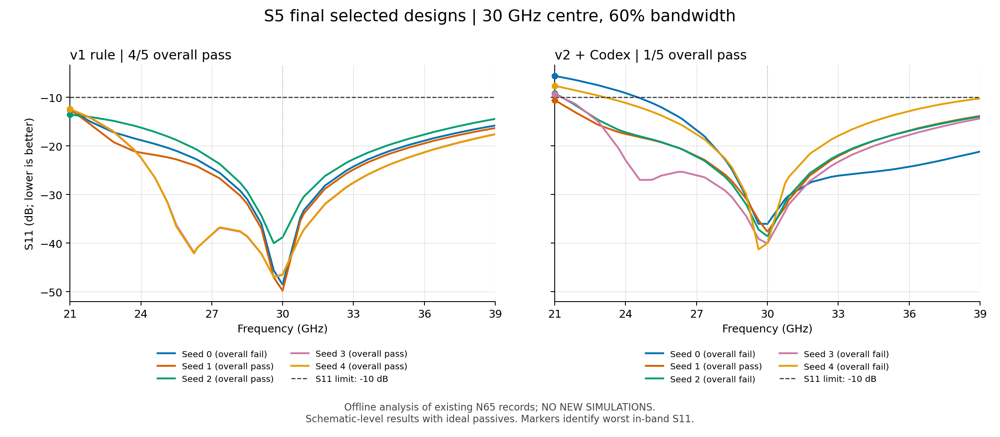

# S5 宽带匹配：离线诊断与独立回退策略实验

日期：2026-11-19。基准源码：`f198922b9d912d2498088d0a6f0218c1462df8e1`；工作分支：`work/s5-offline-diagnosis-20261119`。

## 1. 本轮完成的工作与边界

用户同意从 N65 S5 开始继续项目。本轮读取了已经提交的 v1 / v2 各五个 seed，重算最终 S11 曲线与行动轨迹，增加一个默认关闭的 Refiner 提示开关，并进行离线回归。

**发现的是一个值得受控试验的搜索策略差异，还没有得到新的 N65 通过结果。** 历史记录中 v2 经常在相同关键级匹配上重复 Stage 3；其少量 Stage 2 回退又全部改了 NF 裕量或关键级增益目标。v1 两个成功样例则通过保持目标不变、重新搜索匹配参数改善了 S11。这支持先试一次“保持目标的 S11 回退”，不支持宣称已经找到了唯一根因。

本轮真实 LLM 调用 **0**，新增 Spectre 调用 **0**。离线命令运行于当前 Linux 工作环境，未接入用户原 Mac、VM 或 N65 器件缓存。历史 Mac 位置仍以 [141](141_mac_locations_and_git_recovery_2026-11-19.md) 为准：项目 `/Users/jason/Documents/Open-RFAmpDesigner-Cadence`，VM `/Users/jason/Desktop/IC618_rf/IC618_rf.vmx`。这些是历史证据，不是本轮现场验收。

## 2. 数据范围和重算方法

主比较严格使用原始 1 h 等效预算批次，未把 2 h、prompt rev2、Spectre 锚点或其他工艺混入：

- v1：`results/repro/n65/n3/**/design_S5_seed*_mode1_rule_pdk_n65_smax60.json`。
- v2：`results/repro/v2_a3/n65/**/design_S5_seed*_mode1_codex-mcp_pdk_n65_v2_calls1000_smax60.json`。
- 两组都是 N65、原理图级 PDK 有源器件、理想无源网络；不是硅验证或整片寄生后仿。

可复算入口：

```bash
PYTHONPATH=src MPLBACKEND=Agg .venv/bin/python scripts/report/analyze_s5_matching.py \
  --out results/repro/s5_offline_2026-11-19
```

输出目录保存最终结果表、逐次评估表、动作计数、输入 SHA256 和绘图。分析仅使用电气汇总与动作字段，不复制本地 PDK 模型、器件表或凭据。S11 带内掩码沿用 `circuit.band_metrics` 的边界容差；S5 中心 30 GHz，目标频带 21–39 GHz。输出以原始数组重算，同时与已保存指标核对。

**日志口径：** 实际执行以 `trace` 事件为准，模型请求动作从每条 `llm_log.response` 的 `<tools>` JSON 重解析。旧版 `_record` 在嵌套 Manager→子 Agent 调用后更新共享日志的最后一条，可能使日志的 `tool/args/observation` 与该条 `role/response` 错配；不能直接按这个 `tool` 字段计数。400 字符的日志预览也不等于模型只收到 400 字符：实际 observation 上限是 3000 字符，最近六步保留完整的该摘要。

## 3. 最终结果：问题集中在低频带边

以下 S11 单位均为 dB；中心值来自保存指标，带内值由原始 sweep 校核。通过标准保持带内最差 S11 ≤ −10 dB。

| seed | v1 全部指标通过 | v1 中心 S11 | v1 带内最差 S11 | v2 全部指标通过 | v2 中心 S11 | v2 带内最差 S11 |
|---|---|---:|---:|---|---:|---:|
| 0 | 否 | −48.5569 | −12.5177 | 否 | −36.0284 | −5.5783 |
| 1 | 是 | −49.7827 | −12.4893 | 是 | −37.6510 | −10.5779 |
| 2 | 是 | −38.7936 | −13.5542 | 否 | −38.5898 | −9.1515 |
| 3 | 是 | −46.4336 | −12.4487 | 否 | −40.0744 | −9.3691 |
| 4 | 是 | −46.5452 | −12.3933 | 否 | −40.0275 | −7.6051 |

十个最终设计的最差带内 S11 都发生在 **21 GHz 低频边界**。v1 seed0 的失败来自纹波超出 0.1751 dB，其 S11 已通过。v2 四个失败分别存在 S11 违规 4.4217、0.8485、0.6309、2.3949 dB；seed0、3 还分别有 0.3147、0.0189 dB 纹波违规。



历史 4/5 对 1/5 是工程诊断线索。五 seed 样本不足以证明一般性优劣，也没有控制真实 LLM 的服务版本与非确定性；相关统计解释见 [139](139_experiment_report.md)。

## 4. 行动轨迹支持的解释

### 4.1 重复 Stage 3 对同一匹配候选的 S11 改善很有限

原 v2 五次运行中，同一 CID 的相邻完整链评估共 **112 对**，前一设计均有 S11 违规。单步 S11 绝对变化的中位数约 **0.0162 dB**，最大 **0.5706 dB**；没有一次由 S11 失败变为通过。

这说明在这些已有轨迹上，反复更改 MCR2/MCR3 通常不能消除当前关键级的宽带失配。它不证明 Stage 3 在所有电路上都不影响输入匹配：级间负载存在耦合，个别样例确实有较大的 S11 变化。

### 4.2 v2 已经回退过，但没有尝试保持两个目标不变的重搜

| seed | v2 Refiner Stage 2 调用数 | 与当前候选相比保持 NF 裕量及增益目标不变 |
|---|---:|---:|
| 0 | 3 | 0 |
| 1 | 3 | 0 |
| 2 | 3 | 0 |
| 3 | 3 | 0 |
| 4 | 0 | 0 |

12 次调用中，只有 **2 次**被 Stage 2 判为可行并成为当前候选，其余 10 次被拒绝。两次接受均降低了 NF headroom。唯一通过的 v2 seed1，也是在一次匹配更新后得到 C045，随后通过。因此不能把问题描述为“v2 不会回 Stage 2”。

相反，v1 有两段直接支持本轮假设的轨迹：

| v1 样例 | 匹配更新前 | 同目标 Stage 2 重搜后 | 后续结果 |
|---|---|---|---|
| seed3 | C007，S11 约 −8.679 dB | C023，约 −12.4325 dB | 再调整 Stage 3 纹波后通过 |
| seed4 | C007，约 −9.1719 dB | C016，约 −12.2173 dB | 再调整 Stage 3 纹波后通过 |

两次重搜均保留 NF headroom = 0.2 dB、关键级增益目标 = 17 dB。`DesignSession.tool_impedance_matching` 为新候选使用 `seed + len(candidates)`，所以保持目标不变仍会产生新的 PSO 采样。

不是所有 v1 成功都靠回退：seed1 最终换到另一个初始候选通过；seed2 的匹配原本已合格，只需 Stage 3 修纹波。已有 2 h 实验也包含多次 Stage 2 回退而仍失败；不能保证增加回退就提高成功率。

### 4.3 信息和提示中的具体差别

`tools.impedance_matching` 的优化目标在中心频率评估 NF/S11。完成 PSO 后虽有频带 sweep，Stage 2 给上层的 `Candidate.brief()` 只展示中心 `s11_cp_db`，没有带边 S11。Stage 4 则已经提供 `s11_fc_db`、`s11_max_inband_db` 和违规量，因此不能说 LLM 看不见宽带失败。

v1 规则在剩余 S11 违规时交替尝试 Stage 2 / Stage 3；v2 原 `refiner.md` 第 3 条把 gain、ripple、S11 一并指向 Stage 3。最差频点摘要以后可以补充，但现有 Stage 2 工具并无“指定频点优化”参数，本轮先不同时修改观察接口与优化目标。

### 4.4 另两项问题记录为独立后续工作

1. **日志元数据错配**：见 §2。分析器绕过错配字段，本轮不改执行或日志流程。
2. **较优失败候选可能未被上报**：v2 seed4 的 D028 只余 S11 违规 1.7735 dB；Refiner 显式返回了另一设计，Manager 最终选的 D037 余 2.3949 dB。`report_best` 并不覆盖模型显式指定的 `did`。没有因此漏掉已通过设计，但可能使最终失败指标变差；本轮不把“自动保存最佳”混入 S11 提示试验。

## 5. 实现：只开启一个独立 Refiner 策略

新增环境开关：`ORFADC_V2_S11_BACKTRACK=1`。缺省为 0，v1 与 v2 旧默认行为保留。

新增 `src/orfadc/repro/prompts/v2/refiner_s11_backtrack.md`，只附加给 Refiner，独立于 `ORFADC_V2_PROMPT_REV=2` 的 Manager 指导。实验固定 prompt rev1，不顺便叠加 rev2。

提示规则为：同一候选首次完整评估与一次 Stage 3 重评之后，如果 gain、NF、IP1dB、power 都通过但 S11 仍失败（允许同时有纹波违规），优先进行一次 **保持现有 NF headroom / gain requirement 的 Stage 2 重搜**。确认 `became_current`，再运行 Stage 3 和 Stage 4 验证。每个 Refiner 调用最多一次此类额外 S11 重搜，开始前至少留三个动作槽；后续 S11 搜索交回 Manager 判断。

这是对 LLM 的可选提示，未加入强制规则调度，也未改变电路、指标、PSO 目标、通过标准、预算或 Manager 候选选择。模型是否遵守、是否获得更好电路，都需要真实试验。这个开关测试一整条 S11 行动选择建议，不能再细分宣称时机和保持目标各自贡献了多少改善。

历史 v2 轨迹中，满足“两次相邻同 CID / 不同 DID 评估，四项主指标通过而 S11 失败”这一电气条件的有 19 对，覆盖全部五个 seed（3、6、1、3、6 对）。这只说明规则有相关样例；未检查当时剩余动作槽或每 Refiner 一次限制，不能把 19 当成新策略实际将发起的调用数。

可追溯性：

- 文件名带 `_v2_s11bt`，与历史结果分开。
- 结果顶层及 `run_settings` 增加 `s11_backtrack: true`。
- `agent_impl` 仍为 v2；这是 v2 的可选策略试验，未升为默认或发布新封版。

## 6. 离线验证

全部离线验证完成：

| 检查 | 结果 |
|---|---|
| 核心复现回归 | 14 passed，24.27 s |
| v2 专项回归 | 20 passed，30.42 s |
| S5 分析器解析测试 | 3 passed |
| 全量回归 | **147 passed**，90.08 s；2 条既有依赖警告 |
| 输入与分析保真 | 10 个原始文件 SHA256 已记录；224 条 Stage 4 评价；125 行动作计数；图已目视检查 |

全量日志：`results/runs/takeover_20261119/s5_checks/pytest_full.log`。汇总与源码哈希：`results/repro/s5_offline_2026-11-19/verification.json`。两条警告来自 anyio 的 pytest 兼容层与 pydantic_settings 的未解析类型注解，未造成测试失败。

```bash
PYTHONPATH=src MPLBACKEND=Agg .venv/bin/python -m pytest tests/test_repro_core.py -q
PYTHONPATH=src MPLBACKEND=Agg .venv/bin/python -m pytest tests/test_repro_agents_v2.py -q
PYTHONPATH=src MPLBACKEND=Agg .venv/bin/python -m pytest tests -q
```

新增测试检查：开关关闭不追加提示；开启只影响 Refiner，不自动启用 Manager rev2；v1 命名不变；新变体有独立文件名和 JSON 标记；scripted S2 的设计、指标、动作数量、仿真记账与原默认一致。后者证明提示试验没有偷偷改变数值工具或 scripted oracle，**不证明真实 LLM 的性能提高**。分析器另检验带内掩码和日志动作重解析等实际提取风险。

## 7. 下一次真实试验的具体入口

准备好的队列：`scripts/jobs/queue_n65_s5_s11_backtrack_seed0.txt`。当前未执行。

```bash
scripts/run_job_queue.sh jobs/queue_n65_s5_s11_backtrack_seed0.txt
```

在原 Mac / IC618_rf 环境恢复并验收后，只运行 S5 seed0、mode1、v2 + codex-mcp + N65，使用上述独立提示。队列固定 1 h 等效 EDA 预算、最多 **60 次 Spectre / 1000 次 LLM**，关闭 Spectre 锚点、PDK spiral、Stage2 backoff，Q_MATCH=25、Q_IND=15。历史同批单 seed 用了 24–36 次 Spectre；新策略用量可能不同，60 是上限而非预计必然消耗。

`--backend pdk` 使用当前本地配置和器件表，不会因队列文件名含 n65 就强制选择 N65。派发前必须确认配置与缓存属于原 N65 环境，结果还应核对 `labels.pdk == "crn65lp"`；仅有该标签也不能替代缓存身份检查。

这是新批次的试验包络，不能从已封版的 3144/3300 历史账本自动扣用“剩余 156 次”。需单独记录实际用量、运行设置、源版本和当前实际 LLM 模型。当前队列不替用户挑选一个未经核实的模型 ID；应使用本机可用且明确记录的 `ORFADC_CODEX_MODEL`，防止 CLI 默认模型变化造成额外混杂。

试运行检查三件事：是否更早尝试同目标 Stage 2 重搜、重搜是否被接受并完整评估、带内 S11 与其他指标是否改善。只执行一个 seed 不能评价通过率。若看到值得继续的行为与电气证据，再在相同模型、预算和后端条件下做五 seed 对照；不把历史 seed0 与当下单次结果当成严格配对的因果试验。

队列脚本遇到失败会写各命令退出码后继续，`DONE.txt` 只代表队列结束；验收应读取设计 JSON、`terminated_reason`、真实调用数和日志。连接中断或结果未知时先查远端状态，不自动重派。

## 8. 带回原 Mac 仓库

补丁 `results/repro/s5_offline_2026-11-19/takeover_and_s5_20261119.patch` 汇集了接手文档、Mac 定位恢复脚本、本轮 S5 代码及测试、诊断表图与待执行队列。它以以上基准 HEAD 为基础，不含本地私密配置、PDK 数据库或虚拟机，不会自动执行远程任务。

在原 Mac 项目目录先做 `git apply --check <补丁路径>`，检查通过后再 `git apply <补丁路径>`。若已有同名改动或版本差异，检查会提示冲突，应保留现场改动后合并，不使用强制覆盖。这里只是在本轮交付中准备补丁，未声称已把它写入用户 Mac。

11 月 24 日归档补注：上述补丁路径属于交接时的工作副本，原补丁随交接 ZIP 保存。本仓库收录应用后的源文件，原 Mac 的接通结果见[143 号环境验收](143_environment_run_2026-11-23.md)。
