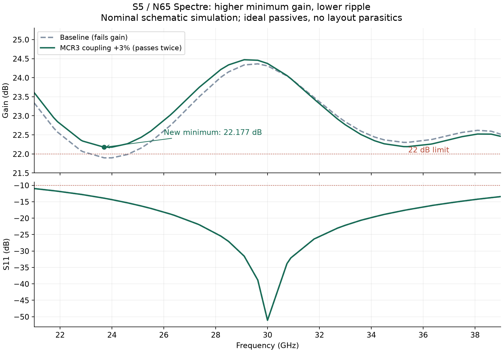

# S5 面向通过的实测与学习日志（2026-11-23）

## 范围

接 docs/144 的工作流改进，用户要求实际运行，以全部指标通过为目标，同时学习过程。
只做 S5 seed0，不扩展到多 seed、PDK 表征或版图。判据保持 `tools.spec_check` 原样。
真实 N65 验证采用 PDK 晶体管、理想无源、无版图寄生；不是流片测量。

## 现场与预算

- 原 Mac 仓库：`/Users/jason/Documents/Open-RFAmpDesigner-Cadence`。
- VMware Fusion：`IC618_rf.vmx` 运行中，IP `〈本机动态地址〉`，SSH 用户 IC，Spectre 可用；派发前确认本机无遗留设计进程、VM 无 spectre/ocean 任务。
- N65：`crn65lp`；缓存仍为 `20261007T011014_fit`（1.2 V）和 `20261007T011207_fit`（0.6 V），沿用原 Y3。
- 继承首批预算：此前 S2=3、S5=16，共19/63次 Spectre，剩余44次。此前真实设计 LLM=87/1000，剩余913次。
- 本次自主设计限1800秒（动作边界退出），Spectre最多44次，LLM最多913次，等效EDA仍为3600秒。
- 固定真实模型 `gpt-6.2-sol`；运行中未切换。角色共用该模型，思考强度由已有CLI配置决定，此轮未额外设置。

## 可复现入口

`scripts/run_s5_live.py` 调用原 `bench design`，只增加实时事件日志，不改变智能体工具或决策。启用 `ORFADC_V2_S5_WORKFLOW=1` 与 `ORFADC_V2_S11_BACKTRACK=1`。

```bash
cd /Users/jason/Documents/Open-RFAmpDesigner-Cadence
ORFADC_V2_S5_WORKFLOW=1 ORFADC_V2_S11_BACKTRACK=1 \
ORFADC_V2_PROMPT_REV=1 ORFADC_V2_WALL_SECONDS=1800 \
ORFADC_LLM_MAX_CALLS=913 ORFADC_SPECTRE_MAX_PER_DESIGN=44 \
ORFADC_BUDGET_SCALE=1 ORFADC_REPORT_BEST=1 \
ORFADC_SPECTRE_ANCHORS=0 ORFADC_PDK_SPIRAL=0 ORFADC_STAGE2_BACKOFF=0 \
ORFADC_Q_MATCH=25 ORFADC_Q_IND=15 ORFADC_PARALLEL=0 \
ORFADC_CODEX_BIN='/Applications/ChatGPT.app/Contents/Resources/codex-cli/CodexCLI.app/Contents/MacOS/codex' \
ORFADC_CODEX_MODEL=gpt-6.2-sol MPLCONFIGDIR=/tmp/orfadc-mpl PYTHONPATH=src \
.venv/bin/python -u scripts/run_s5_live.py --out results/windows_checks/<新的唯一目录>
```

这里只记录本次启动参数。再次运行必须扣除本次已经消耗的额度，不能原样重置44/913；也应先查是否仍有任务。脚本拒绝复用已有实时日志目录。

第一次启动受本机沙箱权限影响：CLI状态数据库只读，3次失败、0次模型成功响应、0次Spectre。通过所需系统权限后启动新目录，保留原认证和CLI的只读工具沙箱。

## 学习日志摘录（均为本轮真实结果）

| 时刻 | 事件 | 观察与理解 |
|---|---|---|
| 23:13:55 | Manager开始 | 总控调用Searcher，随后根据候选结果选择Refiner；三个名字是代码角色，不是三个独立安装的软件 |
| 23:15:48 | 第一轮Searcher结束 | 形成C000–C004；这是缓存模型筛选，尚不代表整机Spectre通过 |
| 23:16:29 | D005首次完整仿真 | 最低增益23.9450已过，但纹波10.9727、S11 −4.8853未过 |
| 23:16:58 | D006重新规划后级 | 纹波降为7.8547，S11仍−4.8855；改善增益形状不等于修好输入匹配 |
| 23:17:13 | Refiner回到Stage 2 | 新C007被筛选拒绝；保持旧候选，没有把未接受的匹配当成改善 |
| 23:17:28 | 交回Manager | 保留较好的D006，明确仍未通过，进入新搜索 |
| 23:22:28 | D016试错 | 相比D015，纹波7.8048→7.1254，却使最低增益21.6026→19.8929，说明不能只压低增益来改善纹波 |
| 23:28:01 | D025 | 中心S11约−57 dB，但21 GHz只有−8.5219 dB；中心很漂亮仍不能代表全带通过 |
| 23:28:34 | D026 | 最低增益16.1860→18.9424，峰值升到30.0740，纹波5.4806→11.1316；抬高谷底时峰值涨得更多，纹波反而变差 |

全带验收检查频率网格内的最差点；NF使用本项目定义的中心NF。加密频率网格、PVT、寄生与稳定性等额外验证，不在本轮原判据之内。

## 定向微调的后备路径

在等待自主任务时，离线分析历史近通过方案D017/C014，扫描MCR2或MCR3的耦合系数±3%、±6%。这是助理在外部进行的敏感性分析，不是本轮Manager/Searcher/Refiner自主选择的动作。

缓存模型预测：MCR3耦合系数+3%时，最低增益22.0592→22.2451 dB、纹波2.3354→2.2734 dB。原始缓存预测已与历史Spectre有差异，因此不能凭这一步宣布通过。

`scripts/verify_s5_local_refinement.py` 实现有界验证：先用Spectre复现历史原设计，关键指标漂移>0.05就停止；随后最多试3个小改动。任何通过设计必须再做一次相同配置的独立Spectre调用确认。总上限6次，所有调用统一计账；不会在远程状态不明时自动重派。

离线干跑证据：`results/runs/s5_workflow_20261123/local_refinement_dryrun/summary.json`。标签为缓存两端口预测，不是新Spectre证据；脚本不会为它生成 `VERIFIED_PASS.txt`。

## 模型选择

当前官方建议Sol用于多数Codex任务，Astra用于复杂工程分析。此项目建议日常代码/日志使用Sol，困难的设计诊断使用Astra，先从中等思考强度开始；这是选型建议，尚无S5受控模型对比证据。选择聊天界面模型不会改变已经启动的外部CLI进程。

来源：[OpenAI模型选择指南](https://developers.openai.com/api/docs/guides/model-selection)。更强的模型不能取代Spectre，模型评估应比较固定预算下的通过率、总墙钟与真实仿真次数。

## 最终结果

**已得到按现有验收口径全指标通过的S5设计，并以第二次独立Spectre调用确认。自主三智能体搜索本次没有通过；通过来自历史最佳方案的助理定向微调。**

### 自主 v2 + 新S5工作流

- 23:13:55–23:44:10，设计墙钟1815.301秒，1800秒限额在最后一条LLM回复返回后安全退出；该迟到动作没有执行。
- `success=false`，`terminated_reason=wall_time_budget`。
- 97次成功设计LLM（Manager14、Searcher30、Refiner53），1次300秒超时后重试恢复；0非法动作，0规则替代，0内部routing重试。
- 成功调用累计延迟1429.058秒；输入2,176,103 token，其中缓存1,655,936；输出17,199 token。超时300秒单独记录，不包含在成功延迟里。
- 22次Spectre，全部原始记录 `status=ok`。
- 按已有违规评分保留D025/C024：最低增益16.1860、纹波5.4806、全带S11 −8.5219，三项未过；中心NF4.5571、IP1dB −16.5781、电流24.8469通过。评分最优不代表各项指标分别最优。
- 结论：诊断、真实工具调用、保留结果与限时机制跑通；没有证据表明新提示提高了自主成功率。历史近通过设计没有被mode1自动继承，这正是后续应补的能力。

原始文件：

`results/windows_checks/s5_workflow_verified_20261123_retry/design_S5_seed0_mode1_codex-mcp_pdk_n65_v2_s11bt_s5wf1_calls913_smax44.json`

实时教学日志：同目录 `live.jsonl`。Spectre原始目录：`results/runs/repro_cadence_pdk/20261123T231354_11dc0f/`。
权限失败的首次启动另留在 `results/windows_checks/s5_workflow_verified_20261123/`，不与有效运行混记。

### 定向微调：3次真实Spectre，8.772秒

23:44:33开始，确认自主任务已退出、VM无遗留spectre/ocean任务后执行。只用了预留6次中的3次：

1. 原方案重跑：仍差0.1024136 dB最低增益，与历史完全一致到保存精度；关键指标与四位小数历史报告的最大偏差为0.0000423。
2. MCR3的耦合系数 `k` 从0.3310778241增加3%至0.3410101588：所有违规为0。
3. 完全相同的修改方案再启动一次独立Spectre：再次全部通过，指标一致。该重复不是缓存复用，也不是第二个seed或PVT试验。

已逐项比较设计字典，**唯一变化是 `.mcr3.k`**；器件尺寸、偏置、输入匹配、其他无源参数和负载没有变化。

| 指标 | 原方案复测 | 修改后两次一致 | 原判据 | 结果 |
|---|---:|---:|---|---|
| 全带最低增益 | 21.8976 dB | **22.1767 dB** | 22–28 dB | 通过 |
| 全带纹波 | 2.4654 dB | **2.2940 dB** | ≤3 dB | 通过 |
| 全带最差S11 | −10.9956 dB | −10.9956 dB | ≤−10 dB | 通过 |
| 中心NF | 4.9131 dB | 4.9119 dB | ≤5 dB | 通过 |
| IP1dB | −16.7318 dBm | −16.6933 dBm | ≥−25 dBm | 通过 |
| 电流 | 25.7217 mA | 25.7217 mA | ≤30.03 mA | 通过 |

最低增益提高0.2791 dB，峰值仅提高0.1078 dB，所以纹波减小0.1714 dB。这不是把曲线整体平移：约24 GHz的谷底被抬高，部分高频增益反而略降。耦合变化影响网络传输与负载，是本次单变量实测结果，不能推广成“增大k一定更好”。

最大带内NF仍约6.6968 dB；它不满足“整个频带NF都≤5 dB”这一更严格条件，但本项目既有判据使用30 GHz中心NF。没有改变这个口径。

**复现证据：**

- 完整设计、曲线与指标：`results/runs/s5_workflow_20261123/local_refinement_pdk/summary.json`。
- 基线一致性：同目录 `baseline_drift.json`。
- 通过确认：同目录 `VERIFIED_PASS.txt`。
- 三次真实原始数据：`results/runs/repro_cadence_pdk/20261123T234433_a41be2/sim00001`、`sim00002`、`sim00003`；分别为原方案、修改方案、重复确认，均 `status=ok`。

运行命令（每次使用新的输出目录）：

```bash
ORFADC_Q_MATCH=25 ORFADC_Q_IND=15 ORFADC_SPECTRE_ANCHORS=0 ORFADC_PDK_SPIRAL=0 \
PYTHONPATH=src MPLCONFIGDIR=/tmp/orfadc-mpl \
.venv/bin/python -u scripts/verify_s5_local_refinement.py \
  --source results/windows_checks/20261123T143737_job/design_S5_seed0_mode1_codex-mcp_pdk_n65_v2_s11bt_calls1000_smax60.json \
  --out results/runs/s5_workflow_20261123/<新的唯一目录> --backend pdk --max-spectre 6
```

先查远端任务与剩余预算，再运行。当前可复现；不需要重新登录或重新表征PDK。

### 累计账本与结论边界

| 项目 | 本轮新增 | 本次接管批次累计 |
|---|---:|---:|
| S2 Spectre | 0 | 3/3 |
| S5 Spectre | 22+3=25 | 16+25=41/60 |
| Spectre总量 | 25 | **44/63，剩19** |
| 成功设计LLM | 97 | **184/1000** |
| 新LLM连通检查 | 0 | 此前2次，另计 |
| 本轮失败请求 | 权限3次、超时1次 | 另计；此前7次失败仍保留原账 |

本轮未重新跑全量测试：核心源代码未改，上一轮156项通过仍为该版回归证据；新增运行脚本经过离线干跑与本轮真实运行验证。`git diff --check`通过，未提交或推送代码。

已跑通：Mac→真实LLM→三角色工具链→N65 Spectre；定向修改后现有六项判据均通过并复跑确认。运行但未通过：本轮从零开始的自主S5搜索。当前无环境阻塞。

通过只证明标称原理图级、现有频率网格与判据成立；最低增益裕量0.1767 dB、中心NF裕量0.0881 dB，尚未证明PVT、寄生或硅上的稳健性。

下一步建议优先将“载入已有最佳设计→单变量小幅微调→完整仿真→确认”的动作接入Refiner，保存成功设计供复用。模型对照再以相同起点与预算比较Sol/Astra，不把本次定向成功当成新模型成功率证据。本轮已达成单设计验证目标，停止额外仿真。


