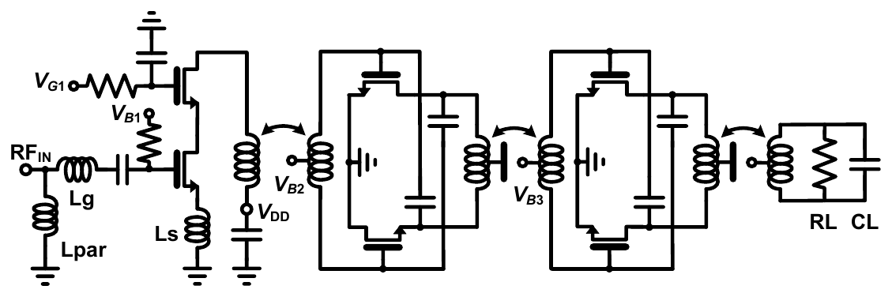
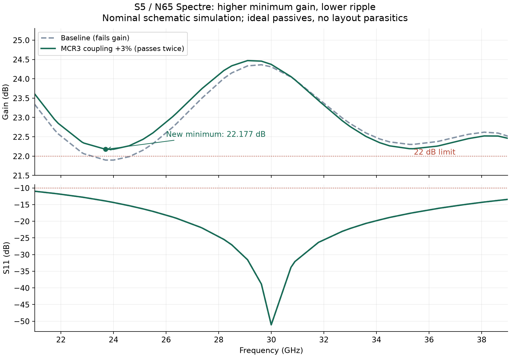
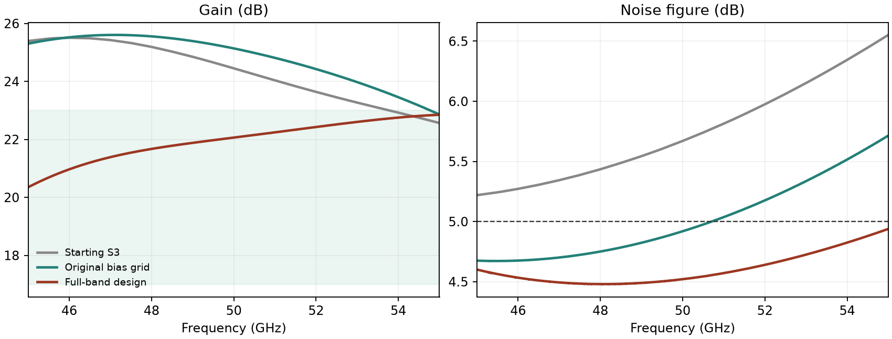
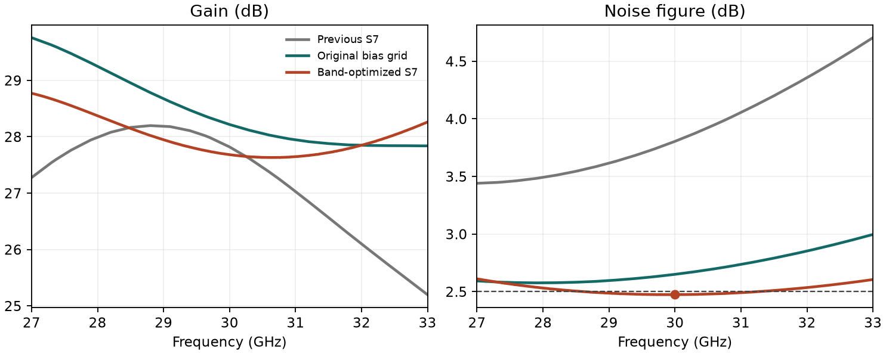
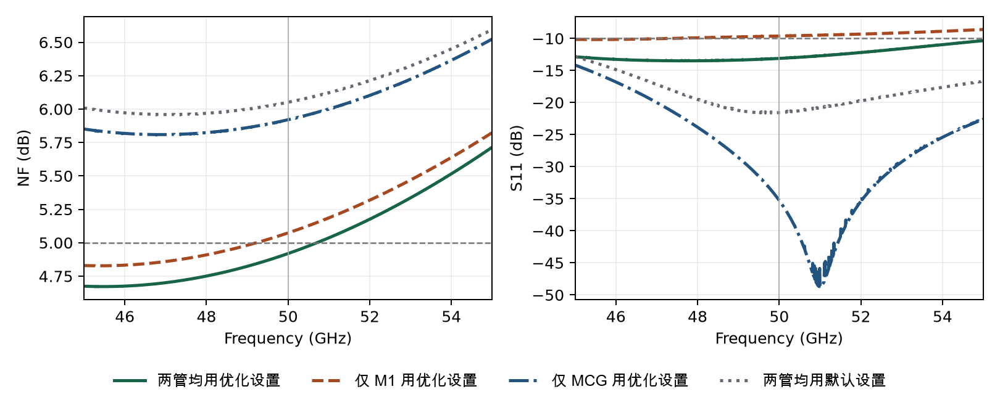
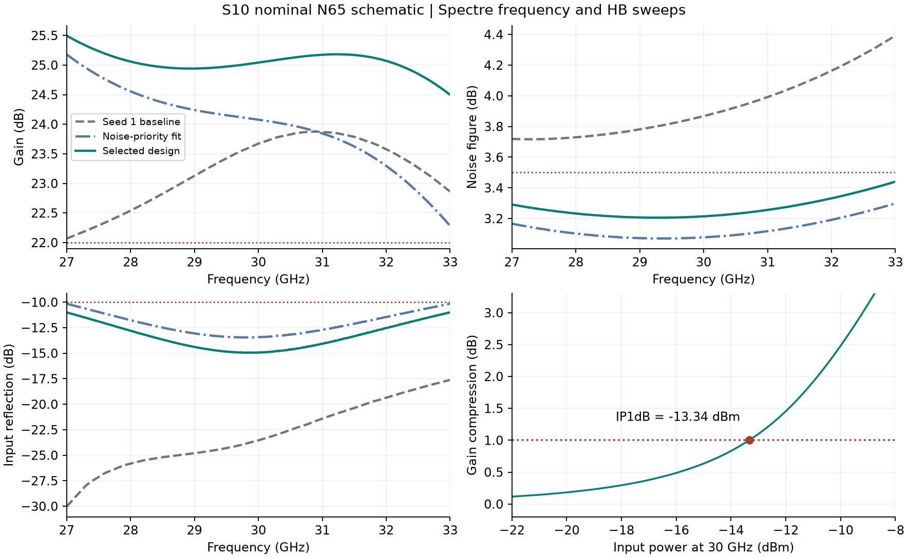
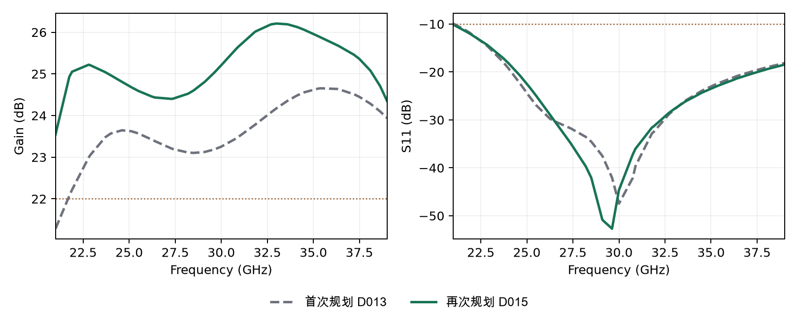

# N65 宽带低噪声放大器自动设计复现实验总报告

## 摘要

RFAmpDesigner 将三级宽带低噪声放大器（LNA）的设计分为器件选型、阻抗匹配、频带规划和整机验收。本项目用同一套 N65 晶体管模型比较两种决策策略：规则策略 v1 在八个规格、每项五个种子的首次设计中通过 24/40，大语言模型（LLM）驱动的三智能体 v2 通过 21/40。差额集中在 S5 的宽带输入匹配。对失败候选做定向诊断后，S1–S8 各有一个通过项目六项判据的标称原理图方案。其中四个方案在全部已测频点也满足各自的噪声限值。S10 通过同频段首级复用和增益整形，补齐了标称难例。限时从零试验另取得一份 S5 自主通过并独立重放的电路。多种子基线用于估计自主搜索能力，各规格所选电路用于判断标称可行性。

## 1　电路拓扑与设计方法

图 1 给出复现采用的拓扑。第一级为带源极退化电感的单端共源共栅级。输入端的 L 型网络和退化电感共同参与输入匹配，第一个磁耦合谐振器（MCR1）将信号转换为差分形式。第二、三级为带中和电容的差分共源级，经磁耦合网络驱动 1,787 Ω 与 62 fF 的并联负载。这一结构提供了两类调节手段：改变首级偏置与器件几何可以影响噪声和电流，改变级间耦合则可以重新分配带内增益。

**从电路参数到智能体决策。** Manager 决定继续搜索还是细化已有设计；Searcher 分配各级电流、选择器件并优化关键级匹配；Refiner 调整后级频带响应，必要时退回输入匹配。知识库提供器件表征，经验库保留相近任务的设计信息。快速两端口模型用于筛选改动方向，候选最终由 Cadence Spectre 完成整机验收。保存完整参数后可以重建候选，核对同一电路的重复运行结果。

## 2　仿真口径与自主基线

**原理图工况与读数。** 采用 N65 标称工艺、原三级拓扑和相同负载。主实验中匹配电感 Q 取 25，MCR 电感 Q 取 15。用小信号扫频提取增益、输入反射 S11 和噪声系数 NF，用直流工作点读取电流，用中心频率的谐波平衡（HB）输入功率扫描读取 1 dB 压缩点 IP1dB。压缩点取增益相对小信号值下降 1 dB 时的输入功率。快速模型先经 S2 宏模型三次 Spectre 交叉核对，N65 候选再交由完整晶体管电路验收。

**判据。** 带内最低增益须落在目标值 ±3 dB 内，纹波为带内最高与最低增益之差，须 ≤3 dB，带内最差 S11 须 ≤−10 dB。中心 NF、IP1dB 及电流按各案门槛判定。另将同一 NF 上限施加到带内每个采样频点，以检查中心验收会遗漏哪些带边问题。原论文在版图后仿真中报告 S1–S8 首次通过 32/40；本项目采用原理图和固定 Q 无源模型，带内 S11 也是项目增加的明确约束。

**基线解释。** 两种策略在 S1、S2、S4、S8 均通过 5/5，在 S3、S6、S7 均为 0/5。S5 为 v1 的 4/5 对 v2 的 1/5。整体比较的 Fisher 检验 p = 0.65，样本不足以判定总体优劣。比总分更有诊断价值的是失败位置：v2 的四次 S5 失败均有输入匹配超限，加倍等效设计时间后仍为 1/5。S7 换用所试 PDK 螺旋电感后也仍为 0/5。将部分校准点改由 Spectre 计算的五组对照中，四组保持原判，v2 的一个原通过设计两次重跑均失败；搜索路径的波动限制了对校准方式的归因。

**难例与记忆对照。** 代理模型上的缩放规格 S9s/S10s，v2 通过 6/10、v1 规则策略为 0/10。换回 N65 原规格，两种策略的 S9 均为 4/5，S10 均为 0/5，v2 扩至九个种子仍为 0/9。原五个种子合计的 Spectre 调用从 401 减到 141，减少主要来自仍未通过的 S10。代理模型连续增益任务中，带记忆的 v2 完成 18/18，遗传算法完成 14/18，平均累计等效时间分别为 1,292 和 11,620 秒。算法和记忆同时变化，该对照无法单独估计记忆的收益。

定向实验从同工艺的 seed0 存量设计出发。S3、S7 因 v2 缺少完整起点，使用 v1 候选。以下分别考察输入匹配回退、首级噪声归因和带边余量，以相同的六项判据复测。

## 3　宽带匹配与增益整形

### S5　同一候选的两种耦合调整

在真实 LLM 回退试验中，Refiner 根据带边 S11 违规返回输入匹配步骤，使最差 S11 回到 −10.996 dB。此时电流为 25.72 mA，剩余违规集中在增益谷底：21.8976 dB，比 22 dB 下限低 0.1024 dB。另一轮限时自主搜索仍未通过。为检验是否能保住输入匹配并抬升谷底，定向试验固定有源器件与偏置，每次只改变一个磁耦合系数。

工程分析选用 MCR3 耦合增加 3%，最低增益由 21.90 升至 22.18 dB，纹波由 2.47 降至 2.29 dB，独立复测通过。局部 Refiner 从同一起点、在预设候选中选择 MCR2 耦合降低 3%，同样通过。后一改动使谷底提高 0.287 dB，峰值提高 0.610 dB，因此纹波增至 2.788 dB。若只要求六项通过，两种调整都成立；若还希望压低纹波，图 2 的调整更合适。这两个结果分别来自工程定向选择和模型的局部选择，自主流程从零找到解的能力仍须单独测量。

### S6　联合拟合输入匹配与带内增益

S6 的工作带宽为 18–42 GHz。局部调整需同时约束两端的增益、反射和中心噪声。用完整电路仿真校准匹配模型并联合拟合后，复测最低增益 17.085 dB、纹波 2.827 dB、最差 S11 为 −10.312 dB。三项距各自门槛仅 0.085、0.173、0.312 dB。中心 NF 为 4.691 dB，而带内最差为 7.338 dB，因此需要在总表中保留两种噪声判定。

## 4　首级噪声与带边验证

### S3　从噪声贡献定位首级，再复调匹配

固定有源器件、只调无源匹配时，50 GHz 中心 NF 仍约 5.67 dB。对复测起点做单频噪声分析，按实例归并输出噪声功率并扣除输入、输出端口，共栅管 MCG 与输入管 M1 分别占电路新增噪声的 42.0% 和 34.8%。因此改动优先落在这两管的分指几何和宽度，再调整匹配以恢复增益与反射。原偏置网格内，0.675 V 方案已满足六项，中心 NF 为 4.919 dB，但 55 GHz 处升至 5.715 dB。

扩展首级偏置后，红线在 1,001 个采样点上的增益为 20.350–22.851 dB，最差 NF 为 4.939 dB，距限值仅 0.061 dB。原判据约束的是最低增益，图 3 的阴影则对每个频点都施加 17–23 dB 约束。中心频率 HB 在压缩点附近采用 0.25 dB 输入功率步长，IP1dB 为 −19.568 dBm，较 −20 dBm 下限高 0.432 dB。

### S7　中心噪声达标后，带边仍决定宽带结论

原偏置网格内，在其余五项通过的候选中，最低中心 NF 为 2.6505 dB。扩展至 0.775 V 后，以带内最差 NF 为目标选取方案，并从完整电路的 DC 工作点读得 25.135 mA。其最差 S11 为 −10.080 dB，细步长 HB 得到 IP1dB 为 −24.727 dBm，分别仅余 0.080 dB 和 0.273 dB。改变噪声目标时仍须同时检查这两项。

## 5　首级两管的几何对照

S3 的噪声归因给出了首级两管的贡献，但贡献比例无法直接预测某项修改能改善多少。本实验从第 4 节中原偏置 0.675 V 的通过电路出发，固定各级偏置、器件请求宽度、退化电感和全部匹配网络。分别让输入管 M1 和共栅管 MCG 使用候选的分指设置或工具默认设置，组合成四个电路。四次完整 Spectre 均扫过 45–55 GHz 的 1,001 个频点，中心频率另做细步长 HB。

表 1　几何设置与 S3 的整机表现。NF 取 50 GHz，S11 取全带最差值，均为 dB。

| M1 | MCG | 中心 NF | 最差 S11 | 六项中超限的指标 |
|---|---|---:|---:|---|
| 优化 | 优化 | 4.919 | −10.348 | 全部通过 |
| 优化 | 默认 | 5.074 | −8.613 | NF、S11、最低增益 |
| 默认 | 优化 | 5.920 | −14.163 | NF |
| 默认 | 默认 | 6.051 | −12.830 | NF |

在 MCG 用优化设置时，调整 M1 使中心 NF 从 5.920 降至 4.919 dB，同时使输入匹配余量缩小。保留优化 M1，再调整 MCG，能把最差 S11 从 −8.613 降到 −10.348 dB。两管优化组合准确重放了原偏置归档结果，但 55 GHz 的 NF 仍为 5.715 dB。该对照说明了为什么需要同时验收噪声和输入匹配。

工具同时改变了单指宽度和允许的指数量。取整后，M1 的实现总宽从默认的 52 变为 54 μm，MCG 从 44 变为 42.5 μm。表中差值包含这些变化及其与原有匹配网络的相互作用，仅适用于所测工作点。自主工具目前可以分配电流和重新匹配，缺少逐管选择分指几何的动作。

## 6　S10 的噪声余量与增益整形

S10 要求 27–33 GHz 最低增益落在 22–28 dB、纹波 ≤3 dB、中心 NF ≤3.5 dB，同时要求 IP1dB ≥−15 dBm。历史 v2 从零设计为 0/9。重放已有 seed1，其余五项已过，中心 NF 为 3.867 dB。保留原器件并重调匹配，可将中心 NF 降至 3.489 dB，但带边仍达 4.034 dB。

同频段 S7 提供了可试的低噪声首级。复用该级和相邻匹配网络、保留 S10 后两级，再用完整工作点重新提取两端口并拟合匹配，得到全带噪声通过的电路。该方案最低增益仅 22.284 dB，纹波为 2.897 dB。进一步提高拟合中的增益谷底目标、收紧纹波后，最低增益提高 2.214 dB，纹波下降 1.898 dB；代价是最差 NF 增加 0.142 dB。

从保存参数重建，在 601 个频点上得到 24.498–25.496 dB 增益、0.999 dB 纹波和 −11.000 dB 最差 S11。中心 NF 为 3.215 dB，33 GHz 最差 NF 为 3.440 dB，距限值仅 0.060 dB。IP1dB 为 −13.340 dBm，直流电流为 18.549 mA。两次加密仿真的曲线和指标逐项一致。该结果支持原偏置网格内的标称可行性。

## 7　从零设计的决策与验收

只给规格、不给已通过的电路，考察智能体在固定时间内能走到哪一步。S3 与 S5 各设两组，均用 seed 17、同一模型和 N65 工具，不载入历史设计。S3 修订 Manager 的候选细化和搜索提示；S5 单独切换 Refiner 的输入匹配回退提示。并行运行共享模型服务和虚拟机，每组主动决策窗口为 16 分钟。每种设置仅观察一次；相同种子约束数值搜索，模型输出仍可能不同。

表 2　四组从零运行。搜索与细化计子智能体调用，Spectre 计实际整机仿真。

| 组别 | 搜索 | 细化 | LLM | Spectre | 六项验收 |
|---|---:|---:|---:|---:|---|
| S3 原策略 | 8 | 1 | 69 | 0 | 无整机读数 |
| S3 修订 | 3 | 1 | 24 | 0 | 无整机读数 |
| S5 原策略 | 2 | 3 | 64 | 14 | 已测未过 |
| S5 回退提示 | 1 | 1 | 22 | 2 | 通过 |

S3 原策略搜索八次，到第 950 秒才进入细化。S3 修订组前两次搜索交回空队列，第三次才交出候选。Manager 在约第 330 秒调用 Refiner，后者判断关键级 NF 偏高，未做整机验收就结束。事后重建该候选并按默认目标补测，中心 NF 为 9.394 dB，最低增益为 11.960 dB。这个频带规划确实未过。S5 原策略返回方案的中心 NF 已达标，实际超限的是纹波与带内 S11，保存的瓶颈标签却写作 NF。

S5 首次整机评估的最低增益为 21.283 dB、纹波 3.371 dB、最差 S11 为 −9.895 dB。Refiner 随后试过一次输入匹配，新候选未获接纳。保留原输入候选，改用 25.7 dB 的整机增益目标并为第二级指定 5 dB 后，三项均通过。第一次评估已有多项违规，第二次通过前没有出现专项回退所需的连续两次 S11 违规。实际通过路径是保留输入候选后重新规划后级。

独立重建先重现原网格指标，再以 10 MHz 步长复验 21–39 GHz。1,801 点的最低增益为 23.546 dB、纹波 2.665 dB、最差 S11 为 −10.118 dB，细步长 HB 得到 IP1dB −20.383 dBm，电流 25.756 mA。中心 NF 为 4.656 dB，最差 NF 为 6.839 dB，额外的全带 5 dB 要求仍超限。

## 8　逐规格结果与结论

表 3 的 v1、v2 列分别统计每个规格五个种子的首次设计。右侧各选一个经 N65 Spectre 验收的定向方案。S5 取逐规格验证批次的候选，图 2 单列的是其前一轮受控微调试验。NF 单位为 dB，验收使用未舍入数据。

表 3　自主基线与所选标称方案的验收结果

| 规格 | v1 首次 | v2 首次 | 定向六项 | 中心 NF | 最差 NF | 全带 NF / 限值 |
| --- | ---: | ---: | --- | ---: | ---: | --- |
| S1 | 5/5 | 5/5 | 通过 | 3.831 | 4.457 | 通过 / 5 |
| S2 | 5/5 | 5/5 | 通过 | 4.814 | 5.479 | 超限 / 5 |
| S3 | 0/5 | 0/5 | 通过 | 4.521 | 4.939 | 通过 / 5 |
| S4 | 5/5 | 5/5 | 通过 | 4.461 | 4.687 | 通过 / 5 |
| S5 | 4/5 | 1/5 | 通过 | 4.905 | 6.642 | 超限 / 5 |
| S6 | 0/5 | 0/5 | 通过 | 4.691 | 7.338 | 超限 / 5 |
| S7 | 0/5 | 0/5 | 通过 | 2.474 | 2.611 | 超限 / 2.5 |
| S8 | 5/5 | 5/5 | 通过 | 3.961 | 4.614 | 通过 / 5 |

**对电路可行性的判断。** S1–S8 各有一个通过六项判据的标称方案。若要求各自全部已测频点均满足 NF 限值，则 S1、S3、S4、S8 通过，S2、S5、S6、S7 超限。不同案例的采样密度不同。S3 在原偏置范围内即可通过六项，进一步满足全带要求使用了扩展偏置；S7 的六项通过也依赖扩展偏置。S9 的历史 v2 seed4 通过六项，带内最差 NF 为 4.806 dB。S10 的定向方案同样通过。综合 S1–S10 的所选标称电路，十个规格均有六项通过记录，其中六个也满足各自的全带采样噪声限值。

**对自动设计能力的判断。** 规则基线和智能体基线可以按 24/40 与 21/40 比较。定向优化使用了既有解、噪声贡献分析及人为限定的候选范围，8/8 衡量可行方案的规格覆盖数。验证改进后的自主性，需要固定工具、预算和工作点范围，通过预设的多个种子比较有无回退策略的首次通过率。

**证据边界。** 基线阶段账本累计 3,144 次 Spectre，截至 S3/S7 全带复测的接管与定向验证账本累计 625 次，后者含宏模型、完整电路、分级提取和参数扫描。S5 回退至局部续调批次累计 185 次成功设计 LLM 调用，连通检查和失败请求另计。S10 的独立批次另计 30 次 Spectre。S3、S7、S10 的数值优化均无项目设计 LLM 调用。限时从零试验与复核的调用数见第 7 节和工作日志。若推进到工艺角、温度和版图寄生验证，应优先复核 S3 的高频带边，以及 S7 的低频噪声、输入匹配和压缩余量。

## 参考与数据索引

[原论文及图 3](../references/paper/RFAmpDesigner.pdf) · [多种子基线报告](139_experiment_report.md) · [逐次设计记录](../results/report/runs.csv) · [证据复核](153_october_report_evidence_review.md)

[环境与宏模型验收](143_environment_run_2026-11-23.md) · [S5 定向试验](145_s5_verified_run_2026-11-23.md) · [局部 Refiner](146_s5_resume_refiner.md) · [逐规格验收](148_s1_s8_spectre_results.md)

[S3 噪声贡献](150_s3_noise_contributions.md) · [S3 全带复测](152_s3_fullband_20261124.md) · [S7 偏置对照](151_s7_noise_20261124.md) · [八案指标与运行号](../results/report/2026-11/s1_s8_nominal.json)

[S10 设计过程与两次复测](155_s10_n65_optimization.md) · [限时对照工作日志与逐组数据](156_cold_start_pilot.md)
