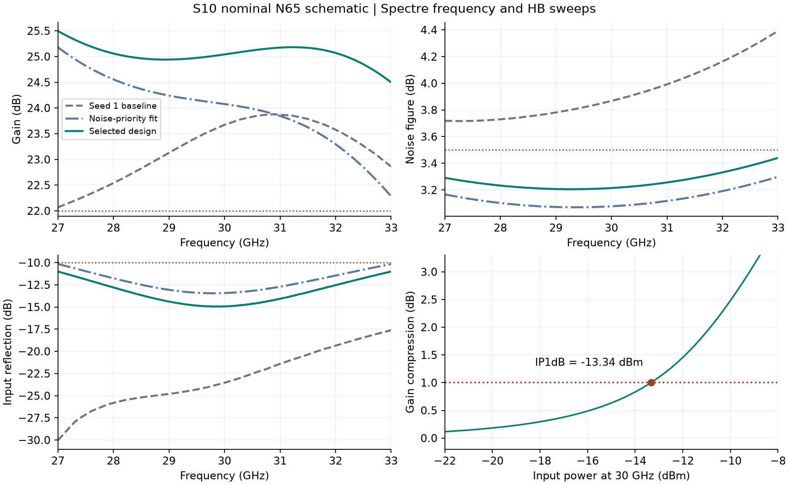

# S10　N65 全带噪声与增益整形

S10 的定向方案通过项目六项判据，也通过额外的全带噪声检查。27–33 GHz 的 601 个采样点上，增益为 24.4978–25.4964 dB，纹波 0.9986 dB，最差 NF 为 3.4404 dB。从保存的参数重建并独立重放，两个加密运行的增益、S11、NF 曲线和汇总指标逐项一致。两次均采用原偏置网格、原拓扑、负载和无源 Q，首级栅偏置为 0.675 V。

## 从失败基线到通过方案

| 完整电路验收 | 最低增益 dB | 纹波 dB | 最差 S11 dB | 中心 NF dB | 最差 NF dB | IP1dB dBm | 电流 mA |
|---|---:|---:|---:|---:|---:|---:|---:|
| 原 seed1 重放 | 22.0675 | 1.8083 | −17.6179 | 3.8674 | 4.3920 | −12.5500 | 24.6090 |
| 原有源器件，仅重调匹配¹ | 23.3139 | 2.8886 | −13.3586 | 3.4887 | 4.0341 | −11.9706 | 24.5856 |
| 复用低噪声首级，再联合调匹配¹ | 22.2835 | 2.8969 | −10.1510 | 3.0776 | 3.2986 | −13.4032 | 18.5574 |
| 最终增益整形方案¹ | 24.4978 | 0.9986 | −10.9996 | 3.2147 | 3.4404 | −13.3399 | 18.5495 |
| 验收门槛 | 22–28 | ≤3 | ≤−10 | ≤3.5 | ≤3.5（额外） | ≥−15 | ≤30.03 |

¹ 这些行取自独立的 10 MHz 步长扫频，压缩点附近 HB 输入功率步长为 0.25 dB。基线行沿用历史网格以核对漂移。项目的增益区间约束最低值，最终方案的全部采样点也位于该区间。

1. **先排除环境漂移。** 启动原 Mac 的 IC618_rf、确认 SSH 用户及远端任务空闲后，重放 S10 v2 的 seed1 与 seed2。两个起点的六项指标与归档精度一致。seed1 只差中心 NF 0.3674 dB；seed2 压缩余量更大，但随后的带宽拟合将纹波推至 4.5624 dB，因此保留 seed1 分支。
2. **先用原器件试匹配的潜力。** 从完整 DC 工作点提取三级有源电路的两端口与噪声参数，接回无源网络，拟合频带响应并由整机确认。seed1 的中心 NF 进入限值，带边仍超出 0.5341 dB。对这一路径补做 30 GHz 单频噪声归因，排除两个端口后，输入管 M1 与共栅管 MCG 各占电路新增输出噪声功率的 42.39% 和 36.23%。这是对当前工作点的解释，比例不能直接推广到另一个设计。
3. **更换首级后重新匹配。** 从同频段 S7 的原偏置网格候选复用首级几何、退化电感、输入匹配和首个耦合网络，保留 S10 后两级。直接组合时最差 NF 已降至 3.0748 dB，但纹波为 3.4385 dB、最差 S11 为 −9.904 dB，整机未过。重新提取两端口并联合调匹配后，得到表中的全带低噪声方案。这一步同时改变若干参数，不能将全部改善归因于单个管子。
4. **把多余的噪声余量用于整形。** 分两轮提高目标增益谷底、收紧纹波并为输入匹配留余量。最终相对低噪声方案，最低增益提高 2.2143 dB，纹波下降 1.8983 dB，最差 NF 增加 0.1418 dB。噪声优先时可复用上一行方案；本次选中最后一行以兼顾最低增益和纹波。最终最差 NF 出现在 33 GHz，余量 0.0596 dB。最差 S11 出现在 27 GHz，压缩余量为 1.6601 dB。



## 重放与证据范围

采用 S10 的原 N65 标称原理图条件。以下命令在原仓库根目录执行，输出目录需为新目录。脚本通过既有配置登录客体，完整设计与原始 PSF 留在原 Mac。先从选定参数重建，在同一网格运行约耗一次 Spectre。

```bash
export PYTHONPATH=src
root=results/runs/s10_target_20261124
.venv/bin/python scripts/refine_s10.py dense \
  --source "$root/selected_dense/trial001.json" \
  --out "$root/replay_new"
```

产生最终设计的顺序为：从历史 S10 seed1 执行 baseline；对结果执行 band；以其输出为基准执行 front 并传入 `--front results/runs/s7_strict_confirm_20261124/trial001.json`；再运行 band；依次执行 shape，目标分别为 `--targets 24 1.6 -10.7` 和 `--targets 24.5 1.0 -11`；最后执行两次 dense。各步完整参数保存在相应运行目录。离线拟合曾达到迭代上限，表中所有指标均取自完整 Spectre。

共核对 **30 次 Spectre**，包括 14 次完整电路、15 次分级两端口和 1 次单频噪声贡献分析。项目设计 LLM 调用 **0 次**。两次最终复测的原始运行号为 `20261124T130331_3a6835`、`20261124T130338_162469`，均为 sim00001。两次各记录 0 错误、68 条警告，日志包含 HB Newton 停滞并由求解器判为收敛的提示。跨 PVT、寄生提取和硅测尚待验证。

本实验复用历史设计和工程定向优化。历史 v2 从零自主搜索的 S10 记录仍为 0/9，本实验补充了 S10 标称可行性的通过证据。[逐调用账本](../results/report/s10_n65/ledger.json) · [采样曲线、HB 功率扫描和最终指标](../results/report/s10_n65/verified.json) · 优化入口（原 Mac 的 `scripts/refine_s10.py`）
