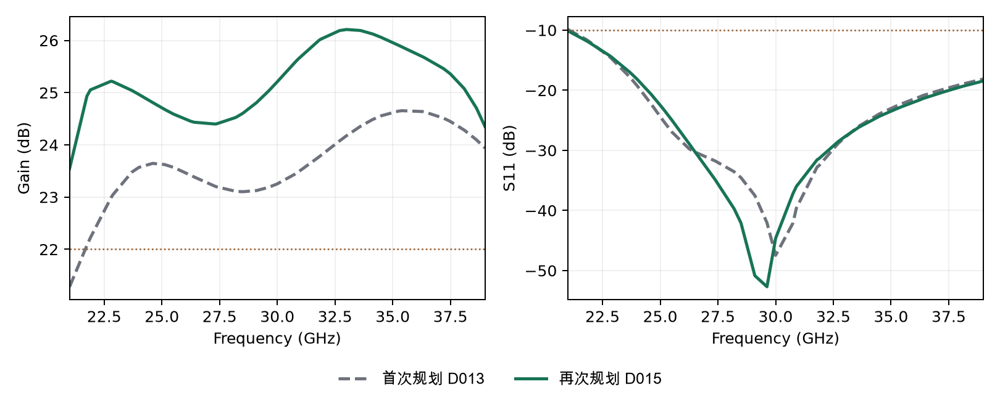
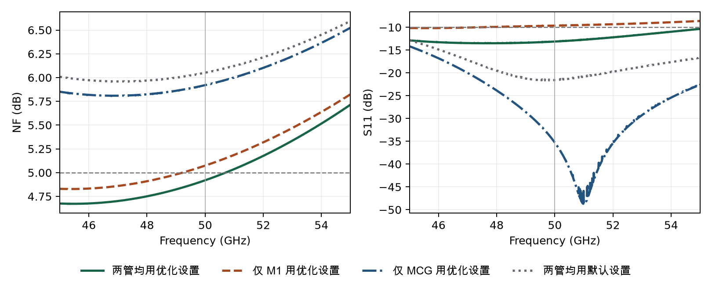

# 156　限时从零设计与首级几何对照

## 本轮问题和条件

历史 N65 多种子基线的 v2 首次通过数为 21/40。已有定向实验则表明，S3 和 S5 各有可通过的标称电路。本轮只给规格，观察智能体能否自行形成候选、进入整机验收并纠正违规。另用固定电路验证 S3 工具中尚未开放的参数。四个从零运行取 seed 17，未加载以前的电路。S5 原策略与回退提示组仅切换 Refiner 的 S11 提示。S3 的修订组使用已有的 Manager 修订 2，同时包括尽早细化、重复分配提示和结束条件。

四组并行，使用同一 gpt-6.2-sol、固定 Q 的 N65 原理图和相同工具。数值搜索种子相同，模型响应具有随机性。每组的主动决策时间窗为 960 秒，进行中的工具或模型请求可以完成。每组均配置 3,600 秒 EDA 等效时间、30 次 Spectre 和 180 次成功模型调用上限。等效时间含代理模型的成本；实际资源消耗另行记账。并发共享模型服务和虚拟机，速度比较仅代表这次运行。

## 从零运行结果

| 组别 | 搜索 | 细化 | LLM | Spectre | 六项验收 |
|---|---:|---:|---:|---:|---|
| S3 原策略 | 8 | 1 | 69 | 0 | 无整机读数 |
| S3 修订 | 3 | 1 | 24 | 0 | 无整机读数 |
| S5 原策略 | 2 | 3 | 64 | 14 | 已测未过 |
| S5 回退提示 | 1 | 1 | 22 | 2 | 通过 |

搜索、细化列分别记录 Manager 调用两个子智能体的次数。LLM 列为成功的真实模型响应数。只有完整 N65 Spectre 电路满足六项才记通过。下表中“无”表示未取得整机读数。

| 组别 | 停止原因 | 决策耗时 / 秒 | 首次整机读数 / 秒¹ | 返回设计 | 中心 NF / dB | 最低增益 / dB | 纹波 / dB | 最差 S11 / dB |
|---|---|---:|---:|---|---:|---:|---:|---:|
| S3 原策略 | 实际时间到限 | 962.9 | 无 | 无 | 无 | 无 | 无 | 无 |
| S3 修订 | 智能体结束 | 351.2 | 无 | 无 | 无 | 无 | 无 | 无 |
| S5 原策略 | 实际时间到限 | 960.1 | 240.2 | D017 | 4.4480 | 22.6154 | 4.6815 | -7.4047 |
| S5 回退提示 | 六项达标 | 336.6 | 293.3 | D015 | 4.6564 | 23.5459 | 2.6628 | -10.1181 |

¹ 决策耗时从决策计时器起算，首次读数从设计会话创建起算。个别终止边界可相差初始化耗时。各组事件、全部候选的实际读数及原始仿真编号保存在汇总数据中。

## S5　为什么一次匹配尝试后仍沿用原候选

S5 回退提示组用 22 次成功模型响应完成一次搜索和一次细化。D013 的最低增益 21.283 dB、纹波 3.371 dB、最差 S11 −9.895 dB，三个指标均超限。Refiner 回到输入匹配，产生 C014；工具判其阶段条件不满足，当前候选仍是 C012。此后 Refiner 把目标增益从 25 提至 25.7 dB，并给第二级指定 5 dB，形成 D015。最低增益升至 23.546 dB，纹波降至 2.663 dB，最差 S11 为 −10.118 dB，六项通过。



专项提示要求同一输入候选在一次后级重规划前后均只剩 S11 或 S11 加纹波违规，同时给匹配、规划、验收留出足够步骤。通过组的首次评估还有增益违规，第二次已通过，未观察到完整触发条件。两组从搜索阶段就有不同的模型输出，选中了不同候选。这个样本证明存在从零通过的路径，无法估计提示的因果效应。

原策略组在 16 分钟内做了 14 次完整 Spectre。最终返回 D017，其中心 NF 为 4.448 dB，满足 5 dB 限值。纹波为 4.6815 dB，超过 3 dB 上限；最差 S11 为 −7.405 dB，超过 −10 dB 上限。机器报告将瓶颈标为 nf，与该设计的实测违规向量不一致。这里按六项电路读数判定。

原策略组出现 3 对符合同一候选连续 S11 电气条件的评估（相邻对可共享一次评估）。第一次为 D012 → D014，随后记录的 Refiner 动作为 impedance_matching。这类已保存状态可用来比较接受同一前置状态时两种提示的后续动作。

独立重建时，原网格重现了 D015 所有发布指标的四位小数精度。随后用 1,801 点复验 21–39 GHz，并在压缩区以 0.25 dB 的输入功率步长补点。六项仍通过，最低增益 23.5459 dB、纹波 2.6651 dB、最差 S11 −10.1181 dB、中心 NF 4.6564 dB、IP1dB −20.3825 dBm、电流 25.7563 mA。最差 NF 6.8393 dB，全带 NF 超出额外的 5 dB 上限。两次复测采用同一标称工艺和模型。

## S3　把搜索、细化和整机读数分开看

S3 原策略搜索八次，到第 950 秒才进入细化。S3 修订组前两次搜索交回空队列，第三次才交出候选。Manager 在约第 330 秒调用 Refiner，后者判断关键级 NF 偏高，未做整机验收就结束。事后重建该候选并按默认目标补测，中心 NF 为 9.394 dB，最低增益为 11.960 dB。这个频带规划确实未过。S5 原策略返回方案的中心 NF 已达标，实际超限的是纹波与带内 S11，保存的瓶颈标签却写作 NF。

修订组交回的 C008 在关键级的预测 NF 为 8.158 dB。事后按相同数值搜索种子和配置重建候选，逐一核对候选编号、关键级增益、NF、反射及压缩估计，再固定默认频带目标补做一次整机 Spectre。除中心 NF 和最低增益外，纹波 5.052 dB 也超限。该诊断独立计账，仅测试这一种频带规划。原策略第一次搜索已经返回候选，但直到第八次搜索后才细化 C030，实际时间窗在得到整机读数前用完。

为检验可供智能体选择的器件参数，另取原偏置 0.675 V 的归档电路，固定请求宽度和所有无源匹配，交叉切换 M1 与 MCG 的分指几何设置。45–55 GHz 以 10 MHz 步长扫描，压缩区以 0.25 dB 输入步长测量。两管均保留时，四条扫频曲线和全部汇总指标与参考归档一致。

| M1 设置 | MCG 设置 | 实现总宽 M1 / MCG（μm） | 中心 NF | 最差 NF | 最差 S11 | 六项超限 |
|---|---|---|---:|---:|---:|---|
| 优化 | 优化 | 54 / 42.5 | 4.9193 | 5.7148 | -10.3477 | 无 |
| 优化 | 默认 | 54 / 44 | 5.0736 | 5.8239 | -8.6127 | 最低增益、中心 NF、S11 |
| 默认 | 优化 | 52 / 42.5 | 5.9203 | 6.5245 | -14.1626 | 中心 NF |
| 默认 | 默认 | 52 / 44 | 6.0511 | 6.5952 | -12.8300 | 中心 NF |

NF 与 S11 单位均为 dB。分指宽度与指数量上限一并切换，实际总宽也会因取整变化。单独恢复 M1 默认设置、保留优化 MCG，中心 NF 增加 1.001 dB。单独恢复 MCG 默认设置、保留优化 M1，最差 S11 恶化 1.735 dB。该结果可用来设计一个有限的几何选项工具。偏置、拓扑或匹配网络改变时需重新验收。



## 资源与重放

四组从零设计共有 179 次成功项目设计 LLM 调用和 16 次 Spectre，正式运行记录 0 次模型传输错误、0 次临时重试、0 次规则回退。工程对照另有 4 次 S3 几何、2 次 S5 重建和 1 次 S3 被跳过候选的补测，均无项目设计 LLM 调用。合计 23 次真实 Spectre。首次启动指定了不存在的 CLI 目录，四个进程共记录 12 次传输错误、0 次成功模型响应、0 次 Spectre；修正后重新从空目录运行。环境连通性检查单独于设计计数。

在已配置的原 Mac 仓库根目录执行下列命令，输出需用新目录。首条使用现有登录并继承 CLI 环境。模型的下一次决策可能不同，其余命令可固定既有输入，分别核对通过电路、几何对照和提前退出的候选。

```bash
export PYTHONPATH=src
pub=results/report/cold_start_pilot_r1
out=results/runs
py=.venv/bin/python
$py scripts/run_cold_start_pilot.py --seed 17 --seconds 960 --out "$out/cold_start_repeat_02"
$py scripts/replay_cold_start_pass.py --source "$pub/s5_replay.json" --out "$out/s5_confirm_02"
$py scripts/check_s3_front_geometry.py --source "$pub/geometry.json" --out "$out/s3_geometry_02"
$py scripts/evaluate_s3_deferred_candidate.py --source "$pub/s3_deferred.json" --out "$out/s3_deferred_02"
```

## 下一轮可检验的问题

S5 可从原策略组已观测到连续 S11 违规的同一状态分叉，比较下一步是重新匹配还是继续规划，并分别验收。S3 可给 Refiner 少量可选的首级几何组合，同时保留原工具作为对照。若要估计从零首次通过率，需要预先确定独立种子、统一验收条件，并保留所有未产生设计的运行。

[逐组动作与资源账本](../results/report/cold_start_pilot_r1/summary.json) · [S5 重建复核指标](../results/report/cold_start_pilot_r1/s5_replay_metrics.json) · [S3 四点对照指标](../results/report/cold_start_pilot_r1/geometry_metrics.json) · [S3 单候选补测](../results/report/cold_start_pilot_r1/s3_deferred_metrics.json)

仓库附件提供测量指标和扫频数据。上述重放命令使用原 Mac 保存的完整设计输入。
