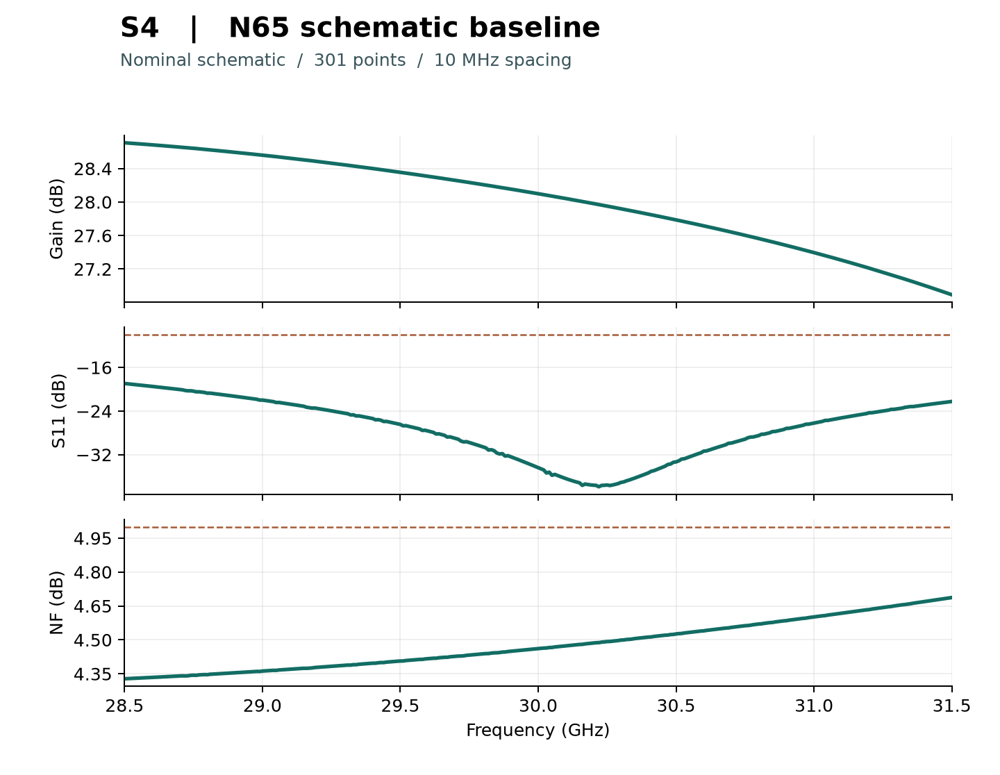
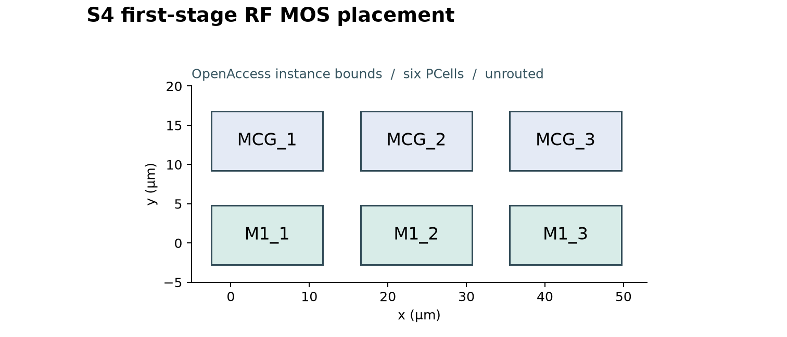

# 157　S4 前仿基线与首级器件版图

S4 在原 Mac 的 N65 Spectre 后端完成了原网格重放和 301 点加密前仿。虚拟机中已建立首级输入管 M1 与共栅管 MCG 的 OpenAccess 器件布局，并导出 GDS。布线、输入无源器件、物理验证和寄生提取仍待完成。目前可以复现前仿曲线和器件放置，尚无可供叠加的后仿曲线。

## 同一电路的前仿参考

冻结原 S4 电路、负载、偏置及无源 Q。第一次使用原评估网格重建，全部汇总指标与原记录在 0.000001 的绝对误差内一致。第二次以 10 MHz 间距覆盖 28.5–31.5 GHz，在 30 GHz 压缩点附近以 0.25 dB 输入功率步长加密 HB。两次真实 Spectre 均完成，项目设计 LLM 调用为 0。

| 指标 | 加密前仿 | 判据 |
|---|---:|---|
| 带内最低增益 | 26.893 dB | 22–28 dB |
| 纹波 | 1.815 dB | ≤3 dB |
| 最差 S11 | −18.941 dB | ≤−10 dB |
| 中心 NF | 4.461 dB | ≤5 dB |
| IP1dB | −15.238 dBm | ≥−25 dBm |
| 直流电流 | 26.251 mA | ≤30.03 mA |

所有采样点的 NF 均不超过 5 dB，最差为 4.687 dB，余量 0.313 dB。增益峰值为 28.708 dB。如进一步要求每个频点的增益均落在 22–28 dB，则峰值高出 0.708 dB。原网格得到 IP1dB −15.297 dBm，两种 HB 采样下均满足压缩要求。



原始记录是运行号 `20261124T000953_ad313b` 的第四个仿真。重放和加密前仿是 `20261124T135031_8475fe` 的第一个和第二个仿真。重放命令在原仓库根目录执行，输出目录需为新目录。

```bash
PYTHONPATH=src .venv/bin/python scripts/verify_s4_prelayout.py \
  --source results/runs/s1_s8_verified_20261124/S4.json \
  --out results/runs/s4_prelayout_replay_02
```

## 从原理图器件映射到版图

IC 用户的工作库中查到了单独的螺旋电感单元，尚未找到 S4 顶层。虚拟机原有 PDK 版图库安装为 LO 工艺选项、1.2/3.3 V 和 6X2Z0U 金属栈，库中缺少 S4 使用的 nmos_rf 版图主单元。S4 实际仿真引用的是 2.5 V 选项的模型组。电压选项描述 PDK 模型库的组合，S4 的晶体管和电路偏置保持归档值。

从原机已有的官方安装包，在独立目录配置 RF 选项、1.2/2.5 V 模型组、1P9M 6X1Z1U ALRDL 金属栈和 1.0 fF MiM 选项。该金属栈在安装器中标有电感和寄生提取支持，是本实验的物理实现选择。原 S4 网表直接引用的两份模型文件与新副本中的对应文件逐字节相同。已放置的器件均为 RF MOS，尚未放置 MiM 或电感。

M1 与 MCG 在网表中均为 60 nm 栅长、2 µm 单指宽、30 指、并联倍数 3。每个器件用三个 PCell 表示，每管总指宽 180 µm。Virtuoso 对六个生成实例逐一读回参数，GDS 导出报告 0 错误、0 警告，回传文件的 SHA-256 与虚拟机原件一致。独立读取 GDS 顶层结构，也得到对同一个 RF PCell 变体的六个引用。图中的矩形为实际实例外框。



虚拟机工作目录为 `/home/IC/rfa_s4_layout_157/workspace`，库、单元、视图依次为 `RFA_S4_157 / S4_active_placement / layout`。原 Mac 上的 GDS 位于仓库的 `results/runs/s4_prelayout_157/placement/placement.gds`。电路级的 149.259 pH 并联输入电感、9.107 pH 串联栅电感、25.844 pH 源退化电感以及首个磁耦合网络仍需物理实现。PCell 在版图中还暴露了 NG 端口；已读回 symbol、Spectre、CDL、LVS 的四端定义和 D/G/S/B 网表顺序，NG 的物理连接仍需按 RF 工艺规则核定。

## 物理验证停在许可证签出

虚拟机可调用 Virtuoso、Spectre 和 Calibre，并已找到该 RF 栈的 DRC、LVS 与 RC 提取规则。在 IC 账户的原有环境中，Calibre 对平坦 DRC、层次 DRC、LVS 和 xRC PDB 作业分别报出许可证签出失败。用于检查工具能否启动的 LVS 输入对应尚未布线的占位单元。这些命令均未给出电路、电气连接或几何规则的通过与失败结论。

已确认 Mentor 许可证路径可读。用随安装提供的 FlexNet 病因诊断分别检查 DRC、LVS、xRC 三类各三个关联许可条目，九项均报告主机标识不匹配。Spectre 与 Virtuoso 的本轮作业均成功。继续验证需要许可管理方为当前虚拟机提供匹配的 Calibre 授权，或安排一台可使用同一工艺库的已授权验证主机。许可证文件、标识符、厂商规则和私有配置未收入报告数据。

恢复后先跑已放置单元的 DRC，再完成首级端口、布线和输入匹配的物理实现。对照原理图做 LVS，按实际覆盖范围提取，并在相同负载、偏置和采样网格下重新测量。报告应注明替换了哪些版图子电路，再叠加增益、S11、NF 和压缩结果。本轮计数为原理图 Spectre 2 次，后仿 Spectre 0 次。

[前仿数据与频率轴](../results/report/s4_layout/prelayout.json) · [放置参数、GDS 校验及验证状态](../results/report/s4_layout/placement.json) · Virtuoso 放置脚本（原 Mac 的 `scripts/layout/s4_place.il`）
