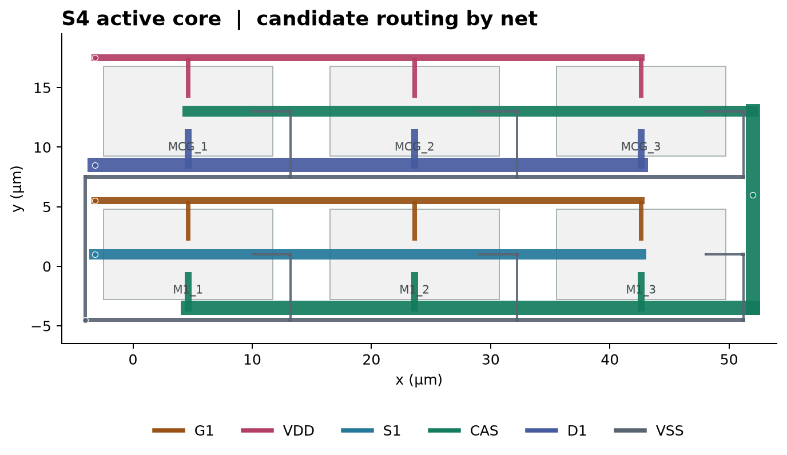
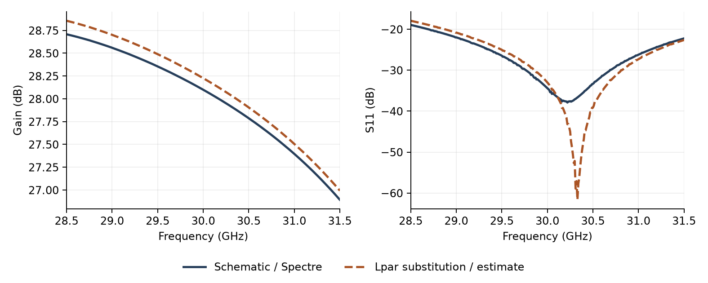

# 158　S4 首级有源布线与输入匹配复核

本轮在原 Mac 的 S4 器件放置 GDS 副本上完成了 M1、MCG 的信号和体端布线草稿。原放置文件和虚拟机库均保留原状。当前可以交接有源核心的 GDS、逐端子连通结果和输入电感候选。原理图前仿六项通过。正式 DRC、LVS、寄生提取和整机后仿仍无结果。

## 1　哪些端子已经连好

M1、MCG 各由三个 RF MOS 实例组成。新顶层为 S4_active_routed_draft，保留六个原始 PCell 引用。漏端从 M2 引出，经过两层带四孔的过孔阵列接至 M4 干线；两行器件在右侧通过 CAS 网络相连。图中圆点标出网络标签位置，灰框来自原 OpenAccess 放置坐标。



| 网络 | 应连接的器件端子 | 从写出的 GDS 读回 |
|---|---|---|
| G1、S1 | M1 的三个栅端、三个源端，分别并联 | 两个独立网络，各 3 个端子 |
| CAS | M1 的三个漏端与 MCG 的三个源端 | 同一网络，6 个端子 |
| VDD、D1 | MCG 的三个栅端、三个漏端，分别并联 | 两个独立网络，各 3 个端子 |
| VSS | 全部六个实例的体端 B | 同一网络，6 个端子 |
| NG | 每个实例另有一个物理护环端 | 6 个分别隔离；最终接法尚待工艺核定 |

独立读回 GDS 文件，展开层次，按 M1–M4 金属的相接及相邻层切孔的重叠重建连通关系。24 个 D/G/S/B 端子都落在预期的六个网络，六网间未发现几何短接。用两个只存在于内存的故障对照验证检查程序：在 CAS 干线中间留 1 µm 间隙能检出断路，用金属桥连接 G1 和 VDD 能检出短接。该检查未覆盖器件识别、阱与衬底连接、工艺间距、载流能力或寄生值。

GDS 几何包含本地 PDK 器件，仅供本地工程使用。本机文件名为 `s4_active_routed_draft.gds` · [端子、原文件与新文件校验值、故障对照](../results/report/s4_closeout/routing_check.json)

## 2　哪些匹配元件已有候选

从历史归档的 Spectre AC 原始数据重新计算 108 种单绕组几何在 8 个频率的复阻抗，共 864 条，与归档表逐项相符。30 GHz 下有 97 个正电感、正电阻且 Q 为正的样本。下表按与目标电感的绝对差取最近样本。

| S4 元件 | 目标 pH | 表中最近 pH | 工程结论 |
|---|---:|---:|---|
| 输入并联电感 Lpar | 149.259 | 149.200 | 0.75 匝、半径 20 µm、线宽 10 µm，误差 −0.040%，30 GHz 时等效串阻 0.662 Ω、Q 为 42.51 |
| 串联栅电感 Lg | 9.107 | 81.770 | 已测库没有足够小的样本 |
| 源退化电感 Ls | 25.844 | 81.770 | 已测库没有足够小的样本 |

首个耦合网络 MCR1 还要求初级 288.643 pH、次级 502.935 pH、耦合系数 0.582。单绕组表不能给出两绕组的互感。Lg 和 Ls 若用短走线实现，必须依据实际回流路径提取其频率相关阻抗；当前有源布线几何本身不足以确定它们的电感量。

## 3　替换并联电感可能带来多少变化

只替换 Lpar。使用已冻结的 S4 301 点前仿复数 S11 和 S21，按 50 Ω 输入阻抗换算，去嵌输入隔直电容，在内部输入节点减去旧支路导纳，再加入候选导纳。保持其余网络、输出终端及小信号工作点不变。30 GHz 的候选阻抗来自归档原始数据，带内其余频点由 25、30、35 GHz 的阻抗实部和虚部分段线性插值。用原支路替回自身时，增益和 S11 与原曲线逐点吻合。

| 28.5–31.5 GHz 指标 | 已完成的原理图 Spectre | 仅替换 Lpar 的线性估算 |
|---|---:|---:|
| 最低增益 | 26.893 dB | 26.993 dB |
| 增益纹波 | 1.815 dB | 1.863 dB |
| 最差 S11 | −18.941 dB | −17.925 dB |

估算中最低增益升高约 0.100 dB，最差 S11 的余量减少约 1.016 dB。该候选值得保留，但表征时采用的单绕组端接与完整电路中的偏置及衬底条件仍需复核。这里没有计算新的 NF、直流或压缩点，也没有使用本轮金属布线的寄生量。



[单绕组候选、频率样本和完整估算曲线](../results/report/s4_closeout/passive_check.json)

## 4　收尾状态与重放

本轮使用既有本机数据，新增设计 LLM、Spectre、EM 和 Calibre 作业均为 0。此前 157 号工作中成功完成两次原理图 Spectre；Calibre 的许可诊断见该记录。仍需物理验证的项目包括 NG 接法、输入匹配及耦合网络的物理实现、DRC、LVS 和寄生提取。因此当前可以重建布线草稿和离线估算，前后仿性能差值仍为空。

以下命令在本次 Codex 工作目录中执行，输出用新目录。原仓库提供历史 PSF、放置 GDS、Python 依赖和 PSF 解析器。

```bash
repo=/Users/jason/Documents/Open-RFAmpDesigner-Cadence
py="$repo/.venv/bin/python"
src=work/s4_closeout
out=outputs/s4_repeat
"$py" "$src/build_route.py" "$repo/results/runs/s4_prelayout_157/placement/placement.gds" "$out"
PYTHONPATH="$repo/src" "$py" "$src/passive.py" "$repo" "$out/passive_check.json"
```
