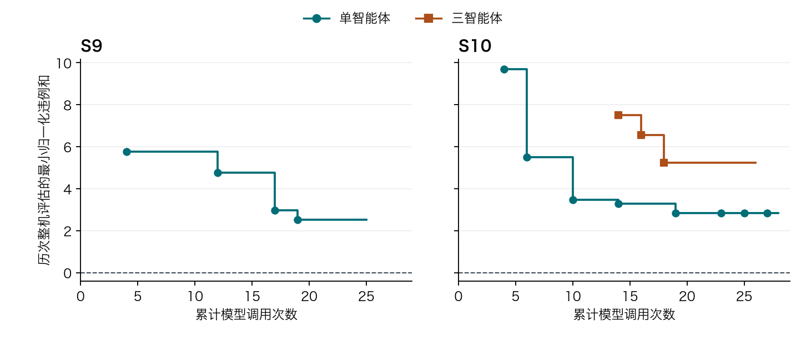

# 159　S9、S10 单智能体与三智能体对照

## 研究问题与设置

从相同的规格和电路搜索种子开始，一个模型直接操作设计工具，与 Manager、Searcher、Refiner 分工使用这些工具相比，哪一种更快得到可检查的整机候选？哪一种最终能让六项约束同时达标？

采用本机项目的两端口代理模型和真实 Codex 模型 gpt-6.2-sol。两种架构均无成功设计热启动或经验库。S9 和 S10 均为 30 GHz、27–33 GHz 通带、30 mA、目标增益 25 dB；中心频点 NF 上限分别为 5 和 3.5 dB。全链采用项目的 spec_check 判定，要求带内最低增益在 22–28 dB，带内纹波 ≤3 dB，最差 S11 ≤−10 dB，输入 1 dB 压缩点 ≥−15 dBm，电流 ≤30.03 mA（含项目容差）。另列带内最差 NF 便于核对。

每组独立从 seed 17 开始，最多 28 次完成的模型调用、420 秒实耗和 18,000 秒代理工具折算额度。实耗截止在动作边界检查，进行中的请求可结束后退出。四组并发，模型服务等待和本机资源竞争均计入各组实耗。固定种子控制数值优化，在线模型回答仍可能变化。

单智能体保留一份决策历史，自行选择尺寸、电流分配、阻抗匹配、带宽规划与全链评估。三智能体沿用项目的三个角色及各自提示，先搜索、再交接候选给精调。单智能体沿用同一组底层数值工具，使用为本实验写的精简提示。角色分工、提示内容、上下文组织和交接次数共同变化，这次对照不能单独识别其中一个因素的因果效应。

## 结果

| 规格 | 架构 | 全部达标 | Stage 2 候选 | 已评估的不同整机 | 首次整机：秒 / 调用 / 输入 token | 总用时（秒） | 停止原因 |
|---|---|---|---:|---:|---|---:|---|
| S9 | 单智能体 | 未通过 | 10 | 4 | 50.9 / 4 / 80,646 | 422.4 | wall_time_budget |
| S9 | 三智能体 | 未评估 | 22 | 0 | 未到达 | 428.0 | wall_time_budget |
| S10 | 单智能体 | 未通过 | 6 | 8 | 54.4 / 4 / 80,806 | 429.8 | wall_time_budget |
| S10 | 三智能体 | 未通过 | 14 | 3 | 199.1 / 14 / 294,972 | 421.2 | wall_time_budget |

| 规格 | 架构 | 有效模型调用 | 模型传输错误 | 输入 token | 其中缓存输入 | 输出 token | 无效动作 |
|---|---|---:|---:|---:|---:|---:|---:|
| S9 | 单智能体 | 25 | 0 | 560,243 | 410,752 | 5,637 | 0 |
| S9 | 三智能体 | 27 | 0 | 586,131 | 426,752 | 5,363 | 0 |
| S10 | 单智能体 | 28 | 0 | 630,284 | 441,984 | 5,522 | 0 |
| S10 | 三智能体 | 26 | 0 | 558,927 | 446,848 | 4,212 | 0 |

输入与输出采用 Codex CLI 的逐调用计数，包含每次 CLI 调用的公共上下文。缓存输入已包含在输入列。所有电路响应均来自同一代理后端。本轮真实 Spectre 调用为 0。

## 最接近全项达标的已评估整机

在每组所有已评估整机中，以项目已有的归一化违例和选出一条。增益、纹波、IP1dB、S11 与电流违例分别除以 3，NF 违例除以 1，达标项记零。同一行的指标全部来自同一个设计。

| 规格 | 架构 | 设计 | 带内最低增益 dB | 纹波 dB | 中心 / 带内最差 NF dB | 最差 S11 dB | IP1dB dBm | 电流 mA | 正式判据未通过项 |
|---|---|---|---:|---:|---:|---:|---:|---:|---|
| S9 | 单智能体 | D011 | 23.24 | 2.87 | 6.02 / 7.13 | -18.67 | -19.53 | 28.91 | 噪声、IP1dB |
| S9 | 三智能体 | — | — | — | — | — | — | — | 未得到整机指标 |
| S10 | 单智能体 | D010 | 26.61 | 2.42 | 4.18 / 4.64 | -20.13 | -21.45 | 28.62 | 噪声、IP1dB |
| S10 | 三智能体 | D010 | 23.21 | 4.11 | 3.23 / 3.87 | -17.82 | -29.60 | 28.39 | 纹波、IP1dB |

## 从第一次评估到停止

图中每个点代表一次整机评估。横轴计入交接在内的全部已完成模型调用，纵轴是截至该次调用观察到的最低归一化违例和。数值越低越接近同时达标，零表示全部通过。首次整机评估前留白。



S9 三智能体生成 22 个关键级候选，其中 4 个通过局部筛选。Manager 在第 415 秒才把候选交给 Refiner，截止时还没有完整电路指标。S10 的单智能体在第 4 次调用完成首次整机评估，三智能体在第 14 次完成。到停止时，两者分别评估了 8 与 3 个不同整机。四组中有 3 组取得整机指标，0 组满足项目全部约束。采用配对单种子，此处只能描述这一轮轨迹。缺少四组可比的成功终点，整轮消耗量不能解释为达到同一设计目标所需的成本。

## 论文参照

原论文表 V 使用 Claude-Sonnet-4.5、每种设置 5 次以及最长 5 小时。两种架构在 S9、S10 均获 5/5。S9 的平均输入 token 从单智能体 161,150 降至三智能体 25,759，S10 从 55,785 降至 40,136。这里的单次短跑单独列示，更换了模型、工具后端和单智能体提示。评估论文所报效率倍数还需要两组均有成功样本，并采用一致的 token 统计边界。

## 复核与重跑

在本次 Codex 工作区根目录运行以下命令。每次使用新的输出目录以保留原始记录。

```sh
/Users/jason/Documents/Open-RFAmpDesigner-Cadence/.venv/bin/python work/agent_comparison/compare.py outputs/agent_comparison_repeat/seed17
/Users/jason/Documents/Open-RFAmpDesigner-Cadence/.venv/bin/python work/agent_comparison/summarize.py outputs/agent_comparison_repeat/seed17
/Users/jason/Documents/Open-RFAmpDesigner-Cadence/.venv/bin/python work/agent_comparison/plot_progress.py outputs/agent_comparison_repeat/seed17
```

各组的 events.jsonl 记录请求、回答与工具调用的相对时间。result.json 保存逐步动作、指标、终止状态与用量。单智能体日志中的 searcher/refiner 工具标签沿用公共工具封装，实际发起决策的身份见请求日志的 role。

既有的 S10 定向调优另有真实 N65 Spectre 数据，见[报告 155](155_s10_n65_optimization.md)。本对照只衡量从零开始的短时搜索。

原始结果与调用记录按组保存。

- S9 单智能体　[完整结果](../results/report/agent_comparison/seed17/S9_single/result.json) · [时间日志](../results/report/agent_comparison/seed17/S9_single/events.jsonl)
- S9 三智能体　[完整结果](../results/report/agent_comparison/seed17/S9_multi/result.json) · [时间日志](../results/report/agent_comparison/seed17/S9_multi/events.jsonl)
- S10 单智能体　[完整结果](../results/report/agent_comparison/seed17/S10_single/result.json) · [时间日志](../results/report/agent_comparison/seed17/S10_single/events.jsonl)
- S10 三智能体　[完整结果](../results/report/agent_comparison/seed17/S10_multi/result.json) · [时间日志](../results/report/agent_comparison/seed17/S10_multi/events.jsonl)

论文数据取自[原文表 V](../references/paper/source/RFAmpDesigner_extracted_text.txt)。
