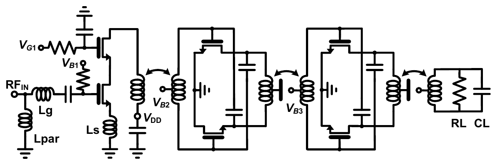
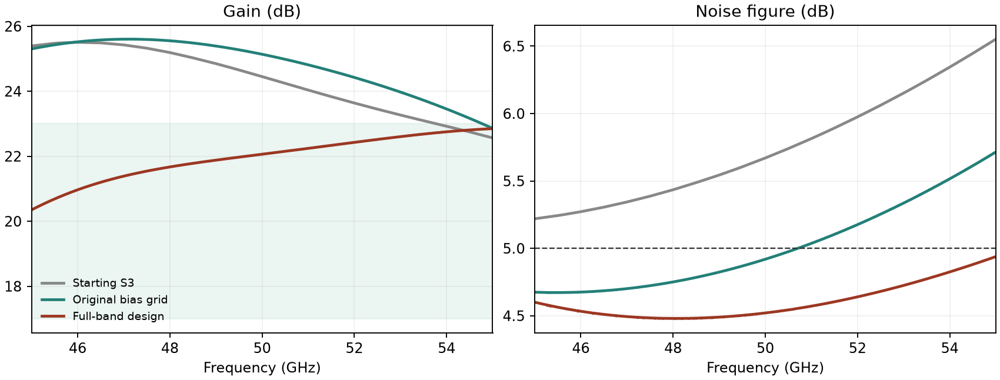
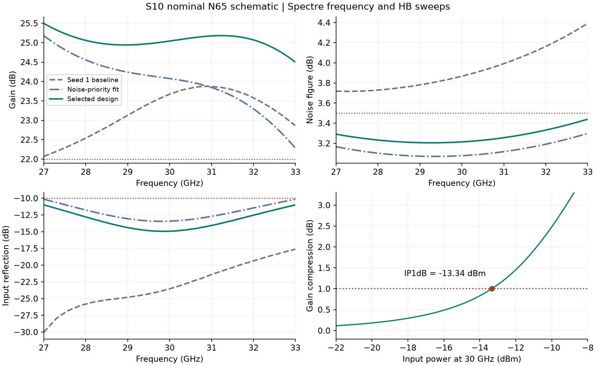
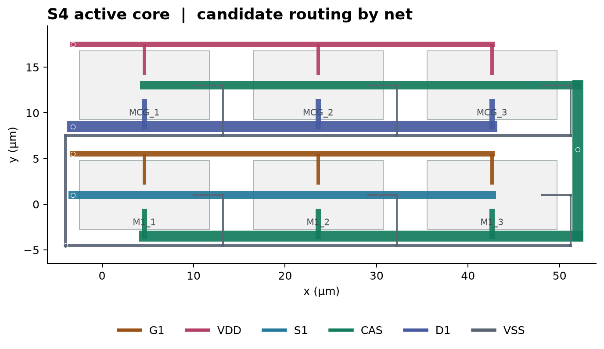

# N65 宽带低噪声放大器自动设计方法复现

[下载 Word 排版版](160_rfa_final_report_draft.docx)

徐鹤岩　　指导教师　陆叶

### 摘　要

为评估大语言模型在宽带低噪声放大器（LNA）设计中的作用，本文在 TSMC 65 nm 工艺上复现 RFAmpDesigner 的分级设计流程，以相同规格比较规则策略和三智能体策略，并用 Spectre 验收标称原理图。S1–S8 各运行五个种子，两种策略分别通过 24/40 和 21/40。结合定向优化，S1–S10 各有一个满足六项约束的电路，其中六个在全部已测频点满足噪声限值。S10 通过复用低噪声首级并调整级间耦合，获得 24.498 dB 的带内最低增益和 0.999 dB 的纹波。结果表明，分级工具能支持标称电路设计。从零搜索的成功率、带边噪声和版图寄生仍限制结论的适用范围。

关键词　宽带低噪声放大器，多智能体，射频电路自动设计，多保真优化，原理图仿真

## 1　引言

宽带 LNA 位于接收机前端。增大输入管宽度可能降低噪声，却会改变输入电容和匹配条件。移动级间谐振峰可以抬高带边增益，也可能扩大纹波。到了毫米波频段，无源损耗与寄生效应使这些权衡更难仅凭解析计算判断。对全部元件直接做遗传算法或贝叶斯优化，每得到一个完整设计的反馈都要付出仿真成本。

### 1.1　原论文的研究目标与方法

Lu 等提出 RFAmpDesigner，研究如何让大语言模型在有限仿真次数内为给定规格找到可行的放大器参数 [1]。作者把设计变量改写为工程师熟悉的两类决策，即三级如何分配电流，磁耦合网络如何分配带内增益。数值工具再把分配目标转化为器件尺寸和匹配参数。解析频带模型用少量仿真校准，管理、搜索和细化三个智能体根据仿真反馈决定在哪一级重试。相近任务的既有设计和调参经验可供后续检索。

论文第一版以十个三级 LNA 规格检验该方法，中心频率为 10–50 GHz，分数带宽为 10%–80%。表 IV 中，前八个规格各运行五次，合计通过 32/40。图 5 的频带规划例中，多保真模型将运行时间从 501.69 秒降至 58.38 秒 [1]。本文沿用这一版的规格与表号。后续修订版将评测对象扩展到驱动放大器和功率放大器 [2]。

### 1.2　本文的复现问题

本文考察三个问题。在同一工艺和判据下，智能体从零搜索能否达到规则基线的通过率？对失败样例，能否通过电路诊断找到可重放的标称解？从原理图走向物理实现后，哪些结论已有版图证据支持？

## 2　实验对象与方法

### 2.1　电路拓扑与分级设计

实验对象为三级磁耦合宽带 LNA。带源极退化的共源共栅首级负责输入匹配与低噪声放大，首个磁耦合谐振器完成单端到差分的变换。后两级为带中和电容的差分共源级，经磁耦合网络驱动 1,787 Ω 与 62 fF 的并联负载（图 1）。

图 1　三级宽带低噪声放大器的电路拓扑，引自文献 [1] 图 3

Manager 根据规格安排搜索或细化。Searcher 先把电流分给三级，选择有源器件，再用粒子群搜索关键级的匹配参数。Refiner 利用磁耦合谐振器模型与校准结果规划后级通带，把完整候选交给整机评估。发现违例后可以重新分配增益或返回输入匹配。器件知识库提供可选工作点，经验库在启用时提供历史设计线索。

### 2.2　仿真后端与评价指标

本地实现先在快速模型上筛选候选，最终以 N65 晶体管模型进行整机 Spectre 仿真。S2 的三次宏模型仿真用于交叉核对两端口计算与仿真接口。另设两端口代理后端，用于观察搜索行为和计算开销。其评估结果在文中单独标注。

增益取带内最低值，须落在各案目标 ±3 dB。增益纹波为同一带内最大值减最小值，须 ≤3 dB。输入反射取最差 S11，须 ≤−10 dB。其余三项为中心频点噪声系数（NF）、中心频点输入 1 dB 压缩点（IP1dB）及直流电流。IP1dB 由谐波平衡功率扫描读取，电流由工作点读取。主实验的匹配电感 Q 为 25，磁耦合网络电感 Q 为 15。

同一项目中，以规则程序决策的实现称为 v1，以大语言模型驱动三个角色的实现称为 v2。自主设计按预设种子统计，每次尝试由一组初始条件启动，允许在该次尝试内多轮仿真与回退。定向优化允许复用既有候选，另按取得可行解的规格数评价。

## 3　实验结果与讨论

### 3.1　逐规格通过率与带内噪声

表 1 汇总每个规格五次独立启动的结果。左侧列出首次通过数与尝试数，右侧给出同一规格下所选标称电路的中心 NF 和带内最差 NF。

表 1　N65 标称原理图的逐规格验收结果

| 规格 | 规则 v1 | 三智能体 v2 | 标称六项 | 中心 NF | 最差 NF / 限值 | 全带 NF |
| --- | --- | --- | --- | --- | --- | --- |
| S1 | 5/5 | 5/5 | 通过 | 3.831 | 4.457 / 5 | 通过 |
| S2 | 5/5 | 5/5 | 通过 | 4.814 | 5.479 / 5 | 超限 |
| S3 | 0/5 | 0/5 | 通过 | 4.521 | 4.939 / 5 | 通过 |
| S4 | 5/5 | 5/5 | 通过 | 4.461 | 4.687 / 5 | 通过 |
| S5 | 4/5 | 1/5 | 通过 | 4.905 | 6.642 / 5 | 超限 |
| S6 | 0/5 | 0/5 | 通过 | 4.691 | 7.338 / 5 | 超限 |
| S7 | 0/5 | 0/5 | 通过 | 2.474 | 2.611 / 2.5 | 超限 |
| S8 | 5/5 | 5/5 | 通过 | 3.961 | 4.614 / 5 | 通过 |
| S9 | 4/5 | 4/5 | 通过 | 4.214 | 4.806 / 5 | 通过 |
| S10 | 0/5 | 0/5 | 通过 | 3.215 | 3.440 / 3.5 | 通过 |

注　NF 单位为 dB。S9 取历史 v2 的种子 4，S10 取定向方案。

将同一噪声上限扩展到每个已测频点，S2、S5、S6、S7 仍超限。各案扫频密度不同。文献 [1] 表 IV 报告 S1–S8 为 32/40，本地三智能体为 21/40。工艺及无源建模、物理验证层级和明确的带内 S11 约束均影响可比性。S5 是本地两种策略通过数有差别的规格，S3、S6、S7 则两种策略均为 0/5。

### 3.2　首级器件几何与带边噪声

S3 在 45–55 GHz 工作，要求中心 NF ≤5 dB。固定有源器件，仅调无源匹配，50 GHz 的 NF 仍约 5.67 dB。对该工作点的输出噪声按器件归并，扣除端口后，共栅管 MCG 和输入管 M1 分别贡献电路新增噪声的 42.0% 与 34.8%。这给出了先检查首级两管的依据。

#### 3.2.1　S3 的首级几何对照

表 2　S3 首级分指几何对整机性能的影响

| 输入管 M1 | 共栅管 MCG | 中心 NF（dB） | 最差 S11（dB） | 超限项 |
| --- | --- | --- | --- | --- |
| 优化 | 优化 | 4.919 | −10.348 | 无 |
| 优化 | 默认 | 5.074 | −8.613 | NF、S11、增益 |
| 默认 | 优化 | 5.920 | −14.163 | NF |
| 默认 | 默认 | 6.051 | −12.830 | NF |

注　首级偏置为 0.675 V。分指设置会改变取整后的实现总宽。

保留优化 MCG 时，改变 M1 几何使中心 NF 下降约 1.00 dB。保留优化 M1 时，改变 MCG 又使最差 S11 改善约 1.74 dB。两管均优化后通过六项，但 55 GHz 的 NF 仍为 5.715 dB。扩展首级偏置至 0.775 V 并复调匹配，才能在本次 1,001 点扫描中把最差 NF 压至 4.939 dB。

图 2　S3 的 N65 Spectre 增益和噪声。红线为扩展偏置后的方案，高频带边距 5 dB 上限仅 0.061 dB。

#### 3.2.2　S7 的低频带边余量

S7 的 NF 上限收紧至 2.5 dB。扩展首级偏置后，中心 NF 降至 2.474 dB，而 27 GHz 仍达 2.611 dB。此时带内最差 S11 仅有 0.080 dB 余量，IP1dB 仅有 0.273 dB 余量。继续降低噪声时，需对同一候选同时复核反射和压缩。当前结论限于标称六项通过。

### 3.3　级间耦合与带内增益整形

#### 3.3.1　S5 的耦合系数对照

S5 的通带为 21–39 GHz。输入匹配恢复后，最差 S11 已到 −10.996 dB，但增益谷底为 21.898 dB，距离 22 dB 下限还差 0.102 dB。此时保持晶体管与偏置不动，分别改变一个后级磁耦合系数，可直接观察峰值和谷底怎样移动。

将 MCR3 耦合增大 3%，最低增益从 21.90 升到 22.18 dB，纹波从 2.47 降到 2.29 dB。另一候选将 MCR2 耦合降低 3%，谷底增加 0.287 dB，峰值却增加 0.610 dB，纹波扩大到 2.788 dB。两种候选均通过六项。前者同时实现了提高最低增益、减小纹波的工程目标。

#### 3.3.2　S10 的噪声余量与增益整形

S10 同时要求 27–33 GHz 的中心 NF ≤3.5 dB 和 IP1dB ≥−15 dBm。原 seed 1 重放时中心 NF 为 3.867 dB。仅重调匹配，中心 NF 可降至 3.489 dB，带边仍达 4.034 dB。复用同频段 S7 的低噪声首级、保留 S10 后两级并重新拟合后，带内最差 NF 进一步降至 3.299 dB，由此获得抬升谷底的余量。

图 3　S10 标称 Spectre 复测。小信号扫频提供增益、噪声与输入反射，中心频率功率扫描给出压缩点。

提高谷底目标并收紧纹波后，最低增益由 22.284 提至 24.498 dB，纹波由 2.897 降至 0.999 dB。代价是最差 NF 增至 3.440 dB，仍留 0.060 dB 余量。独立重建的 601 点复测得到最差 S11 −11.000 dB、IP1dB −13.340 dBm、电流 18.549 mA。该结果使用已有首级与定向拟合。原 v2 冷启动扩至九个种子仍为 0/9。

### 3.4　限时自主搜索与架构对照

#### 3.4.1　N65 上的提示对照

不给已知电路，S3、S5 各用同一数值种子运行两个提示版本，主动决策窗口均为 16 分钟。S3 两组均未在窗口内取得整机读数。对提前放弃的一个候选事后重建并补测，中心 NF 为 9.394 dB、最低增益为 11.960 dB，说明该候选的默认频带规划确实存在明显差距。

S5 原提示调用 14 次整机 Spectre，返回设计仍有纹波和 S11 违规。启用回退提示的组用 22 次模型调用及 2 次整机 Spectre 通过。其新匹配候选未被接纳，实际通过动作是保留原输入候选，将整机增益目标调至 25.7 dB，并给第二级指定 5 dB。独立加密复测得到最低增益 23.546 dB、纹波 2.665 dB、最差 S11 −10.118 dB。专项回退条件未完整触发，这一例支持从零通过路径，尚不能把成功归因于提示改动。

#### 3.4.2　代理后端上的单智能体与三智能体

在 S9、S10 原规格上固定 gpt-6.2-sol、数值种子 17 和底层设计工具。每组约 7 分钟，使用两端口代理完成电路评估。对照组由一个模型直接选择工具，实验组使用 Manager、Searcher、Refiner 及项目原有的分角色提示。

表 3　S9 和 S10 在代理后端的单智能体与三智能体对照

| 规格 | 架构 | 有效模型调用 | 首次整机评估 | 已评估整机 | 六项结果 |
| --- | --- | --- | --- | --- | --- |
| S9 | 单智能体 | 25 | 51 秒 | 4 | 已测未过 |
| S9 | 三智能体 | 27 | 未到达 | 0 | 未评估 |
| S10 | 单智能体 | 28 | 54 秒 | 8 | 已测未过 |
| S10 | 三智能体 | 26 | 199 秒 | 3 | 已测未过 |

注　四组共完成 106 次真实模型调用，Spectre 调用为 0。

S9 三智能体生成了 22 个关键级候选，其中 4 个通过局部筛选，直到第 415 秒才交给 Refiner。S10 单智能体在 54 秒取得首次整机读数，三智能体用时 199 秒。对这两组短跑，早交接让模型有更多机会发现压缩不足。单种子、不同角色提示和不同上下文限制了因果判断。本地尚未验证论文表 V 所报的成功率和 token 节省倍数。

#### 3.4.3　跨任务的经验复用

代理后端的连续增益试验中，带记忆的 v2 完成 18/18 个任务，遗传算法完成 14/18，平均累计等效时间分别为 1,292 和 11,620 秒。对照同时更换了优化算法，单独量化经验库的作用仍需采用同一策略、同一任务次序的开关试验。

### 3.5　S4 的版图实现与验证边界

选 S4 作为物理实现起点，是因为原电路在 28.5–31.5 GHz 既有六项通过记录，也有独立加密前仿可作参照。在 301 个频点上，最低增益 26.893 dB、纹波 1.815 dB、最差 S11 −18.941 dB、最差 NF 4.687 dB。未来提取寄生后，可以在相同偏置、负载和扫频网格下比较这些量。

图 4　S4 首级有源布线草稿。六个参数化 RF MOS 实例组成 M1 与 MCG，彩线表示新增金属网络。

#### 3.5.1　有源布线与无源候选

展开导出的 GDS 后，按金属相接和过孔重叠重建连通关系。24 个漏、栅、源、体端子落在预期的六个网络，六网间未见几何短接。人为引入断路与短接的两个对照，均被检查程序检出。护环端 NG 的最终接法、阱及衬底连接和工艺规则仍需验证。

输入并联电感的目标为 149.259 pH，已有单绕组表征在 30 GHz 给出 149.200 pH 候选。用其阻抗替换原小信号并联支路，估算最低增益升高约 0.100 dB、最差 S11 余量减少约 1.016 dB。这是单元替换的线性估算。串联栅电感、源退化电感与磁耦合网络仍缺少完整的物理实现及相应寄生参数。

#### 3.5.2　物理验证状态

Calibre 的设计规则检查（DRC）、版图与原理图一致性检查（LVS）及寄生提取作业均在许可证签出阶段停止。已有结果支持首级几何连通检查。整机 DRC、LVS、寄生提取及前后仿性能差值仍无可报告的数值。

## 4　结论

本复现建立了从规格、分级设计、整机读数到失败回退的原理图设计流程。S3 表明首级噪声贡献可以指导器件几何选择，S5 和 S10 表明后级耦合能同时改变增益谷底与纹波。将中心噪声扩展到整个带宽后，十个标称候选中仍有四个带边超限。标称采样点的结果也尚未覆盖工艺角、温度、失配或整机布线寄生。

下一步最容易检验的改动，是在 S9 的 Searcher 得到两个满足局部门槛的候选后先交付一批。应固定工具和时间窗，预先给定多个种子，比较首次整机反馈时间、未评估运行数与最终通过数。对 S3 则可把已验证的首级几何组选项开放给智能体，再核对它能否自行复现噪声改善。物理验证待有提取结果后，优先比较 S4 的峰值位置、带内 S11 与噪声余量。

## 参考文献

[1] LU H, LI G, CHEN Q, et al. RFAmpDesigner: A Self-Evolving Multi-Agent LLM Framework for Automated Radio Frequency Amplifier Design [EB/OL]. 2026. [arXiv:2605.10093v1](https://arxiv.org/abs/2605.10093v1)

[2] LU H, LI G, CHEN Q, et al. RFAmpDesigner: A Two-Level LLM-guided Optimization Framework for Automated Differential CMOS RF Amplifier Sizing [EB/OL]. 2026. [arXiv:2605.10093v2](https://arxiv.org/abs/2605.10093v2)

## 附录　实验记录与数据索引

下列编号对应项目中的原始实验记录。自动搜索、存量电路定向优化和独立重放分别记账。同一电路在同一工艺下的重复通过用于核对可重建性，首次通过率只统计预设搜索试验。

方法与基线　报告 139、153、154。逐种子尝试载于 results/report/runs.csv，表 1 的八案指标与运行号载于 results/report/2026-11/s1_s8_nominal.json。

噪声与增益　报告 145–152、155。S10 最终指标、601 点曲线及压缩扫描载于 results/report/s10_n65/verified.json。

从零与消融　报告 156 的 N65 试验含 179 次成功设计模型调用和 16 次在线 Spectre，另有 7 次工程复核。报告 159 的四组代理试验各自保留逐动作记录，106 次模型调用单列。

物理实现　报告 157 给出两次 S4 前仿与器件放置。报告 158 的 routing_check.json 和 passive_check.json 分别记录端子核查与电感替换估算。
