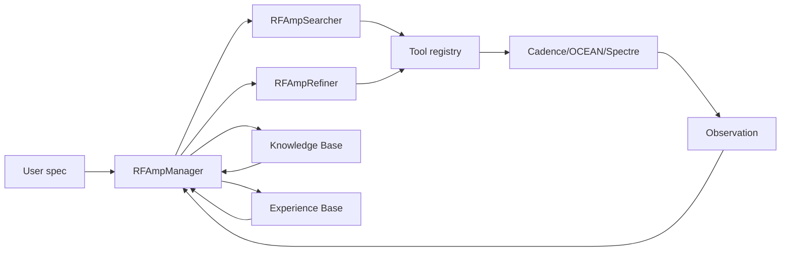

# Open-RFAmpDesigner-Cadence：基于 Cadence、开源项目与多智能体 LLM 的 RF 放大器自动设计复现方案

> 依据：项目论文原文 `references/paper/RFAmpDesigner.pdf`、中文译文 `references/paper/RFAmpDesigner_中文翻译.md`、已有聊天记录，以及本轮核对的官方开源仓库页面。本文档服务于工程 `Open-RFAmpDesigner-Cadence`，目标是形成可执行、可教学、可继续编码的实现方案。

本文中用于讲解 JSON/schema 的候选数值、`pass: true` 与耗时均为示意数据，不是本项目的 Cadence 实测。当前实测状态以 `docs/16_implementation_status.md` 和 `docs/audits/` 为准。论文 Table III 表头使用 IP1dB；p.8 正文讨论 S9/S10 时另称 OP1dB=9 dBm，二者口径冲突，本项目暂按表中 IP1dB 阈值建配置，并单独保留 OP1dB 指标。

## 1. 项目背景

RFAmpDesigner 解决的问题是 RF 放大器参数 sizing 自动化。传统模拟电路自动设计通常把 W/L、偏置、电容、电阻等变量直接交给优化器搜索；但 RF 放大器尤其是宽带 LNA，会同时受输入匹配、输出匹配、噪声、增益、线性度、功耗、寄生和无源网络频率响应影响，直接在原始参数空间搜索非常低效。

论文的核心思路不是让 LLM 直接写 netlist，而是让 LLM 做“资源分配”和“设计策略选择”：先决定每级电流、每级增益、NF headroom、线性度压力，再调用确定性工具和 Cadence/Spectre 仿真，把这些概念级决策落成电路参数。这个工程要复现的正是这种方法级框架。

你的前置 OTA 项目已经覆盖了 Cadence 自动化的主干能力：Virtuoso 建库、OCEAN/SKILL 批处理、Python 远程调用、PSFASCII 解析、参数扫描、指标提取和最优候选记录。现在要做的升级是把 OTA 的低频 AC/DC 自动化，扩展到 RF LNA 的 S 参数、NF、匹配和大信号压缩点。

## 2. 已有基础和学习衔接

你已经完成过折叠共源共栅全差分 OTA 的自动扫参，指标包括差模增益、0 dB 频率、相位裕度、输出共模和电源电流。这与本项目的关系如下：

| OTA 自动仿真经验 | 在 LNA 项目中的对应升级 |
|---|---|
| 修改 MOS W/L | 修改每级 MOS W、偏置、源退化电感、匹配网络、MCR 参数 |
| AC gain | S21、小信号 gain、通带 ripple |
| 相位裕度 | RF 中一般不作为 LNA 主指标，转向稳定性、匹配和宽带响应 |
| 输出共模 | LNA 中仍需检查 bias/common-mode，但不是论文主表指标 |
| 电源电流 | Table III 的 power/current budget |
| PSFASCII 解析 | 继续使用，但要解析 S 参数、noise、PSS/HB 或功率 sweep |
| 参数扫描 | 升级为 Stage 1/2/3 分层搜索和 agent 调度 |

你不需要从“什么是 Cadence”重新学起；重点应补 RF 指标与 testbench 的物理含义。

## 3. 论文完整拆解

### 3.1 论文目标

论文目标是自动化 RF amplifier sizing，从用户规格直接得到满足指标的 schematic-level 设计。RF 比普通模拟电路更难，原因有四点：

1. 指标强耦合：Gain、S11、S22、NF、IP1dB、Power 同时变化。
2. 高频寄生不可忽略：GHz 频段下 MOS 寄生、电感 Q 值、互感、走线和 PDK 无源模型都会影响结果。
3. 可行解稀疏：尤其宽带匹配和高线性度要求下，随机搜索很容易长时间没有正反馈。
4. 仿真昂贵：S 参数、noise、HB/PSS、PEX 后仿都比普通 AC/DC 扫描更耗时。

传统 GA/BO/RL 不够，是因为它们要么直接面对高维稀疏空间，要么需要大量训练数据。LLM 不能直接改 netlist，是因为 RF netlist 中数值关系高度依赖 PDK 和仿真，不是语言模型内部知识能可靠推断的。工具中间件的作用，就是把 LLM 的语言推理限制在低维、工程可解释的资源分配层。

### 3.2 电路对象

论文 proof-of-concept 是三阶段宽带 LNA：

- 第一级：单端 cascode LNA，带源退化电感，主导 NF 和输入匹配。
- 后两级：差分共源级，带中和电容，用于高频增益和线性度。
- 级间网络：MCR 磁耦合谐振器，用交错谐振峰实现宽带响应。
- 负载：`1787 ohm || 62 fF`。
- benchmark：中心频率 10/30/50 GHz，相对带宽 10%-80%，功耗 15/30 mA，增益 20/25 dB，NF 2.5/3.5/5 dB，IP1dB -25/-20/-15 dBm。

### 3.3 四阶段工具流程

论文 Table I 的工具可落成四个阶段：

1. Active sizing & biasing：输入 `power_ratio_list`，输出每级 W、VGS、gm、Id、输入/输出阻抗。
2. Impedance matching：对关键级做源/负载匹配，最小化 NF 和 S11 violation。
3. Band planning：用 MCR 低保真模型规划通带增益和 ripple，再用少量仿真校准。
4. Fullchain evaluation：调用 Cadence OCEAN/Spectre 做全链路小信号、S 参数、noise、HB/PSS 或功率 sweep。

### 3.4 多智能体框架

论文有两个模式：

- Autonomous Search Mode：从零探索，Manager 调度 Searcher 和 Refiner。
- Self-Evolving Retrieve-and-Refine Mode：用 KB 检索历史候选，用 EB 提供经验提示，再局部细化。

三个 agent 分工：

- RFAmpManager：维护 candidate queue，判断 search/refine/stop。
- RFAmpSearcher：提出电流/增益/NF headroom 分配，并调用 Stage 1/2 工具找关键级候选。
- RFAmpRefiner：读取失败指标，决定回到 Stage 2、Stage 3 或 Stage 1。

## 4. RF/LNA 理论基础

### 4.1 LNA 是什么

直观解释：LNA 是接收机前端第一级放大器，把天线来的微弱信号先放大，同时尽量少增加自己的噪声。

工程定义：LNA 是低噪声、高输入匹配、足够增益和线性度的 RF 小信号放大器。它通常工作在 50 ohm 系统里，因此端口匹配非常重要。

常用指标：

- `Gain`：通常看 S21 或电压增益，单位 dB。
- `S11`：输入反射，越负越好。
- `S22`：输出反射，越负越好。
- `NF`：噪声系数，越低越好。
- `NFmin`：在最优源阻抗下可达到的最小噪声系数。
- `IP1dB/OP1dB`：输入/输出 1 dB 压缩点，越高线性度越好。
- `ripple`：通带内 gain 最大值和最小值之差。

### 4.2 从 OTA 到 LNA

OTA 中你关心 `Av, UGF, PM, Idd`。LNA 中对应为：

- `Av` -> `S21/gain`；
- `UGF/PM` -> 不直接对应，RF 中更关注带内 gain、匹配和稳定性；
- `Idd` -> `Power/current budget`；
- 输出摆幅 -> `IP1dB/OP1dB`；
- 输入等效噪声 -> `NF/NFmin`；
- 负载电容响应 -> 宽带匹配网络和 MCR 响应。

### 4.3 为什么多了阻抗匹配

低频 OTA 多数是电压输入、电压输出，不默认 50 ohm 功率传输。RF 系统中源、传输线、仪器和天线通常以 50 ohm 为参考。如果输入阻抗不是 50 ohm，共轭匹配不好，信号会被反射，表现为 S11 变差。

Cadence 中用 `sp` 分析设置 port，扫频后读取 `S(1,1)`、`S(2,1)`、`S(2,2)`。Python 中解析 CSV 后计算：

```text
S11_worst = max(S11_db in band)
S21_min = min(S21_db in band)
ripple = max(S21_db in band) - min(S21_db in band)
```

Agent 使用方式：如果 S11 不达标，Refiner 优先调整输入 L 型网络、源退化电感、balun/MCR 参数，而不是盲目修改所有 MOS。

### 4.4 为什么多了噪声优化

接收机总噪声主要由第一级决定。Friis 公式说明后级噪声会被前级增益除掉，因此第一级 LNA 的 NF 是核心指标。论文把第一级定义为 critical stage，并给 Stage 2 工具专门优化 NF 和 S11。

Agent 使用方式：如果全链路 NF 失败，Refiner 增加 NF headroom，回到 Stage 2 重新匹配关键级；如果还是失败，再回到 Stage 1 调整第一级电流和尺寸。

### 4.5 IP1dB/OP1dB

直观解释：输入信号变大时，放大器不再线性，实际增益会比小信号增益低。当增益下降 1 dB 时，对应输入功率是 IP1dB，对应输出功率是 OP1dB。

Cadence 中可用两种路线：

- 简化路线：输入功率 sweep，测输出基波功率或 gain，找下降 1 dB 的点。
- 高频严谨路线：PSS/HB/QPSS，加端口大信号激励，提取压缩曲线。

Agent 使用方式：如果 IP1dB 不达标，通常说明线性度瓶颈在某一级。Refiner 可以降低前级增益、增加后级电流、重新分配 gain，或者把候选标记为需要 Stage 1 回溯。

## 5. Cadence 仿真流程

### 5.1 Virtuoso schematic 创建

手工路线：

1. 建 library：`orfadc_lna_lib`。
2. 建 cells：`lna_stage1_cascode`、`lna_stage_diff_cs`、`mcr_lumped`、`lna_3stage_top`。
3. 建 testbench：`tb_sparam`、`tb_noise`、`tb_compression`、`tb_fullchain`。
4. 从授权 PDK 选择 MOS、电容、电感、变压器或等效器件。
5. 给关键参数挂 design variables：`w1, w2, w3, vgs1, vgs2, vgs3, ls, k12, l1, l2, c1, c2`。
6. `Check and Save`，保证 netlist 可导出。

自动路线：

- 第一阶段不要急着全自动画 schematic。建议手工建模板 schematic，把所有参数暴露为变量。
- OCEAN/SKILL 先只负责打开 cell、设置变量、运行仿真、导出结果。
- 等参数闭环稳定后，再考虑 SKILL 自动生成局部网络。

### 5.2 Testbench 设计

必须有四类 testbench：

- DC operating point：检查所有 MOS 工作区、Id、gm、gds、Vdsat。
- S 参数：检查 S11/S21/S22、通带 gain、ripple。
- Noise：检查 NF、NFmin，尤其中心频率和通带内最差值。
- Compression：检查 IP1dB/OP1dB，优先功率 sweep，后续升级 HB/PSS。

### 5.3 指标提取

每次仿真输出 `metrics.json`：

```json
{
  "spec_id": "S1",
  "candidate_id": "S1_seed0_cand0001",
  "s11_db_worst": -18.2,
  "s21_db_min": 24.1,
  "s22_db_worst": -11.5,
  "nf_db_worst": 4.8,
  "nfmin_db_center": 3.9,
  "ip1db_dbm": -23.5,
  "op1db_dbm": 1.2,
  "power_ma": 29.8,
  "ripple_db": 2.4,
  "pass": false,
  "violation": {
    "s11": 1.8,
    "gain": 0.9,
    "nf": 0.0,
    "ip1db": 1.5,
    "power": 0.0
  }
}
```

数值只是 schema 示例，不能作为论文复现结果。

## 6. 工具中间件设计

### 6.1 Active sizing & biasing

输入：

```json
{"power_ratio_list": [0.4, 0.3, 0.3], "total_current_ma": 30}
```

计算：

```text
I_stage_i = total_current_ma * power_ratio_i / sum(power_ratio_list)
```

然后查 lookup table。lookup table 由 Cadence 批量仿真生成，字段包括：

```yaml
- topology: cascode
  stage: 1
  width_um: 90
  vgs_mv: 400
  current_ma: 12.1
  gm_ms: 80.0
  zin_real_ohm: 18.0
  zin_imag_ohm: -42.0
  zout_real_ohm: 900.0
  zout_imag_ohm: -120.0
  nf_est_db: 3.8
```

论文作者用 TSMC N65 生成了自己的数据库；本项目只能用实验室授权 PDK 或教学模型重新生成自己的数据库。

### 6.2 Impedance matching

目标：在关键级上同时压低 NF 和 S11。

论文公式 (1)：

```text
NF_violation = max(0, NF_sim - (NF_user - 0.2))
S11_violation = max(0, S11_sim + 20)
cost = 1000 * NF_violation + 1000 * S11_violation
```

实现：

1. 先仿真不含输入匹配网络的前两级，提取第一级输入阻抗。
2. 用 Smith 圆图/L 型网络估算初始 `Lpar, Lg`。
3. 用 PSO 在 Table II Stage 2 范围内搜索 `k, L1, L2, R1, R2, C1, C2, Ls`。
4. 每个候选调用 OCEAN 仿真中心频率 NF 和 S11。
5. cost 越小越好，cost 为 0 表示满足 Stage 2 局部约束。

### 6.3 Band planning

目标：在目标带宽内满足 gain 和 ripple。

论文公式 (2)：

```text
gain_violation = max(0, abs(gain_user - min(gain_cal)) - 3)
ripple_violation = max(0, max(gain_cal) - min(gain_cal) - 3)
cost = 1000 * gain_violation + 1000 * ripple_violation
```

实现：

1. 用 MCR 低保真模型快速计算通带响应。
2. 用 SA 搜索每个 MCR 的 `k, omega0, Q0, C`。
3. 对少量候选做 Cadence 仿真，计算理论-仿真残差。
4. 用残差校准后继续规划，形成 multi-fidelity loop。

### 6.4 Fullchain evaluation

输入整个 active/passive dictionary，调用完整 testbench，输出真实性能。没有 Cadence 仿真时，只能输出 `dry_run` 或 `not_evaluated`，不得给 `pass=true`。

## 7. 多智能体设计

### 7.1 总体架构



### 7.2 Manager prompt 模板

```text
你是 RFAmpManager。你负责维护 candidate queue，并在 SearchCandidates、RefineCandidate、Stop 之间选择。

输入：
- user_spec
- candidate_queue
- latest_reports
- memory_hits
- remaining_budget

可用工具：
- search_candidates
- refine_candidate
- update_memory

输出 JSON：
{
  "action": "SearchCandidates | RefineCandidate | Stop",
  "candidate_id": "... or null",
  "reason": "简短说明",
  "priority_update": [
    {"candidate_id": "...", "priority": 0.0, "reason": "..."}
  ],
  "risk_note": "不得声称严格复现论文原始 TSMC N65 数值"
}
```

### 7.3 Searcher prompt 模板

```text
你是 RFAmpSearcher。你负责从用户规格生成关键级候选。

任务：
1. 提出 1-3 个 power_ratio_list。
2. 判断是否 NF-hard、linearity-hard、bandwidth-hard。
3. 选择 NF_headroom。
4. 调用 active_sizing。
5. 调用 impedance_matching。
6. 返回候选列表。

输出 JSON：
{
  "power_ratio_list": [0.4, 0.3, 0.3],
  "nf_headroom_db": 0.2,
  "gain_require_db": 12,
  "tool_calls": [
    {"tool": "active_sizing", "arguments": {"power_ratio_list": [0.4,0.3,0.3], "total_current_ma": 30}}
  ],
  "candidate_notes": ["first stage gets larger current because NF is tight"]
}
```

### 7.4 Refiner prompt 模板

```text
你是 RFAmpRefiner。你读取仿真失败指标，选择最小回溯步骤。

规则：
- NF 不满足：增加 NF headroom，回到 Stage 2。
- S11 不满足：调整输入匹配网络和 Ls。
- Gain/ripple 不满足：回到 Stage 3，重新设置 MCR 峰位和增益分配。
- IP1dB 不满足：降低关键级增益或增加后级电流，必要时回到 Stage 1。
- Power 不满足：重新分配电流或缩小非关键级。
- 反复失败：返回 infeasible report，不继续浪费仿真预算。
```

### 7.5 Memory 设计

KB 保存事实：

```json
{"spec": {...}, "candidate": {...}, "metrics": {...}, "pass": true}
```

EB 保存经验：

```json
{"condition": "S10, NF<=3.5, IP1dB>=-15", "insight": "gain1 too high worsens compression; keep gain2 >= 6 dB", "confidence": 0.7}
```

检索相似度可先用手写加权距离：

```text
d = w_f*|fc1-fc2| + w_bw*|fbw1-fbw2| + w_nf*|nf1-nf2| + w_ip*|ip1-ip2| + w_p*|p1-p2|
```

后续再接 embedding/RAG。

## 8. 开源项目复用方案

| 开源项目 | 地址 | 可复用模块 | 用于本方案哪一部分 | 与 RFAmpDesigner 的关系 | 局限 |
|---|---|---|---|---|---|
| AnalogCoder | https://github.com/laiyao1/AnalogCoder | `problem_set.tsv`、prompt 模板、simulation-in-loop、样例电路组织 | prompt、benchmark、agent 输出格式 | 同样用 LLM + 仿真反馈做模拟电路设计 | 后端是 PySpice/ngspice，不覆盖 Cadence RF/S 参数/NF |
| EEsizer / LLM-transistor-sizing | https://github.com/eelab-dev/LLM-transistor-sizing（实际重定向到 https://github.com/eelab-dev/EEsizer） | 规格到 transistor sizing 的迭代反馈 | Refiner 流程 | 与 sizing feedback loop 相近 | 需要替换为 Cadence Spectre 和 RF 指标 |
| AutoCkt | https://github.com/ksettaluri6/AutoCkt | `specs_test` YAML、netlist templates、reward/action space、Gym env | GA/BO/RL baseline 和配置组织 | 自动模拟电路设计的基准思路 | 原始重点是 ngspice/RL，Spectre 部分受 license 限制 |
| AnalogGym | https://github.com/CODA-Team/AnalogGym | benchmark 目录、PDK/电路任务组织、BSD-3-Clause license | 公开 benchmark 结构参考 | 可作为任务组织灵感 | 不能直接替代论文三阶段 LNA |
| SPICEBridge | https://github.com/clanker-lover/spicebridge | MCP 式仿真工具 API | Cadence tool registry 设计 | 工具 API 化思想与 Table I 一致 | ngspice 工具不能直接当 Cadence 结果 |
| virtuoso-bridge-lite | https://github.com/Arcadia-1/virtuoso-bridge-lite | LLM-Agent 与 Cadence Virtuoso bridge | 可选 GUI/Skill bridge | 最贴近 Cadence agent 控制 | 需实验室安全许可，不能泄露 PDK |
| ALIGN | https://github.com/ALIGN-analoglayout/ALIGN-public | netlist-to-layout 自动版图框架 | 后续 layout/PEX 方向 | sizing 后可扩展到 layout | 第一阶段不需要；RF/MCR/商业 PDK 适配难 |
| ngspice | https://github.com/ngspice/ngspice | 开源混合级电路仿真器 | 无 Cadence 时调试工具层 | 可做方法 fallback | 不能说成 Cadence/PDK 结果 |
| Xyce | https://github.com/Xyce/Xyce | 并行电子仿真器 | 大规模开源仿真 fallback | 可用于算法和数据管线压力测试 | RF PDK 和 Cadence testbench 不等价 |

具体使用步骤统一为：

1. `git clone <repo>` 到 `third_party/` 或单独研究目录。
2. 阅读 `README.md`、`LICENSE`、环境文件和 benchmark/testbench 目录。
3. 只迁移结构、schema、prompt 和流程思想；复制代码前先确认 license。
4. 把 PySpice/ngspice 调用替换为 `src/orfadc/cadence/run_ocean.py`。
5. 在 `third_party_notes/` 记录 URL、commit、license、复用点。
6. 不提交商业 PDK 路径、模型、PCell、原始 netlist 或含敏感信息的日志。

## 9. 数据结构

### 9.1 spec

```yaml
id: S1
fc_ghz: 10
fbw_ratio: 0.20
power_ma: 30
gain_db: 25
nf_max_db: 5
ip1db_min_dbm: -25
```

### 9.2 candidate

```json
{
  "candidate_id": "S1_seed0_cand0001",
  "spec_id": "S1",
  "seed": 0,
  "power_ratio_list": [0.4, 0.3, 0.3],
  "active_params": {},
  "passive_params": {},
  "status": "created"
}
```

### 9.3 experiment summary

```json
{
  "spec_id": "S1",
  "method": "our_tool",
  "seed": 0,
  "pass": true,
  "wall_time_s": 655,
  "num_sims": 42,
  "num_search": 3,
  "num_refine": 4,
  "prompt_tokens": 0,
  "completion_tokens": 0
}
```

## 10. 代码结构

现有工程已经建立：

- `config/`：论文规格、变量范围、agent 设置、Cadence 路径占位。
- `src/orfadc/cadence/`：OCEAN/Spectre 调用、CSV/PSFASCII 解析、指标提取。
- `src/orfadc/tools/`：Table I 工具和 cost function。
- `src/orfadc/agents/`：Manager/Searcher/Refiner/Memory 骨架和 prompt。
- `src/orfadc/baselines/`：GA/BO/tool baseline 占位。
- `src/orfadc/experiments/`：单 spec dry-run 入口，后续扩展 Table IV/V/消融。
- `src/orfadc/plots/`：Fig-like 绘图脚本入口。
- `results/`：运行、表格、图、日志、memory 输出。

## 11. OCEAN/SKILL 脚本设计

建议模板：

- `create_lna_schematic.ocn`：后期自动创建/检查 schematic；MVP 不强制。
- `run_sparam.ocn`：设置 design variables，运行 `sp`，导出 `sparams.csv`。
- `run_noise.ocn`：运行 noise/sp-noise，导出 `noise.csv`。
- `run_compression.ocn`：运行 HB/PSS 或 input power sweep，导出 `compression.csv`。
- `run_fullchain.ocn`：串行调用所有仿真。
- `export_results.ocn`：统一导出 CSV/PSFASCII。
- `verify_design.ocn`：检查 netlist、端口、变量、仿真状态。

MVP 最稳妥做法是让 OCEAN 只负责“设置变量、运行、导出 CSV”，复杂指标全部放 Python 算。

## 12. Python 自动化设计

一轮候选流程：

1. 读取 `specs_table_iii.yaml`。
2. Manager 生成或检索候选。
3. Searcher 调用 `active_sizing`。
4. Stage 2 工具写入参数并调用 `run_ocean.py`。
5. Python 解析 CSV，计算公式 (1)。
6. Stage 3 工具规划 MCR，计算公式 (2)。
7. Fullchain eval 调完整 Cadence testbench。
8. Refiner 读取 violation，决定回溯。
9. 写入 `metrics.json`、`agent_trace.json`、`kb.jsonl`、`eb.jsonl`。

## 13. 优化算法设计

- Stage 1：枚举/查表，不建议上来就用复杂优化。
- Stage 2：PSO，变量为 `k, L1, L2, R1, R2, C1, C2, Ls`。
- Stage 3：SA，变量为每个 MCR 的 `k, omega0, Q0, C`。
- Baseline：GA/BO flat search 用于对比，但优先实现 tool-only 和 random search。

停止条件：

- cost 为 0；
- 达到仿真预算；
- 连续 N 次没有改善；
- agent 判断候选不可行。

## 14. 实验设计

阶段 1：论文结构复现。

- 输出 Table I/II/III 的 YAML/CSV。
- 公式单元测试通过。
- dry-run candidate 可以生成。

阶段 2：Cadence 简化 LNA。

- 用 TSMC40 或实验室授权 PDK 建单级/两级 LNA。
- 跑通 S 参数、noise、AC、power。
- 不追求论文 10-50 GHz 数值，只验证闭环。

阶段 3：论文级近似复现。

- 三阶段 LNA + MCR 等效网络。
- 10 specs、5 seeds。
- 输出 Table IV/V/VI-like 和 Fig. 7-11-like。
- 报告中明确“趋势级”和“近似 Cadence 环境”。

## 15. 结果表和图的生成

输出文件：

- `results/tables/table_iii_specs.csv`
- `results/tables/table_iv_like.csv`
- `results/tables/table_v_like.csv`
- `results/tables/table_vi_like.csv`
- `results/figures/fig7_like_sparams.png`
- `results/figures/fig8_like_time.png`
- `results/figures/fig9_like_search_refine.png`
- `results/figures/fig10_like_sample_efficiency.png`
- `results/figures/fig11_like_fom.png`

Table-like 可以复制论文结构，但数据必须来自自己的实验或标注为“paper reported value”。Fig-like 不能说是原 Fig. 7 复现，只能说是本工程候选的同类曲线。

## 16. 消融实验

实现顺序：

1. `tool_only`：无 LLM，只按固定策略跑工具。
2. `single_agent`：一个 agent 完成 search/refine。
3. `multi_agent`：Manager/Searcher/Refiner。
4. `without_refiner`：只 search，不做局部细化。
5. `without_react`：单次 JSON 决策，不允许观察后反思。
6. `with_eb` / `without_eb`：对比经验库效果。
7. `GA/BO baselines`：先在简化问题上实现，再迁移到 Cadence。

## 17. 自进化 KB/EB

KB 是“事实数据库”，保存候选和真实指标；EB 是“经验数据库”，保存可迁移设计经验。

错误经验污染控制：

- EB 每条经验必须带来源候选和验证次数。
- 失败候选也保存，但不能作为正向建议直接使用。
- 经验要有 `confidence`，每次复用成功提高，失败降低。
- 不允许 LLM 自己编造 EB；只能从真实仿真记录归纳。

## 18. 工程目录

推荐目录已在项目中建立。下一步要补齐：

- `circuit/virtuoso/`：schematic 创建说明、library 命名、截图或导出说明。
- `circuit/testbenches/`：每个 testbench 的端口、变量、仿真类型说明。
- `circuit/spectre/`：非商业示例 netlist 模板。
- `results/tables/`：表格 schema。
- `third_party_notes/`：开源项目 license 和使用记录。

## 19. 实施计划

第 1 阶段：文档和骨架。

- 已完成：README、配置、cost function、agent 骨架、dry-run、测试。
- 待补：CSV schema、OCEAN 模板参数注入、结果聚合脚本。

第 2 阶段：接入你的 OTA 自动化经验。

- 复用 SSH 调用 Linux VM 的执行器。
- 复用 PSFASCII 解析框架。
- 把 OTA 指标提取器替换为 RF 指标提取器。

第 3 阶段：Cadence 单级 LNA MVP。

- 建单级共源/共源共栅 LNA。
- 跑 `sp` 和 `noise`。
- 自动扫描 `W, VGS, Ls, Lg`。

第 4 阶段：多级和 MCR。

- 加二级/三级。
- 加 MCR 等效 RLC。
- 加 Stage 3 band planning。

第 5 阶段：agent 和实验报告。

- 接 LLM 输出 JSON。
- 跑 5 seeds。
- 生成表格、图和课程/科研训练报告。

## 20. 风险和不可复现边界

不能严格复现：

- TSMC N65 PDK；
- 作者 PCells；
- 作者 post-layout netlist；
- 作者 OCEAN scripts；
- 作者 lookup table；
- 作者 KB/EB；
- 作者 prompt；
- 作者最终候选参数；
- 作者 Cadence/Spectre 环境；
- 作者模型调用延迟和 token 价格。

可以说：

- 复现了 RFAmpDesigner 的方法框架；
- 复现了工具中间件结构；
- 复现了多智能体设计流程；
- 在 Cadence 环境下实现了近似 RF/LNA 自动化仿真闭环；
- 复现了论文趋势级结论。

不能说：

- 严格复现了论文原始 TSMC N65 结果；
- 复现了 Fig. 7 的原始曲线；
- 复现了 Table IV/V 的精确数值。

## 21. 给大二学生的学习路线

1. 复习 OTA 自动扫参代码，把“参数、仿真、指标、cost、记录”五件事写成抽象流程。
2. 学 S 参数：先会读 S11/S21/S22 曲线，再学 Smith 圆图。
3. 学 LNA：理解第一级噪声、源退化、电感匹配。
4. 学 Cadence RF testbench：port、sp、noise、PSS/HB。
5. 学 Python RF 指标提取：band worst-case、ripple、compression。
6. 学工具中间件：把电流分配和匹配网络搜索拆开。
7. 学 agent：先确定性策略，再接 LLM。

## 22. 最小可行版本 MVP

MVP 不做三阶段毫米波宽带 LNA。MVP 做：

- 一个授权 PDK 下的单级共源/共源共栅 LNA；
- 参数：`W, VGS, Ls, Lg, Cmatch`；
- 仿真：DC op、S 参数、noise；
- 指标：S11、S21、NF、power；
- Python：读取 spec、生成候选、调用 OCEAN、解析 CSV、输出 metrics。

MVP 成功标准：

- 能自动跑 20 个候选；
- 每个候选有独立 run directory；
- 能画 S11/S21/NF 曲线；
- 能按 cost 排序；
- 不需要 LLM 也能跑通。

## 23. 后续增强版本

- V1：单级 LNA + 自动 S/NF。
- V2：两级 LNA + Stage 1/2 工具。
- V3：三阶段 LNA + Stage 3 band planning。
- V4：LLM Manager/Searcher/Refiner。
- V5：KB/EB 自进化。
- V6：MCR + Fig. 7-like 曲线。
- V7：layout/PEX/后仿。

## 24. 附录

### 附录 A：RFAmpDesigner 论文表格复现清单

| 项目 | 可复现方式 |
|---|---|
| Table I | 工具接口文档和 Python tool registry |
| Table II | `variable_ranges_table_ii.yaml` |
| Table III | `specs_table_iii.yaml` 和 `table_iii_specs.csv` |
| Table IV | 自己实验生成 `table_iv_like.csv` |
| Table V | 自己实验生成 `table_v_like.csv` |
| Table VI | 自己 LLM 调用和仿真耗时生成 `table_vi_like.csv` |

### 附录 B：RF/LNA 指标公式速查

```text
S11_dB = 20 log10 |S11|
S21_dB = 20 log10 |S21|
ripple = max(S21_band) - min(S21_band)
NF_violation = max(0, NF_sim - (NF_user - headroom))
S11_violation = max(0, S11_sim + 20)
```

### 附录 C：Cadence/OCEAN 命令速查

```text
ocean -nograph -restore run_sparam.ocn
spectre input.scs
```

实际命令要以实验室 Cadence 版本为准。

### 附录 D：Python 模块设计

- `config_loader.py`：YAML/JSON 读写。
- `schemas.py`：Spec/Candidate/SimResult。
- `run_ocean.py`：调用 OCEAN。
- `extract_rf_metrics.py`：提取 RF 指标。
- `cost_functions.py`：论文公式。

### 附录 E：Agent prompt 模板

见 `src/orfadc/agents/prompts/`。要求 JSON-only，禁止直接输出 netlist。

### 附录 F：JSON/YAML schema

第一版用 dataclass + YAML。后续可上 Pydantic 校验。

### 附录 G：开源项目来源和 license 注意事项

所有来源写入 `third_party_notes/README.md` 或独立 markdown。复制代码前检查 license；只借鉴思想也要在报告中说明。

### 附录 H：实验记录模板

```yaml
date: 2026-08-04
spec_id: S1
seed: 0
candidate_id: S1_seed0_cand0001
cadence_version: local
pdk: private_authorized_pdk_name_only
result: failed
main_failure: S11
notes: do not include model paths
```

### 附录 I：常见错误和排障

- S 参数端口方向错：检查 port 顺序和 reference impedance。
- NF 异常：检查 noise source、温度、端口类型。
- 压缩点不收敛：缩小输入功率步长，先用简化 sweep。
- PSF 解析失败：优先 OCEAN 导出 CSV。
- PDK 泄露风险：日志脱敏，不提交 model path。

### 附录 J：课程设计/科研训练报告写法

报告结构建议：

1. 论文背景；
2. 可复现边界；
3. Cadence testbench；
4. Python 自动化；
5. 工具中间件；
6. 多智能体；
7. 实验结果；
8. 与论文差异；
9. 结论和后续工作。
